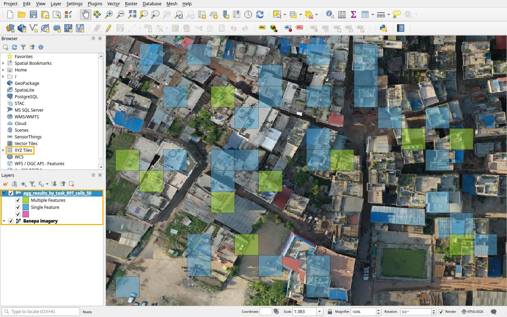

# Example: water tanks in Banepa

This example ran on stage, following the guides from start to finish. It asks volunteers to find rooftop water tanks in drone imagery of Banepa, Nepal.

## Files

- [Area of interest](files/banepa-water-tanks-aoi.geojson): a rectangle of about 300 m by 300 m inside the imagery.
- [Cover image](files/banepa-water-tanks-cover.jpg): a crop of the same imagery.
- [Tutorial scenarios](files/banepa-water-tanks-scenarios.geojson): the three scenarios made with the [tutorial builder](../builder/index.html).

## Project settings

| Field | Value |
|---|---|
| Project type | Locate Objects |
| Project topic | `fAIrSwipe - Nepal - HOT - Water Tanks` |
| Project number | 1 |
| Project region | `Banepa, Nepal` |
| Organization | Humanitarian OpenStreetMap Team |
| Instruction | `We are looking for rooftop water tanks` |
| Look for (legacy) | `Water tanks` |
| Verification number | 3 |
| Group size | 25 |
| Imagery | [UAV Images of Banepa Municipality](https://imagery.hotosm.org/browse?lat=27.6337&lon=85.5228&zoom=13.4&selected_id=62d86c65d8499800053796c4) on OpenAerialMap, April 2022, Geomatics Engineering Society, CC-BY 4.0 |
| Tile URL | `https://api.imagery.hotosm.org/raster/collections/openaerialmap/items/62d86c65d8499800053796c4/tiles/WebMercatorQuad/{z}/{x}/{y}?assets=visual&nodata=0` |
| Imagery credits | `OpenAerialMap, Geomatics Engineering Society, CC-BY 4.0` |
| Min and max zoom | 14 and 22 |
| Zoom level | 20 |
| Sub-grid size | 4x4 |
| Multiple Features | Included |
| Export Meta | `man_made` = `storage_tank` |

Processing created 120 tiles. Export Meta follows the OpenStreetMap tag for tanks: `man_made=water_tank` is deprecated in favour of `man_made=storage_tank` with `content=water` ([source](https://wiki.openstreetmap.org/wiki/Tag:man_made%3Dwater_tank)). Export Meta holds one pair, so it carries `man_made=storage_tank`.

On stage the project is `/project/913` and its tutorial `/tutorial/102` in the manager, both published.

## Tutorial

One information page, **Rooftop water tanks**: "In Banepa most houses keep water in plastic tanks on the roof. From above they look like round circles, usually green, black, blue or yellow."

Three scenarios, with cells numbered row by row from 0:

| Screen | Tile | Single Feature cells | Multiple Features cells | Instruction |
|---|---|---|---|---|
| 1 | 20 / 773386 / 440490 | 6 | 4, 9 | Find the water tanks |
| 2 | 20 / 773389 / 440490 | 5, 13 | 0, 2 | Tanks side by side |
| 3 | 20 / 773389 / 440494 | none | none | Is there a tank here? |

Icons: **Tap** for instructions, **Information** for hints, **Check** for success messages.

## A finished project

A second, smaller stage project ran through every step, from the [area finder](../builder/area.html) to QGIS:

| Step | Result |
|---|---|
| Area | 4 by 3 tiles at zoom 20, drawn in the area finder, which estimated 12 tiles |
| Processing | 12 tasks |
| Tutorial | An earlier copy of the tutorial above, with the same pages and scenarios |
| Mapping | All 12 tiles mapped once in the web app, by looking at each tile |
| Finish | **Finish** in the manager, with each tile mapped once (below 100%) |
| Results | 192 rows, one per cell: 29 marked Single Feature, 10 Multiple Features |
| QGIS | Cells kept at 50% in the [results map](../builder/results.html), coloured by answer, as in [Use the results in QGIS](../guides/qgis.md) |

