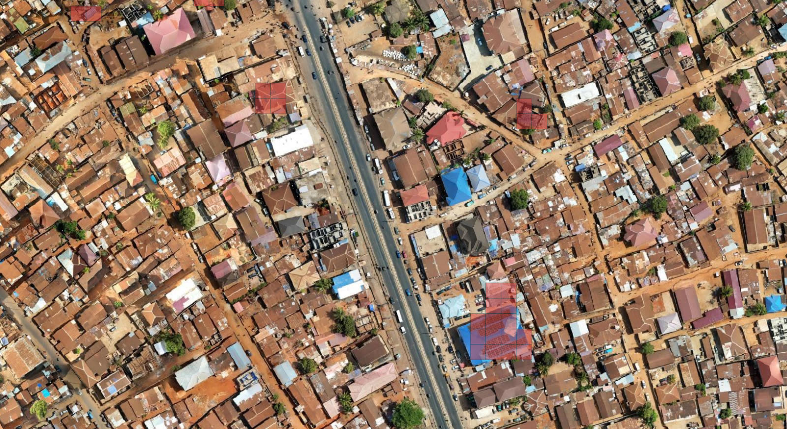
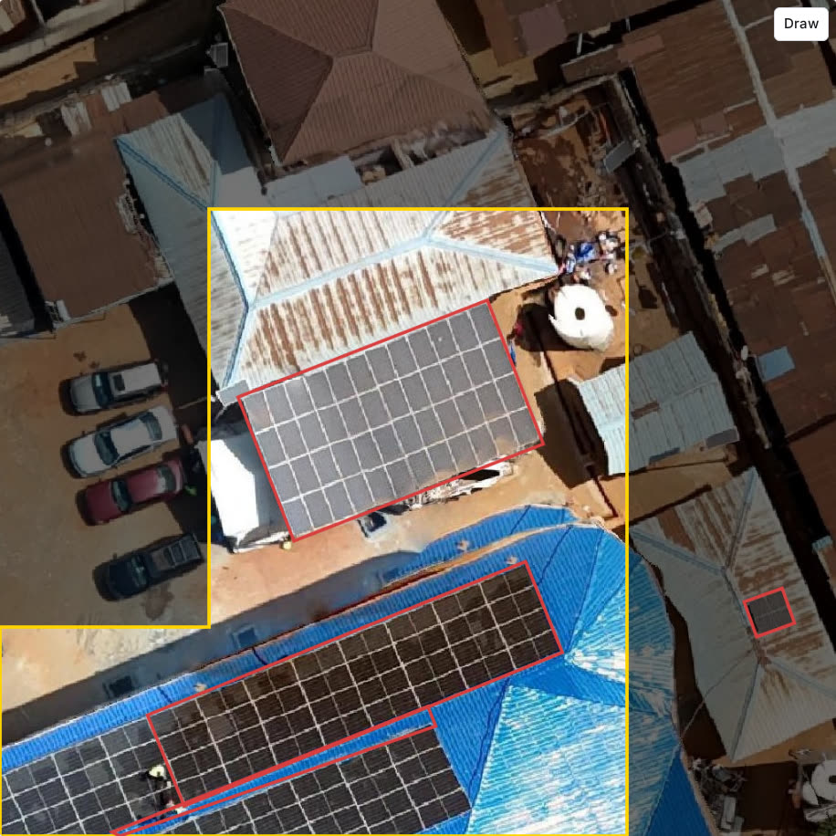

# Example: solar panels in Freetown

This example follows one finished production project from the imagery to a training dataset. Volunteers looked for rooftop solar panels in drone imagery of Freetown, Sierra Leone. The values below come from the [project page](https://mapswipe.org/en/projects/01M4XM3A1B2WV1T04A8SHV2DBK/) and its public exports.

## Files

| File | What it is |
|---|---|
| [Area of interest](files/freetown-solar-panels-aoi.geojson) | The rectangle uploaded to the project, about 2.8 km by 1.4 km |
| [Cover image](files/freetown-solar-panels-cover.png) | The project's cover image |
| [Processed tasks](files/freetown-solar-panels-processed-tasks.geojson) | The 2,964 project tiles, built from the project's **Tasks** export, for the [tutorial builder](../builder/index.html) |
| [Aggregated results](files/freetown-solar-panels-aggregated-results.csv.gz) | The project's **Aggregated Results** export |
| [Cells at 50%](files/freetown-solar-panels-cells-50.geojson) | The cells marked by at least 50% of volunteers, downloaded from the [results map](../builder/results.html) |
| [Results training dataset](files/freetown-solar-panels-yolo-obb-50.zip) | A YOLO oriented bounding box dataset from the [auto labeller](../builder/boxes.html), with `labels.geojson` and a `README.md` for QGIS |

## Project settings

| Field | Value |
|---|---|
| Project type | Locate Objects |
| Project name | `Locate Objects - Locate Solar Panels Freetown - Sierra Leone (3) HOT` |
| Project description | `Please help us to locate solar panels in Freetown to train AI` |
| Project region | `Sierra Leone` |
| Organization | HOT |
| Imagery | [Freetown Urban with Sensitive Areas Blurred](https://imagery.hotosm.org/browse?selected_id=69075f1de47603686de24fe8) on OpenAerialMap: DroneTM, DJI Mini 4 Pro, 22 October 2025, about 4 cm per pixel, CC-BY 4.0 |
| Zoom level | 20 |
| Sub-grid size | 4x4 |
| Multiple Features | Left out: the results have no `2_count` column, since the results list one column per answer the project offers ([source](https://github.com/mapswipe/python-mapswipe-workers/blob/main/mapswipe_workers/mapswipe_workers/generate_stats/project_stats.py)) |
| Verification number | 20, the `number_of_users_required` of every group in the **Groups** export |
| Groups | 39 groups, each 3 tiles tall and 24 to 26 tiles wide |

The instruction, Look for, Export Meta, the group size setting and the tutorial are not on the public project page or in its exports.

The project used this tile URL:

```text
https://2glp8ghj65.execute-api.us-east-1.amazonaws.com/cog/tiles/WebMercatorQuad/{z}/{x}/{y}@1x?url=https://oin-hotosm-temp.s3.us-east-1.amazonaws.com/690585b76415e43597ffd7ea/0/690585b76415e43597ffd7eb.tif
```

The same image is on `api.imagery.hotosm.org`, which the [area finder](../builder/area.html) and the [tutorial builder](../builder/index.html) use in their Freetown examples:

```text
https://api.imagery.hotosm.org/raster/collections/openaerialmap/items/69075f1de47603686de24fe8/tiles/WebMercatorQuad/{z}/{x}/{y}?assets=visual&nodata=0
```

## Results

| | Value |
|---|---|
| Contributors | 221 |
| Tiles | 2,964 |
| Rows (cells) | 47,424 |
| Volunteers per cell | 19 to 21 |
| Cells marked by at least 50% of volunteers | 152, on 73 tiles, all Single Feature |

The cells at 50% in QGIS, as in [Label in QGIS](../guides/training-data/qgis.md#3-colour-the-cells-by-answer):



## Training data

The auto labeller loads the same project at a 50% share and lists the 73 tiles. The dataset marks 36 solar panel arrays on 20 of those tiles: EdgeTAM found 32 from a tap or a drag, and 4 were drawn by hand. With **Boxes**, each box follows the angle of the array:



The `README.md` in the dataset has the tile URL and the steps to show `labels.geojson` over the imagery in QGIS.
