# Create a Locate project

A project goes through these states in the manager: **Initialize**, **Draft**, **Processing**, **Processed**, **Publishing**, **Published** and **Finished**. This page takes it from Initialize to Processed.

## 1. Prepare the area, tile URL and cover image

Find the image on <https://imagery.hotosm.org/browse> and click it. Its details open in the list on the left, with **Hide Details** and an **ID**. Copy the page address, or click **Copy TMS**. Check that the copied text contains the same ID: clicking **Show Details** on another image in the list opens that image instead.

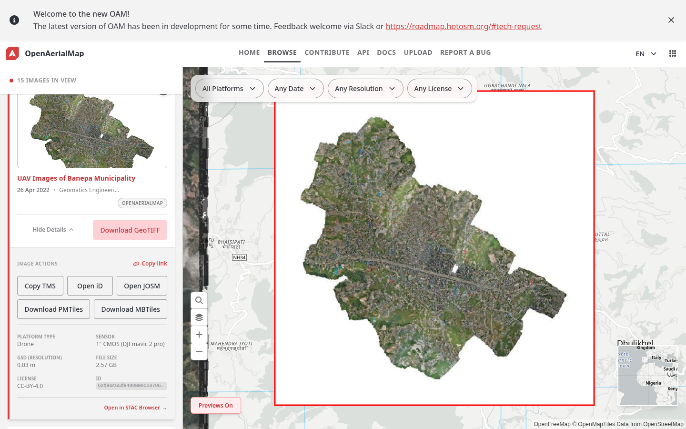

Open the [area helper](../builder/area.html), paste the address, choose the zoom level the project will use (20 for small objects such as water tanks, see step 5), and click **Load**. The red line shows where the image has imagery; white and black edges are left out.

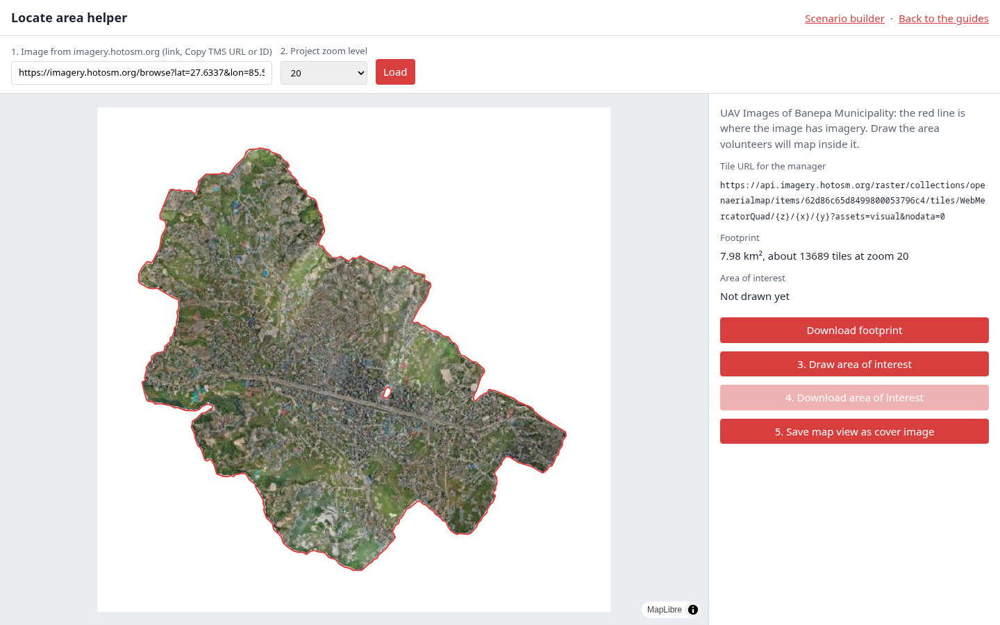

Then:

1. Click **Draw area of interest** and drag a rectangle over the part volunteers will map. The helper cuts it to the imagery and shows its size and how many tiles MapSwipe will create.
2. Click **Download area of interest** to save `area-of-interest.geojson`.
3. Zoom the map to a view that shows the object well and click **Save map view as cover image** to save `cover-image.jpg`.
4. Copy the **Tile URL for the manager**.

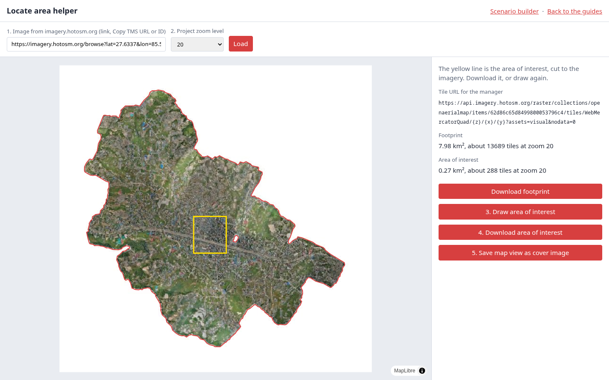

## 2. Start a new project

Log in to the manager dashboard and click **New Project** on the home page. Under **Project Type**, select **Locate Objects**. The type cannot be changed later.

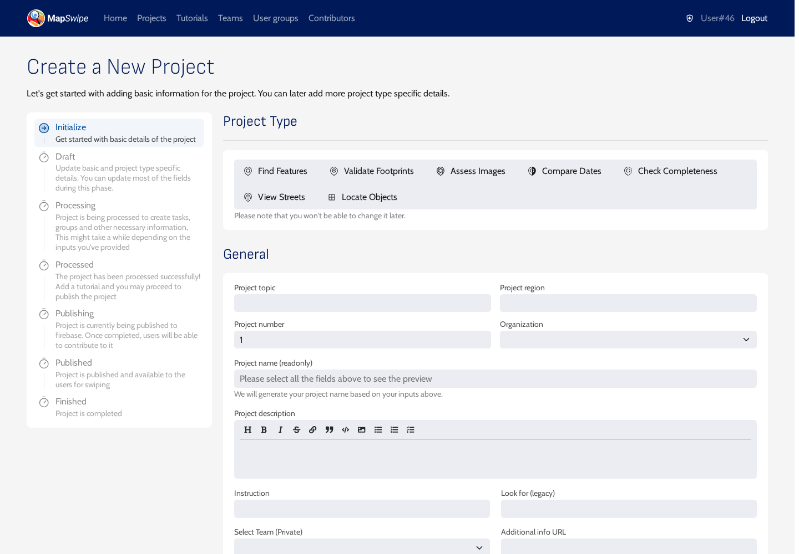

## 3. Fill in the general details

| Field | What to enter | Example |
|---|---|---|
| Project topic | Title following the naming convention on the [home page](../index.md), on stage and production alike | `fAIrSwipe - Nepal - HOT - Water Tanks` |
| Project region | City and country | `Banepa, Nepal` |
| Project number | `1`, or the next number when the same feature and area get several projects | `1` |
| Organization | The organization requesting the data | `Humanitarian OpenStreetMap Team` |
| Project description | Why the data is collected; markdown is supported | `Help us to identify rooftop water tanks in Banepa, Nepal. Your answers help train GeoAI models created with fAIr.` |
| Instruction | What volunteers look for, shown above every tile | `We are looking for rooftop water tanks` |
| Look for (legacy) | The feature name. The web app shows it in the tutorial as "You are looking for: ..." | `Water tanks` |

The project name is generated from these fields. Leave **Select Team** and **Additional info URL** empty.

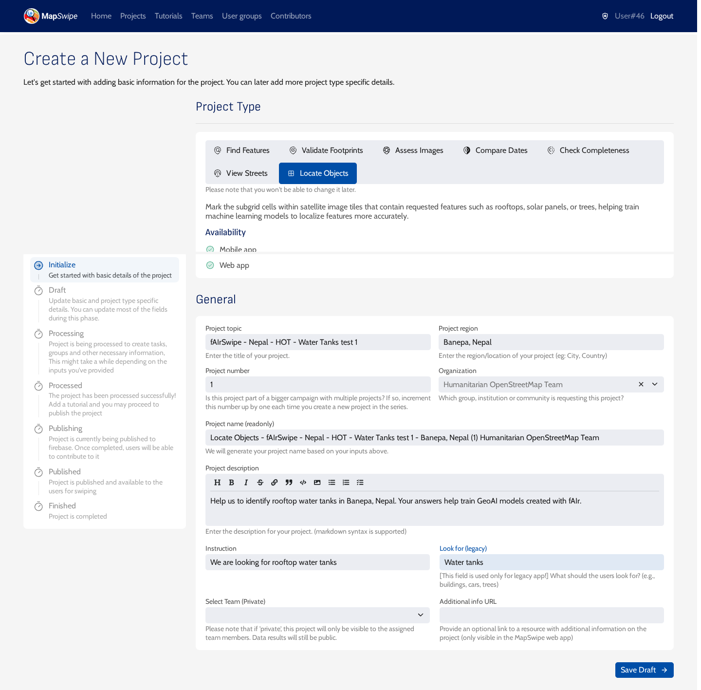

Click **Save Draft**. The page reloads as **Update project** and the project is now a draft.

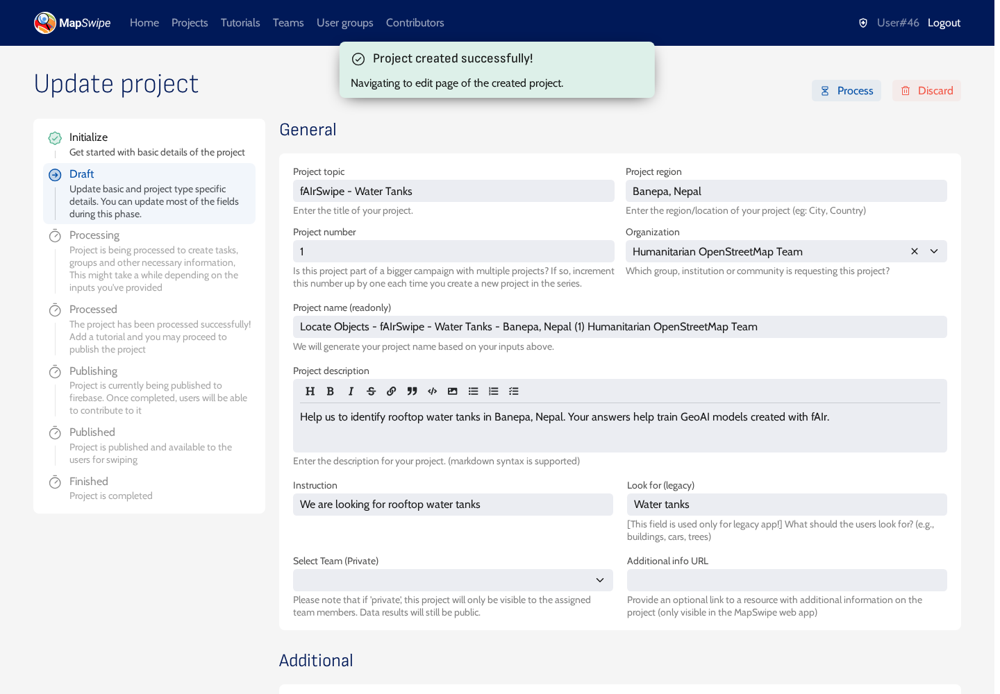

## 4. Set the task details and cover image

Under **Additional**:

- **Verification number**: how many volunteers see each tile. The form default is 3; use 5 or more for hard-to-see objects.
- **Group size**: about how many tiles a volunteer maps in one session. The form default is 25. MapSwipe builds groups from strips of tiles three rows tall, so a session can hold a few more tiles.
- **Max tasks per user**: leave empty for no limit.
- **Project cover image**: `cover-image.jpg` from step 1, or another `.jpg` or `.png` you have the rights to use.

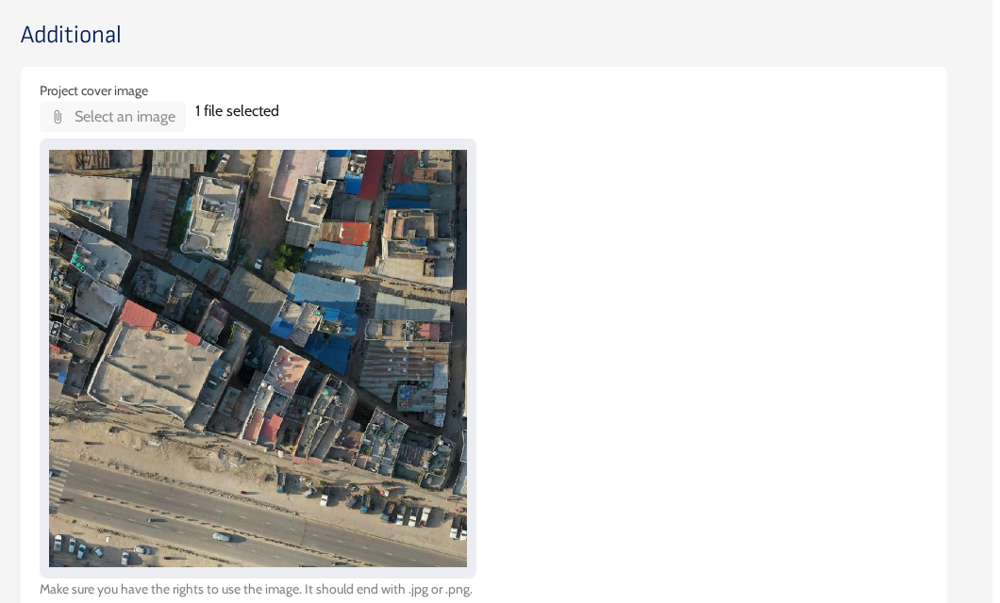

## 5. Add the area and imagery

Under **Locate Objects**:

1. **AOI geometry**: click **Select geojson** and upload `area-of-interest.geojson` from step 1.
2. **Imagery server**: check that **Custom** is selected.
3. **Custom Imagery Server URL**: paste the tile URL from step 1. It looks like `https://api.imagery.hotosm.org/raster/collections/openaerialmap/items/62d86c65d8499800053796c4/tiles/WebMercatorQuad/{z}/{x}/{y}?assets=visual&nodata=0`.
4. **Imagery Credits**: the image provider and licence, for example `OpenAerialMap, Geomatics Engineering Society, CC-BY 4.0`.
5. **Min zoom** and **Max zoom**: the zoom levels the imagery supports, for example 14 and 22 for drone imagery.
6. **Zoom level**: open the list (it starts at **18 - Pedestrian View**) and select the zoom volunteers see. Use **19** or **20 - Close-up View** for small objects such as solar panels and water tanks.

The map preview on the right shows the imagery once the URL is right.

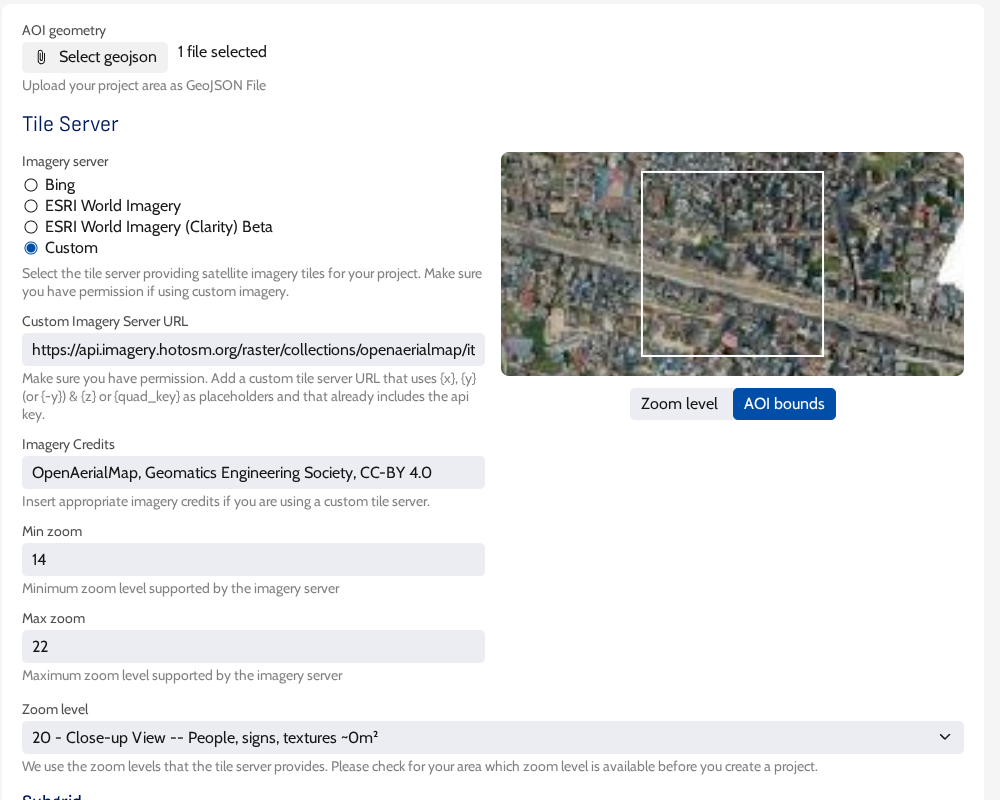

## 6. Choose the grid and answers

- **Sub grid Size**: no size is selected at first. Select how many cells each tile is split into: 4x4 (16 cells) suits most rooftop objects; use 8x8 for very small objects.
- **Include 'Multiple Features' option**: keep it ticked when one cell can hold several objects. Without it, volunteers only choose between **No** and **Single Feature**.
- **Export Meta**: a key and a value that describe the feature, for example its OpenStreetMap tag. The MapSwipe documentation describes it as an "additional metadata entry attached to exports" ([source](https://github.com/mapswipe/mapswipe-docs/blob/main/docs/project_types/locate_objects.md)). Both fields are required.

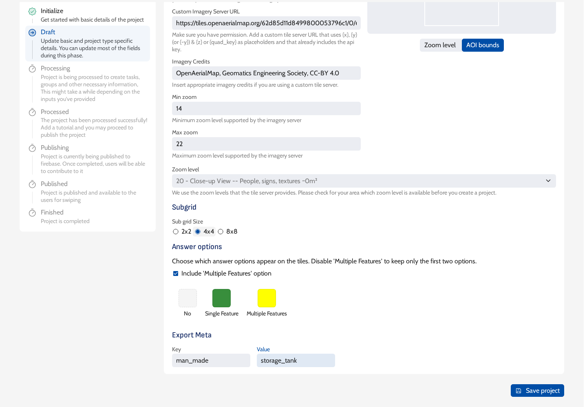

!!! warning "Export Meta is required"
    The form does not mark Export Meta as required, but saving without it fails with `Expected non-nullable type 'String!' not to be None` for `exportMetaKey` and `exportMetaValue`.

    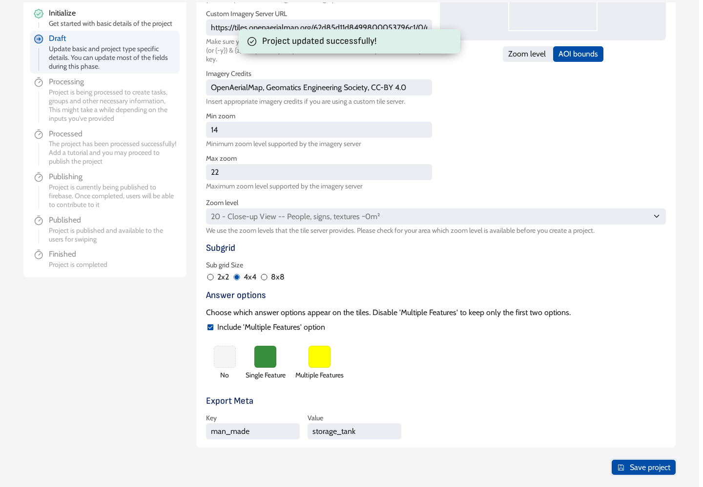

Click **Save project**. Reload the page and check that the imagery URL, zoom level and AOI file are still there.

## 7. Process the project

Click **Process** at the top right and **Confirm**. Processing splits the area into tiles at the chosen zoom and groups them. An area of a few hundred tiles takes under a minute.

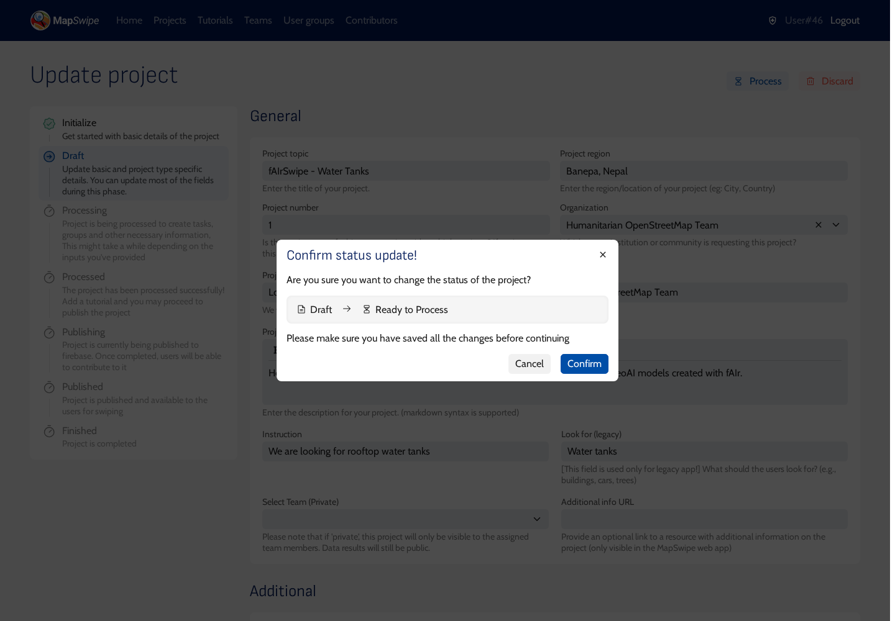

When processing finishes, the project is **Processed** and a **Publish** button appears. From now on the area and imagery settings are read-only. Before publishing, the project needs a tutorial: continue with [Create the tutorial](create-the-tutorial.md).

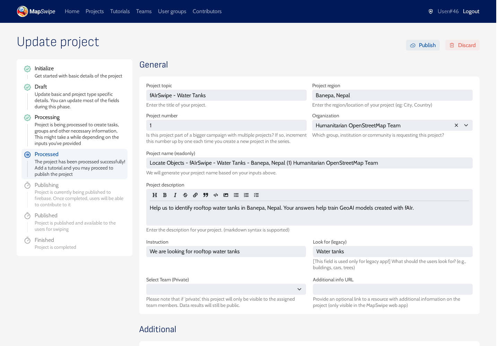
