# Create a Locate project

A project goes through these states in the manager: **Initialize**, **Draft**, **Processing**, **Processed**, **Publishing**, **Published** and **Finished**. This page takes it from Initialize to Processed.

## 1. Prepare the area, tile URL and cover image

Find the image on <https://imagery.hotosm.org/browse> and click it. Its details open in the list on the left, with **Hide Details** and an **ID**. Copy the page address, or click **Copy TMS**. Check that the copied text contains the same ID: clicking **Show Details** on another image in the list opens that image instead. When several images cover the same place, prefer the newest; between images of similar date, pick the finest resolution. When copies differ only in compression or file size, compare them at the project zoom and pick the smallest file that looks the same.

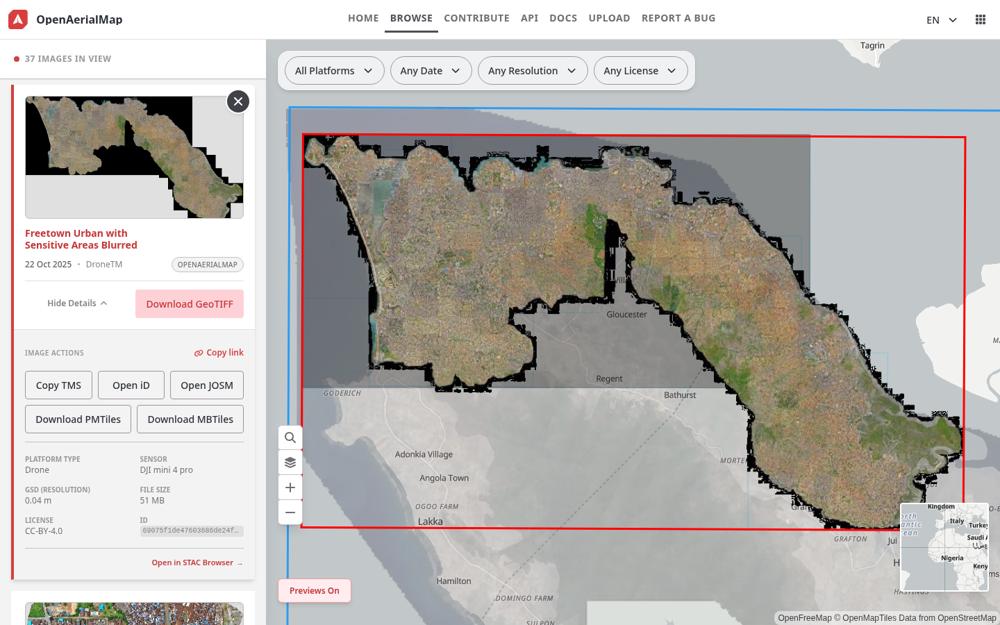

??? note "Area across several images"
    Most projects use one image; skip this when yours does. When the area needs several images, merge them in the [imagery merger](../helpers/index.md#imagery-merger) and use its tile URL in step 5. For the area of interest, load each image in the area finder below and download an area of interest for each. Rename each download after its place, for example `wellington.geojson`, before loading the next image. Then combine the files in QGIS with [Merge vector layers](https://docs.qgis.org/latest/en/docs/user_manual/processing_algs/qgis/vectorgeneral.html#merge-vector-layers):

    1. Drag the files onto the QGIS map.
    2. Open **Vector > Data Management Tools > Merge Vector Layers**. Next to **Input layers**, click **…**, tick each layer and click **OK**.
    3. Untick **Add source layer information** (QGIS 3.42 and later), which would write each file's local path into the result. Under **Merged**, click **…**, then **Save to File**, choose GeoJSON and name the file `area-of-interest.geojson`.
    4. Click **Run**.

    Keep one shape per place: a single rectangle around places far apart also covers the ground between them, outside the images, and volunteers see blank tiles there. Some tiles at the edges of each shape still fall outside the imagery, because MapSwipe groups tiles into rectangles three tiles tall and an even number of tiles wide, and every tile in a rectangle becomes a task ([grouping](https://github.com/mapswipe/mapswipe-backend/blob/develop/utils/geo/tile_grouping.py), [tasks](https://github.com/mapswipe/mapswipe-backend/blob/develop/project_types/tile_map_service/base/project.py)).

Open the [area finder](../builder/area.html), paste the address and click **Load**. The red line shows where the image has imagery; white and black edges are left out. In the side panel, choose the **Project zoom** the project will use (20 for small objects such as solar panels, see step 5); the tile estimates follow it. Choose the **Sub-grid** too and zoom in on the map: white lines show the tiles and the cells, the mini-tiles volunteers tap, and **Cell size** gives a cell's width. Compare it with the objects volunteers look for.

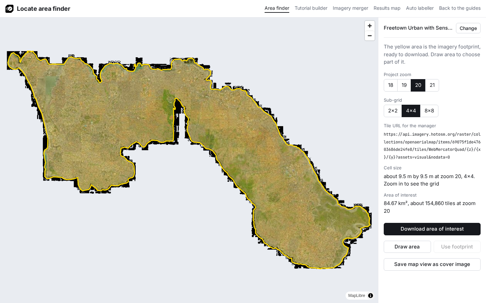

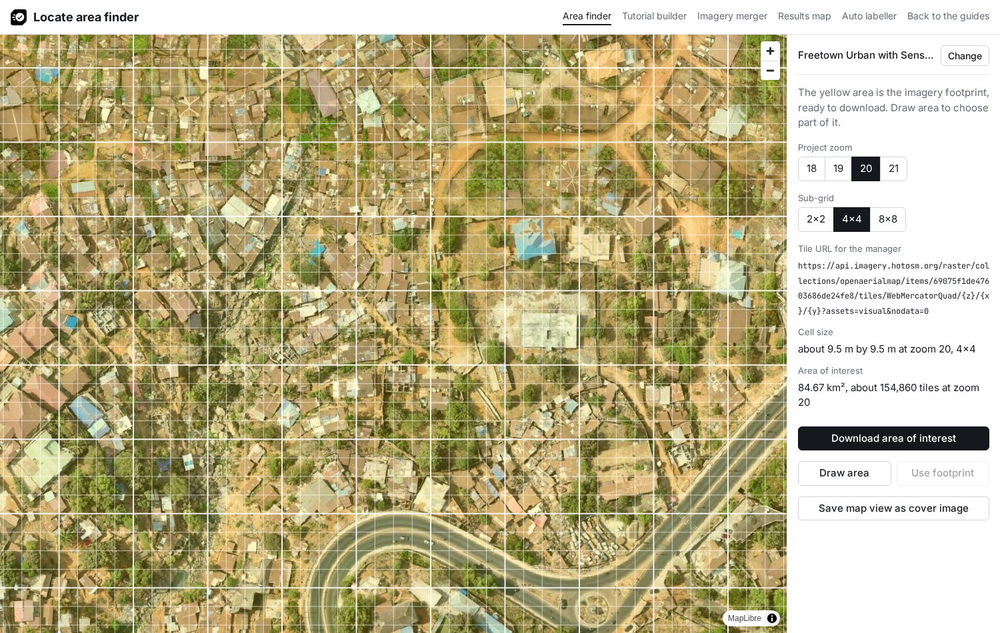

Then:

1. Click **Draw area of interest** and drag a rectangle over the part volunteers will map. The helper cuts it to the imagery and shows its size and an upper estimate of how many tiles MapSwipe will create, counted over the rectangle around the area.
2. Click **Download area of interest** to save `area-of-interest.geojson`.
3. Zoom the map to a view that shows the object well and click **Save map view as cover image** to save `cover-image.jpg`.
4. Copy the **Tile URL for the manager**.

**Download footprint** saves the outline of the whole image, if you want to keep it.

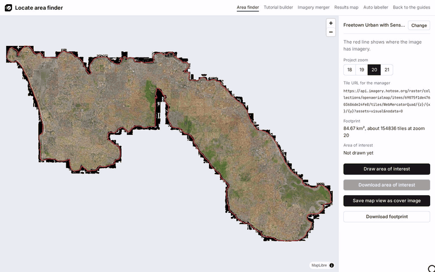{ loading=lazy }

## 2. Start a new project

Log in to the manager dashboard and click **New Project** on the home page. Under **Project Type**, select **Locate Objects**. The type cannot be changed later.

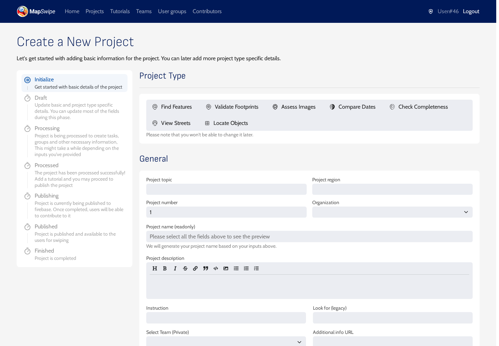

## 3. Fill in the general details

| Field | What to enter | Example |
|---|---|---|
| Project topic | Title following the naming convention on the [home page](../index.md), on stage and production alike | `fAIrSwipe - Sierra Leone - HOT - Solar Panels` |
| Project region | City and country | `Freetown, Sierra Leone` |
| Project number | `1`, or the next number when the same feature and area get several projects. **Save Draft** fails with `Project name already exists in database` when a project that is not discarded or withdrawn has the same generated name ([source](https://github.com/mapswipe/mapswipe-backend/blob/develop/apps/project/serializers.py)); use the next number | `1` |
| Organization | The organization requesting the data | `Humanitarian OpenStreetMap Team` |
| Project description | Why the data is collected; markdown is supported | `Help us to find rooftop solar panels in Freetown, Sierra Leone. Your answers help train GeoAI models created with fAIr.` |
| Instruction | What volunteers look for, shown above every tile | `We are looking for rooftop solar panels` |
| Look for (legacy) | The feature name. The web app shows it in the tutorial as "You are looking for: ..." | `Solar panels` |

The project name is generated from these fields. Leave **Select Team** and **Additional info URL** empty.

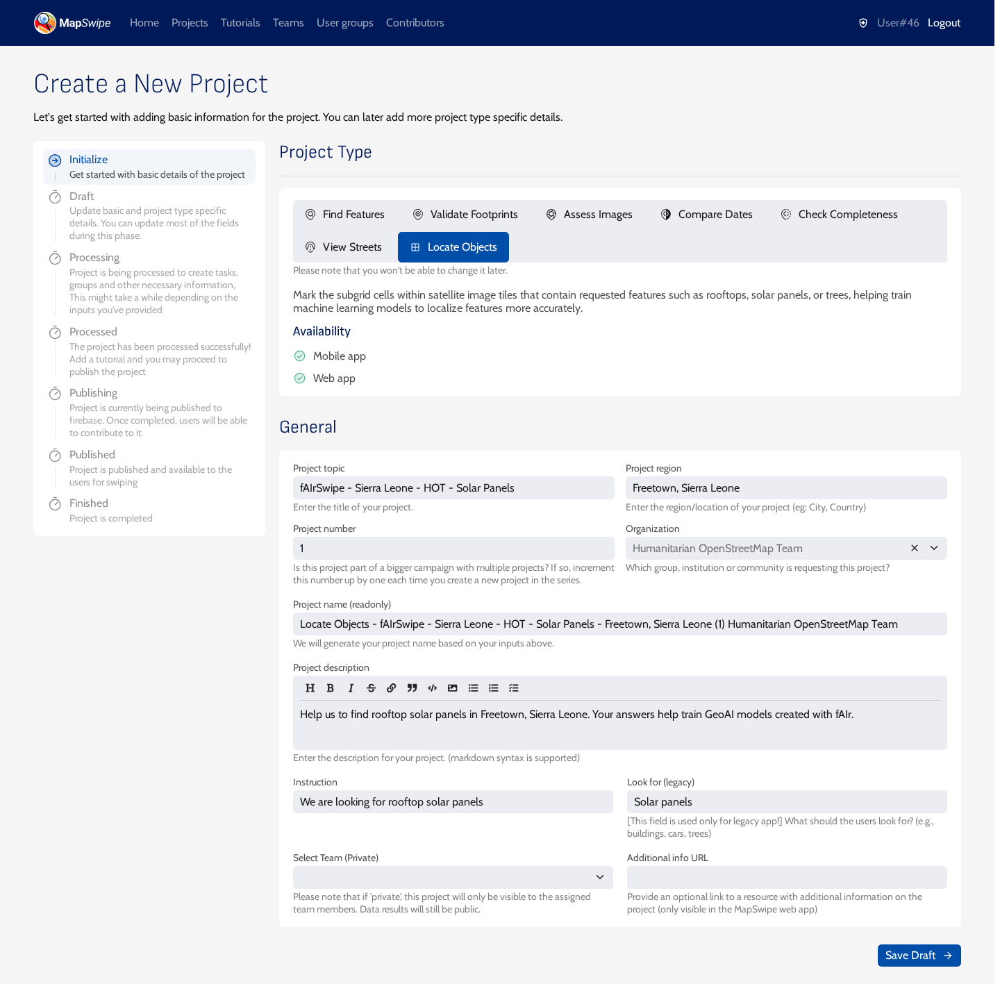

Click **Save Draft**. The page reloads as **Update project** and the project is now a draft.

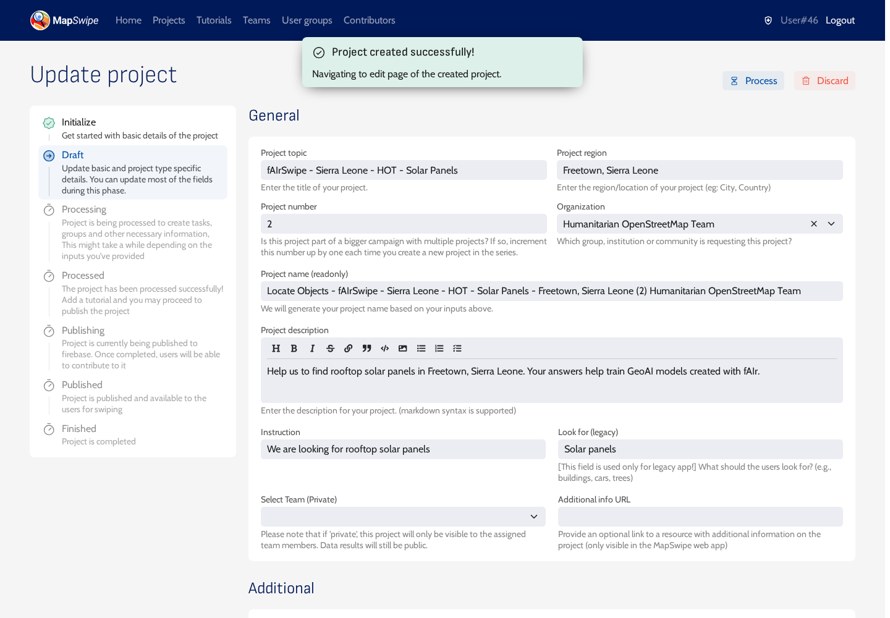

## 4. Set the task details and cover image

Under **Additional**:

- **Verification number**: how many volunteers see each tile. The form default and minimum is 3; use 5 or more for hard-to-see objects.
- **Group size**: the width of one group in tiles; the form default is 25. Groups are three tiles tall, so one mapping session holds up to about three times this number ([source](https://github.com/mapswipe/mapswipe-backend/blob/develop/utils/geo/tile_grouping.py)).
- **Max tasks per user**: leave it empty to let each volunteer map any number of tasks.
- **Project cover image**: `cover-image.jpg` from step 1, or another `.jpg` or `.png` you have the rights to use.

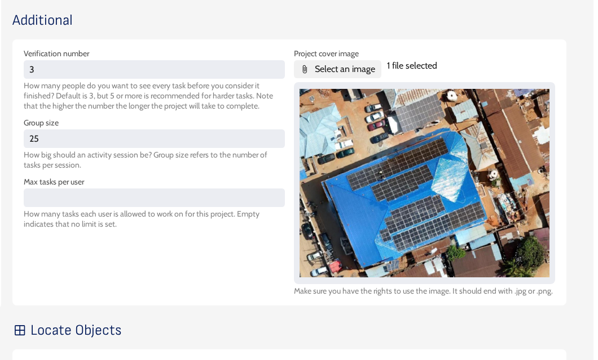

## 5. Add the area and imagery

Under **Locate Objects**:

1. **AOI geometry**: click **Select geojson** and upload `area-of-interest.geojson` from step 1.
2. **Imagery server**: check that **Custom** is selected.
3. **Custom Imagery Server URL**: paste the tile URL from step 1. It looks like `https://api.imagery.hotosm.org/raster/collections/openaerialmap/items/69075f1de47603686de24fe8/tiles/WebMercatorQuad/{z}/{x}/{y}?assets=visual&nodata=0`.
4. **Imagery Credits**: the image provider and licence, for example `OpenAerialMap, DroneTM, CC-BY 4.0`.
5. **Min zoom** and **Max zoom**: leave **Min zoom** empty and set **Max zoom** to 22. For a Locate project these fields only set the zoom range of the map previews in the manager (this one and the tutorial preview); the app receives the tile URL, credits and key ([source](https://github.com/mapswipe/mapswipe-backend/blob/develop/project_types/tile_map_service/locate/project.py)). The preview cannot be zoomed and by default fits the whole area (**AOI bounds**), so a larger area shows a lower zoom ([source](https://github.com/mapswipe/manager-dashboard/blob/develop/app/components/domain/GeoJsonMapSource/index.tsx)), and it doesn't load imagery below **Min zoom** ([source](https://github.com/mapswipe/manager-dashboard/blob/develop/app/components/domain/BaseMap/index.tsx)).
6. **Zoom level**: open the list (it starts at **18 - Pedestrian View**) and select the zoom volunteers see. Use **19 - Front Door View** or **20 - Close-up View** for small objects such as solar panels. Each entry in the list describes what is visible at that zoom, for example **16 - Building View**: houses, small buildings.

The map preview on the right shows the imagery once the URL is right. Below it, **AOI bounds** fits the whole area and **Zoom level** shows the chosen zoom at the centre of the rectangle around the area. When the area has two separate places, that centre can fall between them and show a blank map, so check the imagery with **AOI bounds** ([source](https://github.com/mapswipe/manager-dashboard/blob/develop/app/components/domain/RasterTileServerInput/index.tsx)).

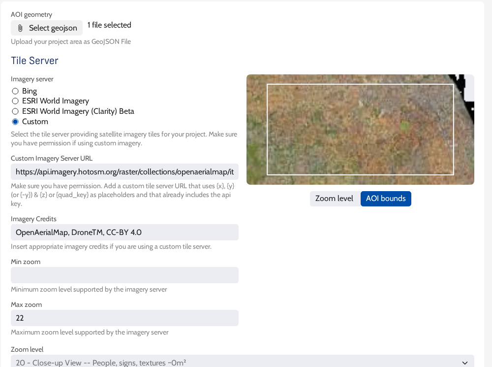

!!! warning "Use a tile URL from api.imagery.hotosm.org"
    The manager draws its maps in the browser, which reads only tile servers that send CORS headers. `api.imagery.hotosm.org` sends them. `tiles.openaerialmap.org` links do not: with one, this preview and the tutorial preview stay blank. On stage, the web app still showed the imagery of such a project. A preview that turns white after **Min zoom** changes is caused by that setting: see the **Min zoom** and **Max zoom** item above. The area and imagery settings are read-only after processing (step 7), so check that the preview shows imagery before you continue.

## 6. Choose the grid and answers

- **Sub grid Size**: the form starts without a selected size. Select how many cells each tile is split into: 2x2, 4x4 or 8x8. Use the size you checked in the area finder in step 1.
- **Include 'Multiple Features' option**: keep it ticked when one cell can hold several objects. Without it, volunteers only choose between **No** and **Feature Exists**: the manager and the web app show the Single Feature answer under that name, and the results still count it as answer `1` ([source](https://github.com/mapswipe/manager-dashboard/blob/develop/app/views/EditProject/UpdateProjectForm/LocateObjectProjectSpecifics/index.tsx)). For trees, keep it: Multiple Features shows where trees grow in groups. Untick it when knowing whether a cell has the object is enough.
- **Export Meta**: a key and a value that describe the feature, for example its OpenStreetMap tag. The MapSwipe documentation describes it as an "additional metadata entry attached to exports" ([source](https://github.com/mapswipe/mapswipe-docs/blob/main/docs/project_types/locate_objects.md)). Both fields are required. Examples:

    | Feature | Key | Value |
    |---|---|---|
    | Trees | `natural` | `tree` ([OSM wiki](https://wiki.openstreetmap.org/wiki/Tag:natural%3Dtree)) |
    | Solar panels | `generator:source` | `solar` ([OSM wiki](https://wiki.openstreetmap.org/wiki/Tag:generator:source%3Dsolar)) |
    | Buildings | `building` | `yes` ([OSM wiki](https://wiki.openstreetmap.org/wiki/Key:building)) |

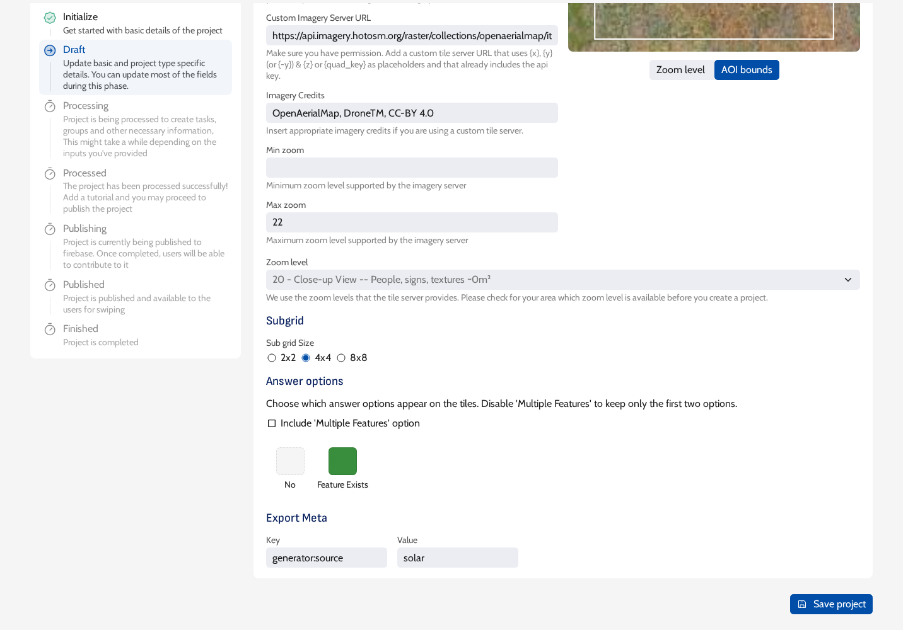

!!! warning "Export Meta is required"
    The form does not mark Export Meta as required, but saving without it fails with `Expected non-nullable type 'String!' not to be None` for `exportMetaKey` and `exportMetaValue`.

    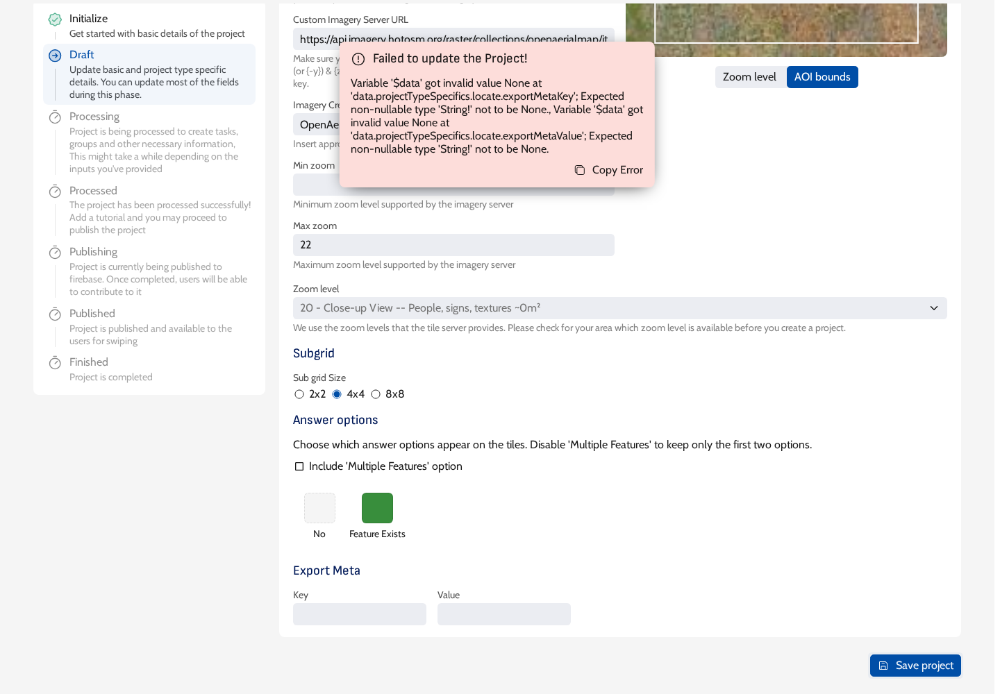

Click **Save project**. Reload the page and check that the imagery URL, zoom level and AOI file are still there.

## 7. Process the project

Click **Process** at the top right and **Confirm**. Processing splits the area into tiles at the chosen zoom and groups them. An area of a few hundred tiles takes under a minute.

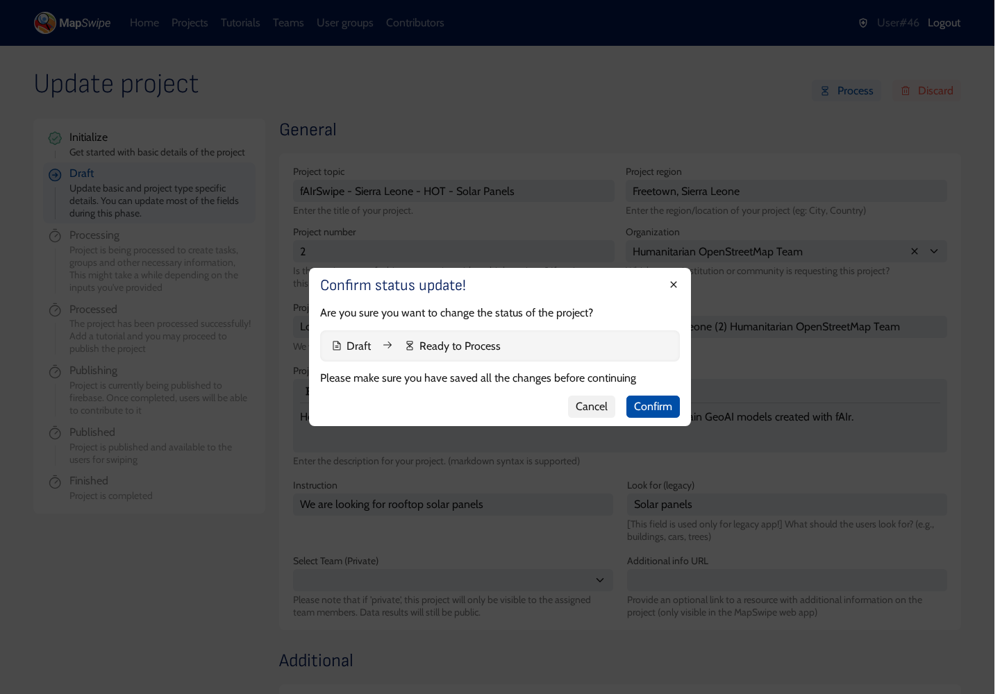

When processing finishes, the project is **Processed** and a **Publish** button appears. From now on the area and imagery settings are read-only. On stage, **Update project** on a processed project saved only once a tutorial was selected under **Tutorial**, so other changes wait until the tutorial exists. Before publishing, the project needs a tutorial: continue with [Create the tutorial](create-the-tutorial.md), which starts with checking for an existing one.

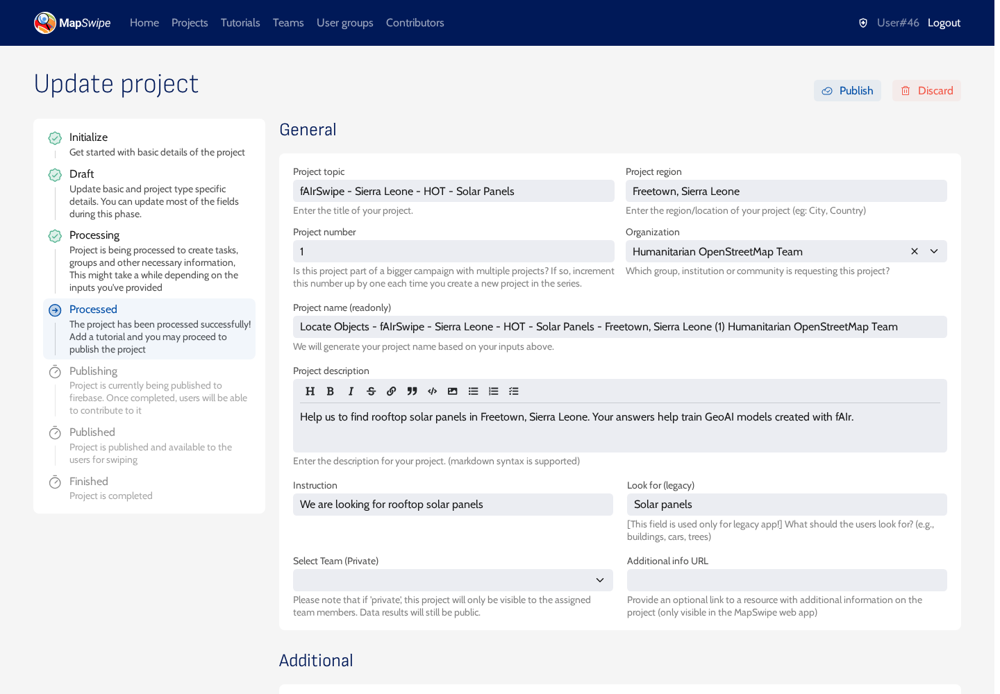
