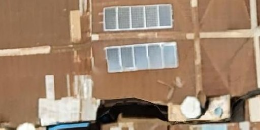
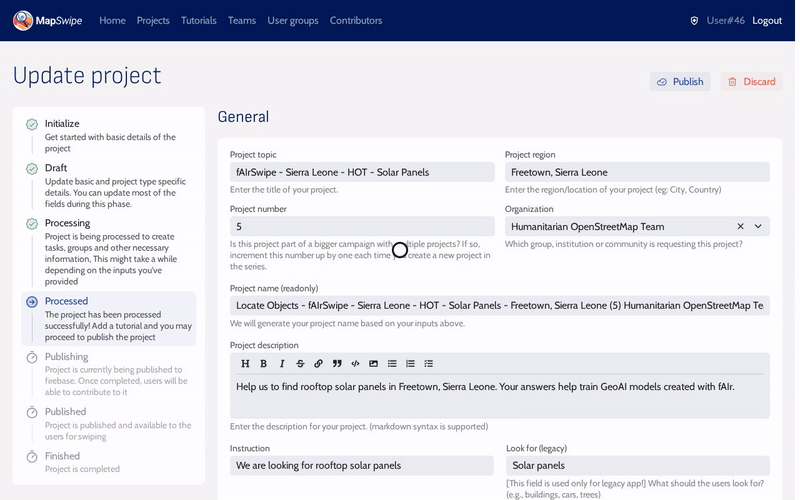

# Create a Locate project

This guide goes from an image on imagery.hotosm.org to a processed project in the MapSwipe manager. Follow the steps in order. You need a manager account on stage or production (see the [home page](../index.md)). Create and check the project on stage first, then create it again on production.

!!! warning "Check that your object fits"
    Locate Objects suits separate objects you can point at, such as solar panels or water tanks. Lines such as roads, sorting by type such as roof types, and two objects in one project fit poorly. Read [Check that your object fits](check-your-object.md) first.

## 1. Copy the image link

1. Open <https://imagery.hotosm.org/browse>.
2. Find your area: click the magnifier on the map, type the city and country, for example `Freetown, Sierra Leone`, and click **Go** (observed on imagery.hotosm.org). You can also turn the mouse wheel over the map, or click **+** and **-**.
3. The list on the left shows the images in view. When the image you want isn't listed, click **Load More** at the bottom of the list (observed on imagery.hotosm.org). The examples in these guides use **Freetown Urban with Sensitive Areas Blurred**.
4. Under the image you want, click **Show Details**.
5. Check that the details that opened belong to the image you chose, then click **Copy TMS**.

<video src="../assets/create/imagery-copy-tms.mp4" autoplay loop muted playsinline aria-label="Show Details and Copy TMS on imagery.hotosm.org"></video>

??? note "Choosing between images"
    When several images cover the same place, prefer the newest. Between images of similar date, pick the finest resolution: **GSD (RESOLUTION)** in the details, where a smaller number is sharper. When copies differ only in compression or file size, load each in the area finder, compare them in the **Volunteer view** (step 3), and pick the smallest file that looks the same.

??? note "Area across several images"
    Most projects use one image. When the area needs several images, merge them in the [imagery merger](../helpers/index.md#imagery-merger) and click **Open in area finder**. The area finder opens with all the images loaded, and the steps below are the same. Under **Images** in the side panel, click an image to go to it, which helps when the images are far apart.

## 2. Load the image in the area finder

1. Open the [area finder](../builder/area.html) in a new browser tab.
2. Click the field under **Load an image** and paste the link with ++ctrl+v++.
3. Click **Load**.
4. Wait until the side panel says **The yellow area is the imagery footprint, ready to download.**

The red line shows where the image has imagery. White and black edges are left out. The yellow area inside the red line is the area of interest.

<video src="../assets/create/area-finder-load.mp4" autoplay loop muted playsinline aria-label="Pasting the link and loading it in the area finder"></video>

## 3. Choose the zoom and the sub-grid

The **Volunteer view** in the side panel shows the tile under the white square in the middle of the map, with its cells. Volunteers see one tile like this on each screen of the app (observed in the web app). Volunteers tap the cells that contain the object.

1. Turn the mouse wheel over the map to zoom in until you can see the objects volunteers will look for, for example solar panels. Then drag the map so the white square sits on one of them.

    

    In the Freetown image, rooftop solar panels show as light grey rectangles with white frames, set in rows, as in the picture above.

2. Under **Project zoom**, click **18**, **19**, **20** and **21** in turn, and look at the **Volunteer view** each time. Choose the lowest zoom where you can still recognise the object. A red note under **Project zoom** means the zoom is finer than the imagery, so its tiles look blurred: choose the zoom it names or lower. Each step down in zoom covers the same area with four times fewer tiles, so volunteers finish sooner. A red note under **Area of interest** means the area is too large at that zoom (see step 4).
3. Under **Sub-grid**, click **2x2**, **4x4** and **8x8** in turn. Choose the size where one object fits inside about one cell.
4. Write down the zoom and the sub-grid. You enter them in the manager in steps 8 and 9.

<video src="../assets/create/area-finder-zoom.mp4" autoplay loop muted playsinline aria-label="Changing the zoom and the sub-grid and watching the Volunteer view"></video>

??? note "Where these suggestions come from"
    MapSwipe doesn't publish a rule for choosing the zoom or the sub-grid of a Locate project. Steps 2 and 3 above are suggestions for comparing the options by eye. **Cell size** in the side panel gives the width of one cell on the ground. Zoom the map in to see the tile and cell lines over the imagery.

## 4. Download the area of interest

Check **Area of interest** in the side panel: it gives the size and an estimate of how many tiles MapSwipe will create. A red note appears when the area is too large for MapSwipe at the project zoom, or when the file is larger than 1 MB. Draw a smaller area or choose a lower zoom.

To use the whole image, click **Download area of interest**. The file `area-of-interest.geojson` is saved.

To use only part of the image, draw around places where you saw the object, so the tutorial has clear examples to show:

1. Click **Draw area**.
2. Click on the map to add the corners of a shape. Click the first corner again to close it.
3. For a separate place, draw another shape.
4. While you draw, the **Draw area** button reads **Done**. Click **Done** when the shapes are closed. A shape that is not closed yet is dropped.
5. Click **Download area of interest**.

The helper cuts the shapes to the imagery. **Use footprint** removes the shapes and goes back to the whole image.

<video src="../assets/create/area-finder-draw.mp4" autoplay loop muted playsinline aria-label="Drawing a shape and downloading the area of interest"></video>

??? note "Change a shape"
    Click a shape to select it, then drag it to move it, or drag a corner. Drag the point between two corners to add a corner. Right-click a corner to remove it. Press ++delete++ to remove the selected shape.

??? note "Limits and how MapSwipe uses the file"
    - MapSwipe accepts an area up to 5 × 4^(23 − zoom) km², for example 320 km² at zoom 20 and 80 km² at zoom 21 ([source](https://github.com/mapswipe/mapswipe-backend/blob/develop/project_types/tile_map_service/base/project.py)). The manager accepts a file up to 1 MB ([upload](https://github.com/mapswipe/manager-dashboard/blob/develop/app/components/domain/AssetInput/index.tsx), [limit](https://github.com/mapswipe/manager-dashboard/blob/develop/app/utils/common.ts)).
    - The file holds one MultiPolygon feature with one part per place, and MapSwipe makes tasks for each part ([grouping](https://github.com/mapswipe/mapswipe-backend/blob/develop/utils/geo/tile_grouping.py)).
    - Some tiles at the edges of each part fall outside the imagery, because MapSwipe groups tiles into rectangles three tiles tall and an even number of tiles wide, and every tile in a rectangle becomes a task ([tasks](https://github.com/mapswipe/mapswipe-backend/blob/develop/project_types/tile_map_service/base/project.py)).

## 5. Save a cover image and copy the tile URL

1. Zoom the map to a view that shows the object well.
2. Click **Save map view as cover image**. The file `cover-image.jpg` is saved.
3. Under **Tile URL for the manager**, click **Copy tile URL**. Keep the area finder tab open: you paste this URL again in step 8 and in the tutorial builder.

<video src="../assets/create/area-finder-cover.mp4" autoplay loop muted playsinline aria-label="Saving the cover image and copying the tile URL"></video>

## 6. Start the project in the manager

1. Log in to the manager: <https://managers-stage.mapswipe.org/> for stage, <https://managers.mapswipe.org/> for production.
2. On the home page, click **New Project**.
3. Under **Project Type**, click **Locate Objects**. The type can't be changed later.
4. Under **General**, fill in the fields:

    | Field | What to enter | Example |
    |---|---|---|
    | Project topic | A title following the naming convention on the [home page](../index.md) | `fAIrSwipe - Sierra Leone - Solar Panels` |
    | Project region | City and country | `Freetown, Sierra Leone` |
    | Project number | `1`, or the next number when the same feature and area get several projects | `1` |
    | Organization | Type `fAIrSwipe` and pick **fAIrSwipe Grantees** | `fAIrSwipe Grantees` |
    | Project description | Why the data is collected; markdown is supported | `Help us to find rooftop solar panels in Freetown, Sierra Leone. Your answers help train GeoAI models created with fAIr.` |
    | Instruction | What volunteers look for, shown above every tile | `We are looking for rooftop solar panels` |
    | Look for (legacy) | The object name. The web app shows it in the tutorial as "You are looking for: ..." | `Solar panels` |

5. Leave **Select Team** and **Additional info URL** empty.
6. Click **Save Draft**. The message **Project created successfully!** appears and the page opens as **Update project**.

<video src="../assets/create/manager-new.mp4" autoplay loop muted playsinline aria-label="Filling in the general details and saving the draft"></video>

??? note "Project name already exists"
    The manager builds the project name from these fields. **Save Draft** fails with `Project name already exists in database` when a project that is not discarded or withdrawn has the same name ([source](https://github.com/mapswipe/mapswipe-backend/blob/develop/apps/project/serializers.py)). Increase **Project number** by one and save again.

## 7. Set the task details and cover image

Scroll down to **Additional**.

1. **Verification number**: how many volunteers see each tile. The form says "Default is 3, but 5 or more is recommended for harder tasks." (observed in the manager). Enter `3` for objects that are easy to see, or `5` for harder ones.
2. **Group size**: keep 25.
3. **Max tasks per user**: leave it empty, so each volunteer can map any number of tasks.
4. **Project cover image**: click **Select an image** and choose `cover-image.jpg` from step 5.

<video src="../assets/create/manager-additional.mp4" autoplay loop muted playsinline aria-label="Verification number and cover image"></video>

??? note "What Group size means"
    Group size is the width of one group in tiles. Groups are three tiles tall, so one mapping session holds up to about three times this number of tiles ([source](https://github.com/mapswipe/mapswipe-backend/blob/develop/utils/geo/tile_grouping.py)).

## 8. Add the area and imagery

Scroll down to **Locate Objects**.

1. **AOI geometry**: click **Select geojson** and choose `area-of-interest.geojson` from step 4.
2. **Imagery server**: check that **Custom** is selected.
3. **Custom Imagery Server URL**: paste the tile URL from step 5. It starts with `https://tiles.imagery.hotosm.org/`. If you type the URL, a red note about `{x}`, `{y}` and `{z}` shows until the URL is complete.
4. **Imagery Credits**: the image provider and licence, for example `OpenAerialMap, DroneTM, CC-BY-4.0`. The image record lists the provider under `providers` and the licence under `license`, for example `DroneTM` and `CC-BY-4.0` in the [Freetown image record](https://api.imagery.hotosm.org/stac/collections/openaerialmap/items/69075f1de47603686de24fe8).
5. **Min zoom**: leave it empty. **Max zoom**: enter `22`.
6. **Zoom level**: click the field and choose the zoom from step 3, for example the item that starts with **20** (**Close-up View**).
7. Look at the map preview on the right. Click **AOI bounds** to see the whole area. Check that it shows the imagery.

<video src="../assets/create/manager-imagery.mp4" autoplay loop muted playsinline aria-label="Uploading the area and entering the imagery settings"></video>

!!! warning "Use a tile URL from tiles.imagery.hotosm.org"
    The manager draws its maps in the browser, which reads only tile servers that send CORS headers. `tiles.imagery.hotosm.org` sends them. With a `tiles.openaerialmap.org` link, this preview and the tutorial preview stay blank. The area and imagery settings become read-only after processing (step 10), so check the preview before you continue.

??? note "Min zoom, Max zoom and the preview"
    - For a Locate project, **Min zoom** and **Max zoom** only set the zoom range of the map previews in the manager. The app receives the tile URL, credits and key ([source](https://github.com/mapswipe/mapswipe-backend/blob/develop/project_types/tile_map_service/locate/project.py)). The preview doesn't load imagery below **Min zoom** ([source](https://github.com/mapswipe/manager-dashboard/blob/develop/app/components/domain/BaseMap/index.tsx)), so a preview that turns white after **Min zoom** changes is caused by that setting.
    - The preview can't be zoomed. **AOI bounds** fits the whole area, so a larger area shows a lower zoom ([source](https://github.com/mapswipe/manager-dashboard/blob/develop/app/components/domain/GeoJsonMapSource/index.tsx)). **Zoom level** shows the chosen zoom at the centre of the rectangle around the area. When the area has two separate places, that centre can fall between them and show a blank map ([source](https://github.com/mapswipe/manager-dashboard/blob/develop/app/components/domain/RasterTileServerInput/index.tsx)).

## 9. Set the grid, answers and export meta

1. **Sub grid Size**: click the size from step 3, for example **4x4**.
2. **Include 'Multiple Features' option**: keep it ticked when one cell can hold several objects, for example trees in groups. Untick it when knowing whether a cell has the object is enough. The solar panel example unticks it.
3. **Export Meta**: enter a **Key** and a **Value** that describe the object, for example its OpenStreetMap tag:

    | Object | Key | Value |
    |---|---|---|
    | Solar panels | `generator:source` | `solar` ([OSM wiki](https://wiki.openstreetmap.org/wiki/Tag:generator:source%3Dsolar)) |
    | Trees | `natural` | `tree` ([OSM wiki](https://wiki.openstreetmap.org/wiki/Tag:natural%3Dtree)) |
    | Buildings | `building` | `yes` ([OSM wiki](https://wiki.openstreetmap.org/wiki/Key:building)) |

4. Click **Save project**. The message **Project updated successfully!** appears.
5. Reload the page and check that the tile URL, the zoom level and the area file are still there.

<video src="../assets/create/manager-grid.mp4" autoplay loop muted playsinline aria-label="Sub-grid, export meta and saving the project"></video>

!!! warning "Export Meta is required"
    The MapSwipe documentation describes Export Meta as an "additional metadata entry attached to exports" ([source](https://github.com/mapswipe/mapswipe-docs/blob/main/docs/project_types/locate_objects.md)). The form doesn't mark it as required, but saving without it fails (observed in the manager) with `Expected non-nullable type 'String!' not to be None` for `exportMetaKey` and `exportMetaValue`.

    

??? note "Answers without Multiple Features"
    Without **Multiple Features**, volunteers choose between **No** and **Feature Exists**. The manager and the web app show the Single Feature answer under that name, and the results still count it as answer `1` ([source](https://github.com/mapswipe/manager-dashboard/blob/develop/app/views/EditProject/UpdateProjectForm/LocateObjectProjectSpecifics/index.tsx)).

## 10. Process the project

1. At the top right, click **Process**.
2. Click **Confirm**. The message **Project status updated successfully!** appears and the left panel shows **Processing Project**.
3. Wait, and reload the page now and then. An area of a few hundred tiles takes under a minute (observed in the manager).
4. When **Processed** is highlighted in the left panel, a **Publish** button appears at the top right.

<video src="../assets/create/manager-process.mp4" autoplay loop muted playsinline aria-label="Processing the project"></video>

From now on the area and imagery settings are read-only. Before publishing, the project needs a tutorial: continue with [Create the tutorial](create-the-tutorial.md).

??? note "Changes after processing"
    On stage, **Update project** on a processed project saves only after a tutorial is selected under **Tutorial** (observed in the manager), so other changes wait until the tutorial exists.
