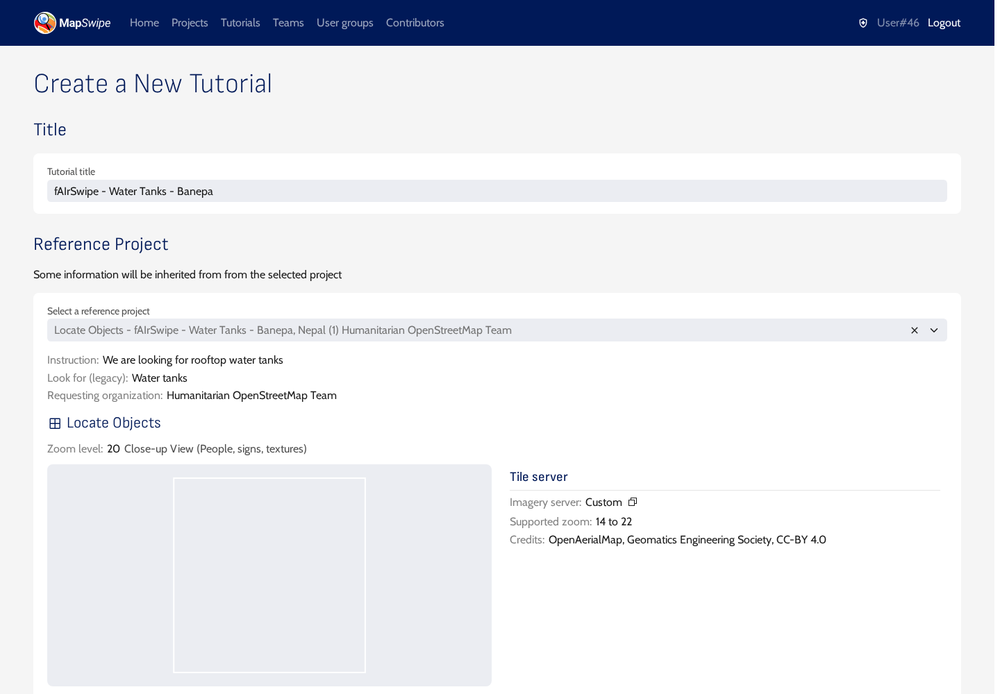
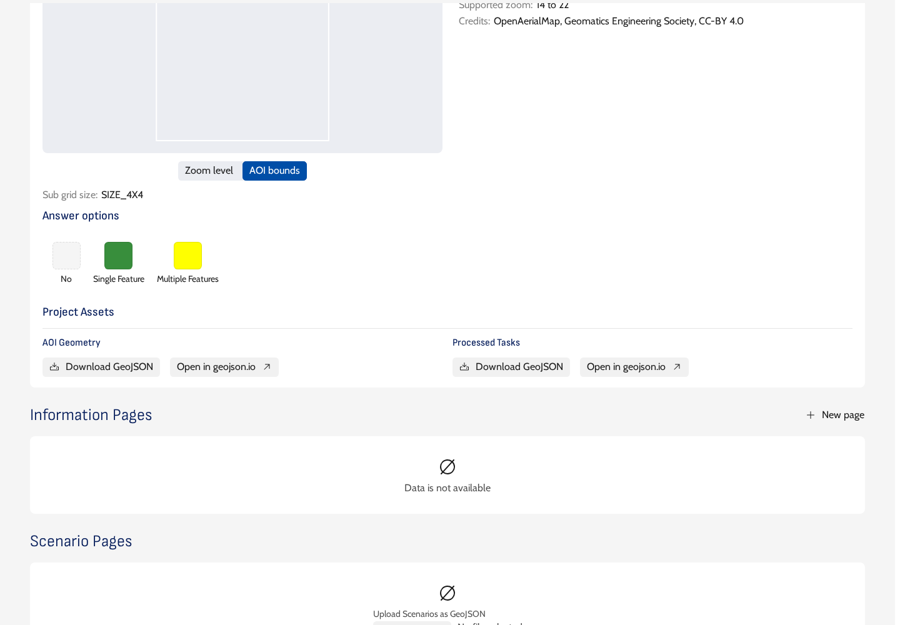
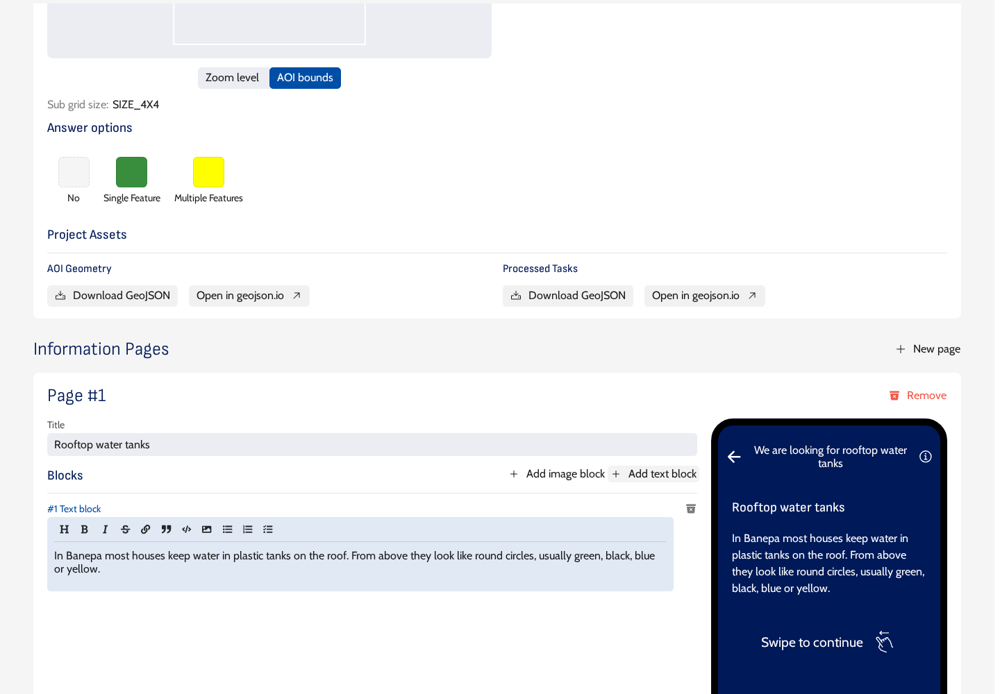
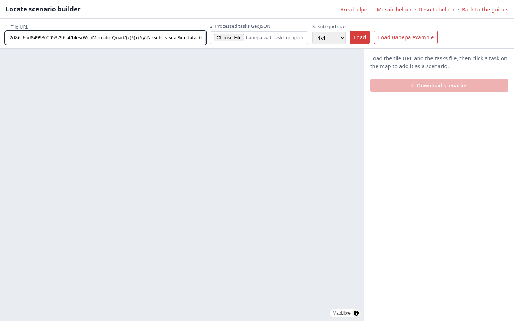
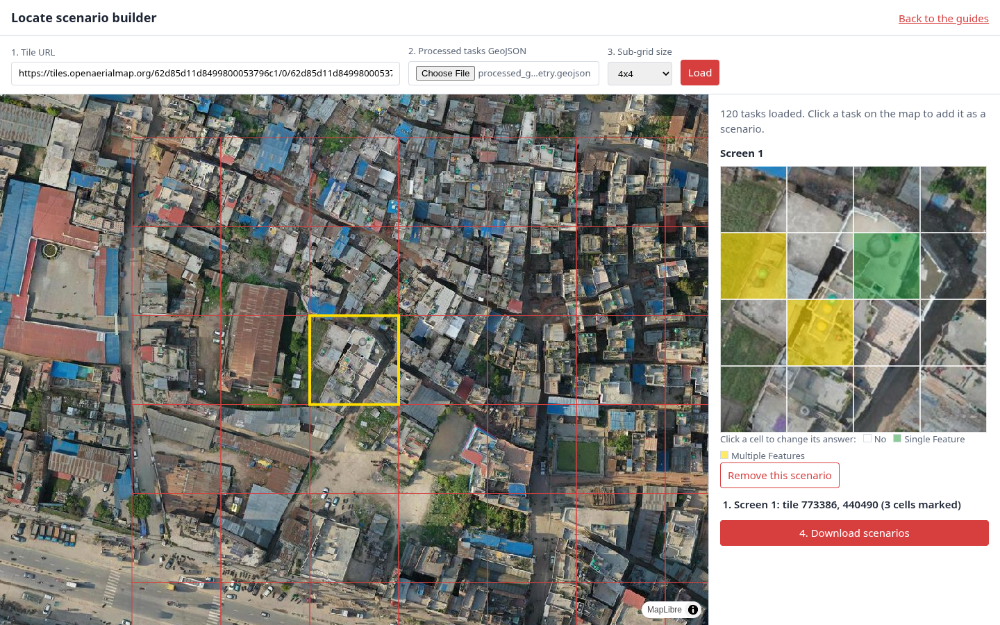
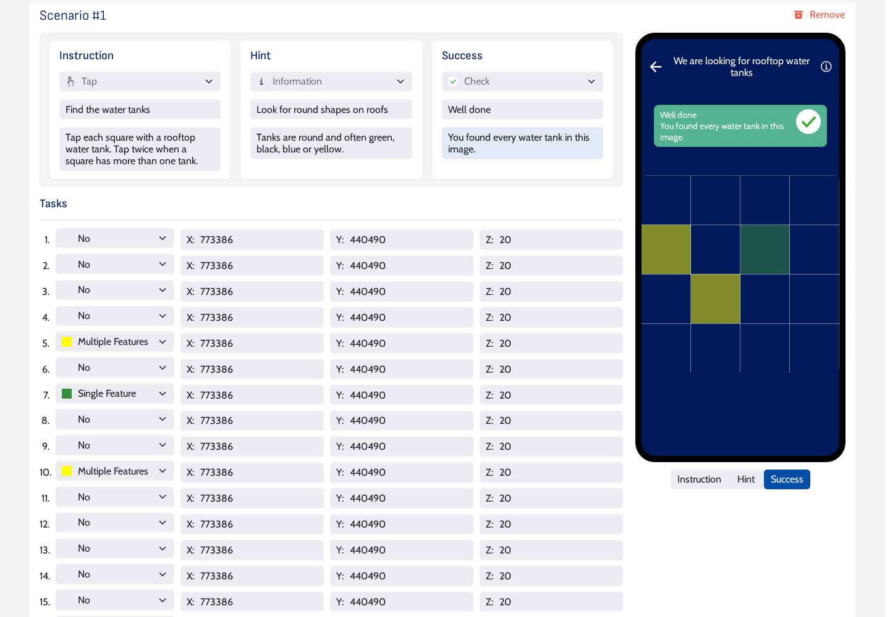

# Create the tutorial

The tutorial runs the first time a volunteer opens the project. It has information pages that explain the object, then scenario pages: real tiles from the project where the volunteer must tap the right cells before moving on.

!!! tip "Check for an existing tutorial first"
    In the manager, open **Tutorials** and look for a published Locate tutorial on the same object, made with imagery that looks like your area. If one fits, skip this page: select it in [Attach the tutorial to the project](publish.md#2-attach-the-tutorial-to-the-project) and publish.

## 1. Create the tutorial

In the manager, open **Tutorials** and click **New Tutorial**. Enter a title, select the processed project under **Reference Project**, and click **Submit**. The tutorial copies the instruction, imagery and grid settings from that project.

## 2. Download the processed tasks

On the tutorial page, under **Project Assets**, click **Download GeoJSON** next to **Processed Tasks**. The file lists every tile of the project with its `tile_x`, `tile_y` and `tile_z`. If it opens in a new browser tab instead of downloading, save that tab with ++ctrl+s++ as `processed_geometry.geojson`.

## 3. Add an information page

Under **Information Pages**, click **New page**, enter a title, then **Add text block** (and **Add image block** if you have an example image). Describe what the object looks like from above. In the web app, the page title becomes a tab name in the tutorial.

Click **Update tutorial** to save the page before going on.

## 4. Build the scenarios

Open the [scenario builder](../builder/index.html) in a new browser tab.

1. Paste the same tile URL used in the project.
2. Choose the processed tasks file.
3. Select the same sub-grid size as the project.
4. Click **Load**. The project tiles appear on the map, and the imagery a few seconds later.

Click a tile on the map to add it as a scenario. The tile opens on the right with its grid. Click each cell to set its answer: one click for **Single Feature** (green), two for **Multiple Features** (yellow), three to go back to **No**.

Add three to five scenarios that cover the cases volunteers will meet:

- a tile with one or two clear objects,
- a tile with several objects close together,
- a tile with no object, ideally with things that look similar, so volunteers learn what to leave out.

Click **4. Download scenarios**. The file has one feature per scenario, numbered in the order you added them, with the answer of every cell.

If the project leaves out **Multiple Features**, mark cells only as **Single Feature**. The manager rejects a file with Multiple Features answers for such a project.

!!! tip "Check what you mark"
    Volunteers cannot leave a scenario until their taps match your answers exactly. Leave out tiles where you are unsure whether something is the object.

## 5. Upload the scenarios

Back on the tutorial page, under **Scenario Pages**, click **Select a file** and upload the downloaded file. One scenario page appears per tile, with the cell answers already set. The manager lists the cells as tasks 1 to 16, row by row, so cell 0 in the builder is task 1 in the manager.

For each scenario, pick an icon and write a title and description for the three messages. The icons are required.

| Message | Icon | When it shows | Example |
|---|---|---|---|
| Instruction | Tap | When the scenario opens | **Find the water tanks**: Tap each square with a rooftop water tank. Tap twice when a square has more than one tank. |
| Hint | Information | After a wrong tap | **Look for round shapes on roofs**: Tanks are round and often green, black, blue or yellow. |
| Success | Check | When all cells are right | **Well done**: You found every water tank in this image. |

The phone preview on the right shows the result.

Click **Update tutorial**, then continue with [Publish and check the project](publish.md).
