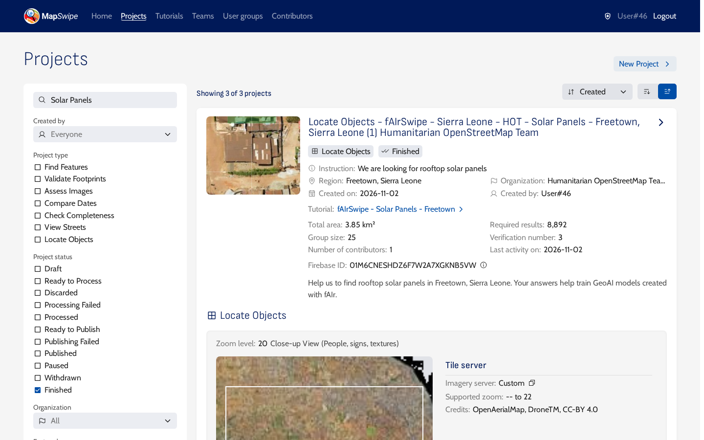
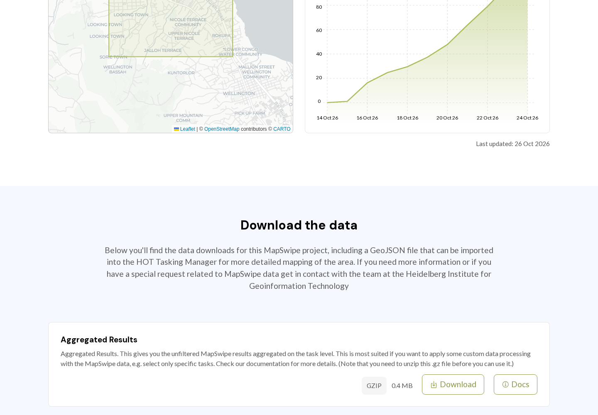

# Download the results

There are two ways to get the results:

| You need | Get it from |
|---|---|
| The cells that reach your volunteer share, as GeoJSON, for labelling | **Download cells** in the [results map](../builder/results.html), see [View the results](view-results.md) |
| The project's export files, with every answer of every volunteer | The MapSwipe website for production projects, or the MapSwipe API for stage and production, see [Get the export files](#get-the-export-files) |

The results map reads the Aggregated Results export file of the project, so its cells come from the same counts.

## When the results appear

After a volunteer saves a group, MapSwipe updates the project's export files. On stage the files were updated two minutes after the group was saved.

## Get the export files

### From the MapSwipe website (production)

Each production project has a page at `https://mapswipe.org/en/projects/<firebase id>/` with a **Download the data** section. The Firebase ID is in the web app address when you open the project, and in the manager on the **Projects** page, where the project's entry lists it as **Firebase ID**.



The website is rebuilt every six hours ([source](https://github.com/mapswipe/website/blob/main/.github/workflows/cd.yml)), so a new project's page can take that long to appear. The screenshot below is from a finished production project.



### From the MapSwipe API (stage and production)

The stage website (<https://website-stage.mapswipe.org/>) may not list new stage projects. Any project's file links are also available from the MapSwipe API without signing in. Open this link in the browser, after changing `923` in it to your project number (the number in the manager address, `/project/<number>/edit`):

[List the result files of stage project 923](https://backend-stage.mapswipe.org/graphql/?query=%7B%20publicProject%28id%3A%20%22923%22%29%20%7B%20exportAggregatedResults%20%7B%20file%20%7B%20url%20%7D%20%7D%20exportAggregatedResultsWithGeometry%20%7B%20file%20%7B%20url%20%7D%20%7D%20exportResults%20%7B%20file%20%7B%20url%20%7D%20%7D%20exportTasks%20%7B%20file%20%7B%20url%20%7D%20%7D%20exportGroups%20%7B%20file%20%7B%20url%20%7D%20%7D%20exportUsers%20%7B%20file%20%7B%20url%20%7D%20%7D%20exportHistory%20%7B%20file%20%7B%20url%20%7D%20%7D%20%7D%20%7D)

The browser shows a short JSON text with one `url` per file. Open a `url` to download that file. For production projects, change `backend-stage.mapswipe.org` in the link to `backend.mapswipe.org`.

## The files

Most files are compressed (`.gz`). Unzip them before use.

| File | Content |
|---|---|
| Aggregated Results | One row per tile cell, with how many volunteers gave each answer (CSV) |
| Aggregated Results (with Geometry) | The same rows as GeoJSON |
| Results | Every answer of every volunteer |
| Tasks | The project tiles |
| Groups | The groups and their progress |
| Users | Contributor statistics for the project |
| History | Daily progress |

The [MapSwipe data documentation](https://github.com/mapswipe/mapswipe-docs/blob/main/docs/about_data.md) describes each file.

## Reading Locate results

Each tile is exploded into one row per cell. These columns matter most:

| Column | Meaning |
|---|---|
| `task_id` | The tile, as `zoom-x-y`, for example `20-485867-499535` |
| `task_partition_index` | The cell, counted row by row from the top left, starting at 0 ([source](https://github.com/mapswipe/manager-dashboard/blob/develop/app/utils/geo.ts)). In a 4x4 grid the first row is 0 to 3 and the last row is 12 to 15 |
| `0_count`, `1_count`, `2_count` | How many volunteers answered No, Single Feature and Multiple Features |
| `0_share`, `1_share`, `2_share` | The same counts as shares of `total_count` |
| `total_count` | How many volunteers answered this cell |
| `url` | The imagery tile |

A row from the [Freetown example](../examples/freetown-solar-panels.md), where 17 of 20 volunteers marked solar panels in cell 1. The project leaves out Multiple Features, so the file has no `2_count` column. The row shows only the columns above; the file has more:

```text
task_id,task_partition_index,0_count,1_count,total_count
20-485867-499535,1,3,17,20
```

!!! note "Geometry is the whole tile"
    In the GeoJSON file, every row carries the polygon of the whole tile, not of the cell. Use `task_partition_index` with the sub-grid size to find the cell inside the tile.
