# Publish and check the project

## 1. Publish the tutorial

On the tutorial page, click **Publish** and **Confirm**. Only a published tutorial can be attached to a project.

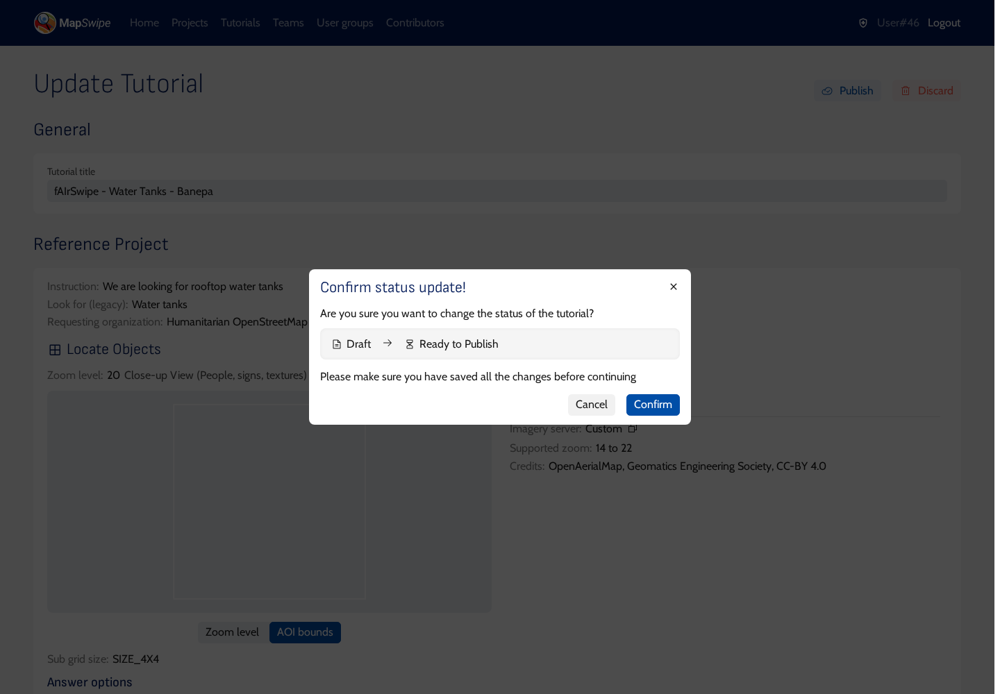

## 2. Attach the tutorial to the project

Open the project. Under **Tutorial**, select the tutorial you created and click **Update project**. Only tutorials of the same project type are listed.

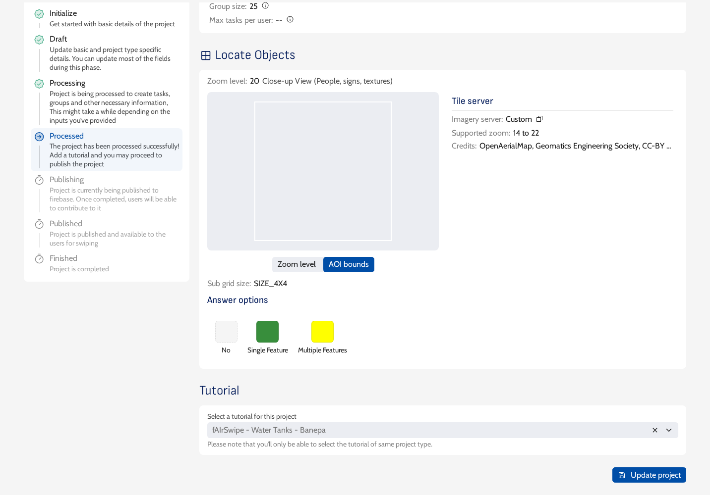

## 3. Publish the project

Click **Publish** at the top right and **Confirm**.

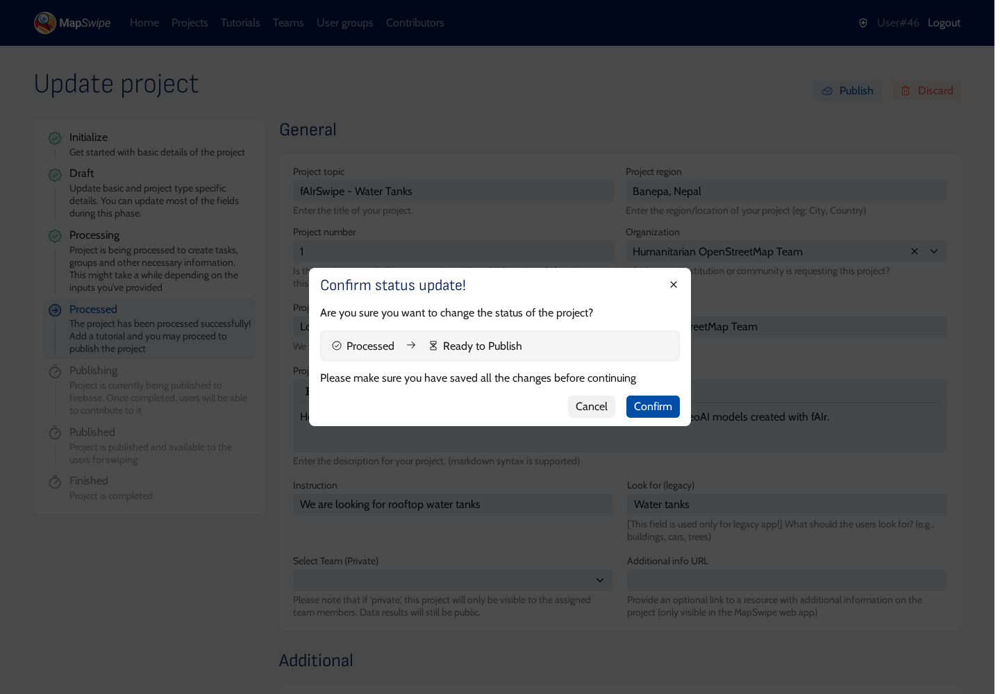

The project moves to **Published**, and the top right now shows **Withdraw**, **Finish** and **Pause**.

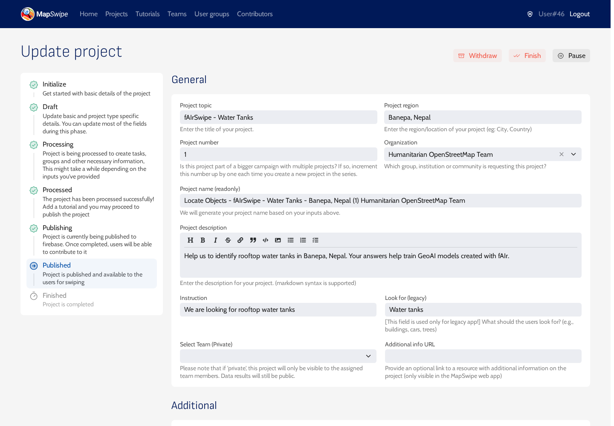

**Pause** hides the project from volunteers without losing anything; publish it again to bring it back. This is useful for preparing projects ahead of a mapathon.

## 4. Check it as a volunteer

Open the web app for the same environment (<https://web.mapswipe.org/dev/> for stage). To sign in, click the person icon at the top right. Under **Projects**, scroll to your project (new projects are near the end of the list) and click **Contribute**. The project details open; click **Contribute** again.

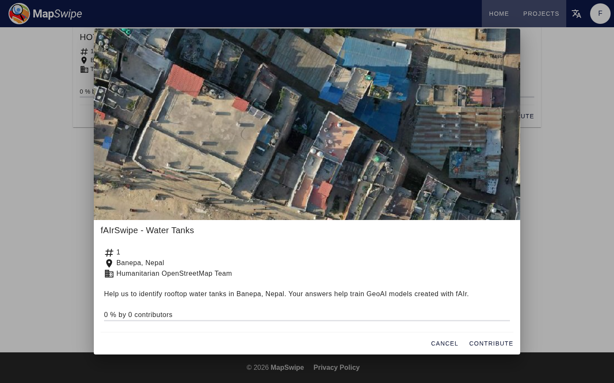

The tutorial opens with tabs along the top: **How to contribute?**, one tab per information page, and **Tutorial**. Move between them with the arrows at the bottom. **Close** skips the tutorial at any time.

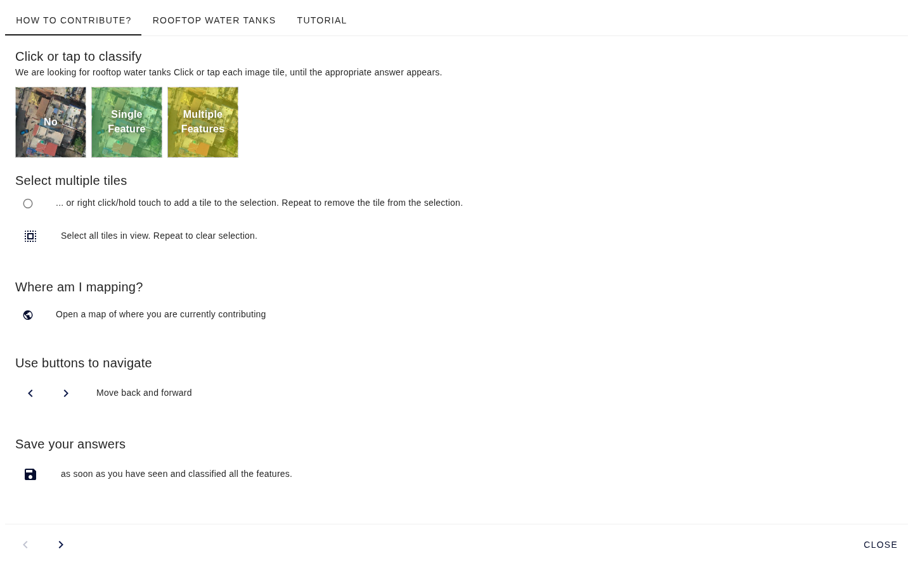

The **Tutorial** tab shows the scenarios with your instruction.

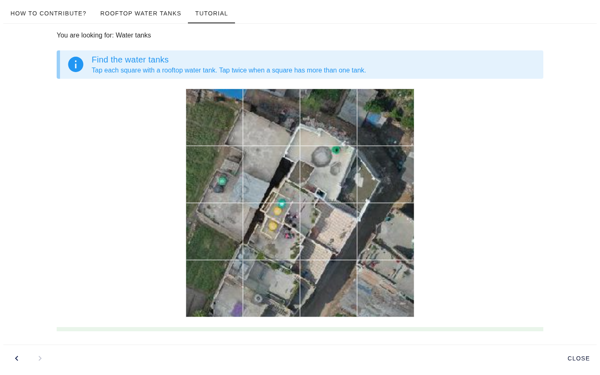

A wrong tap shows the hint.

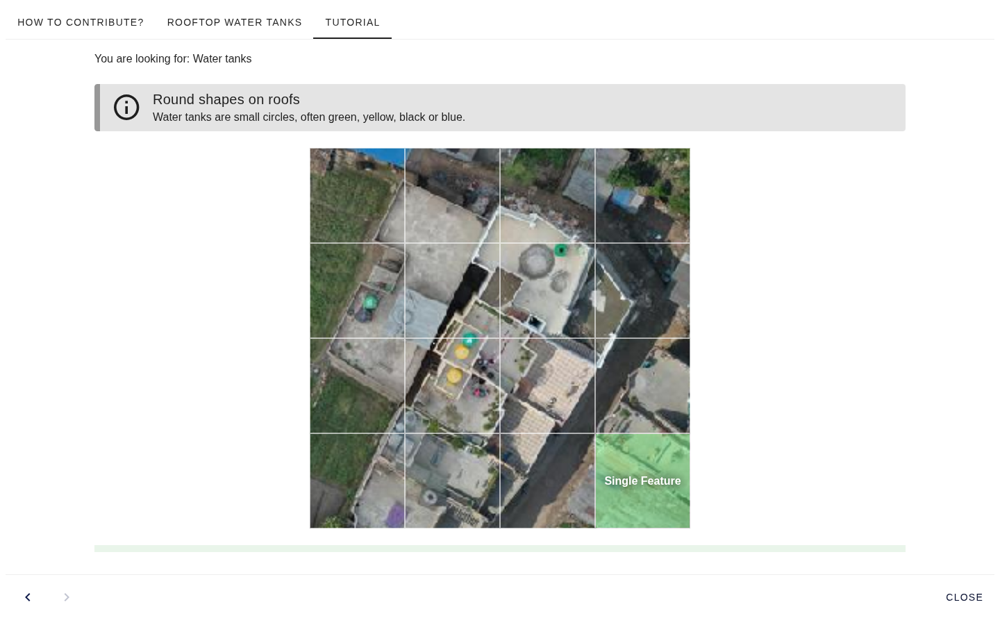

When the cells match the answers, the success message and **Next task** appear.

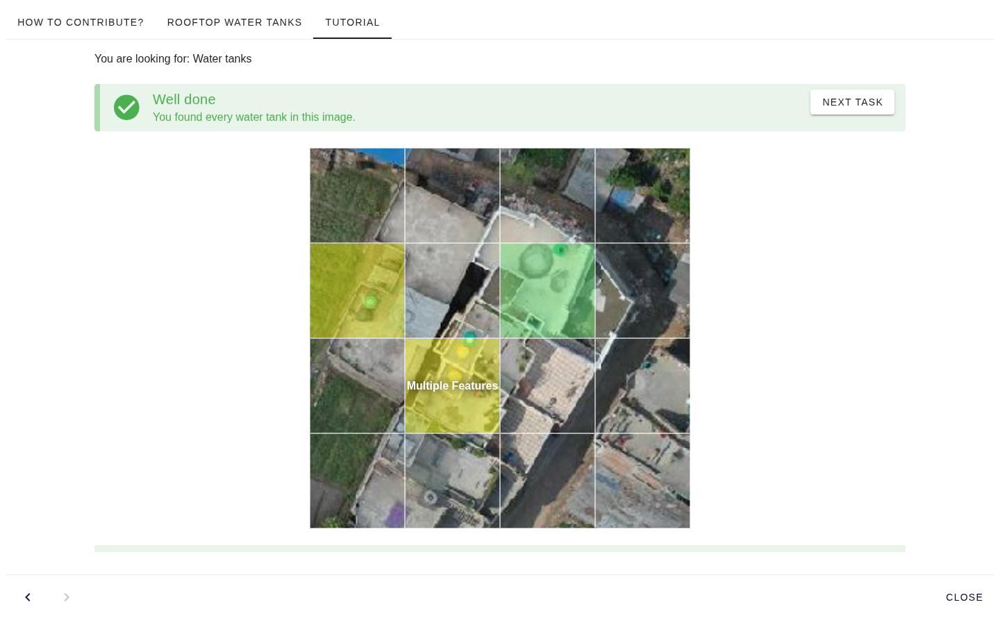

After the last scenario, the app shows "You're ready to start MapSwiping!". Click **Start mapping**.

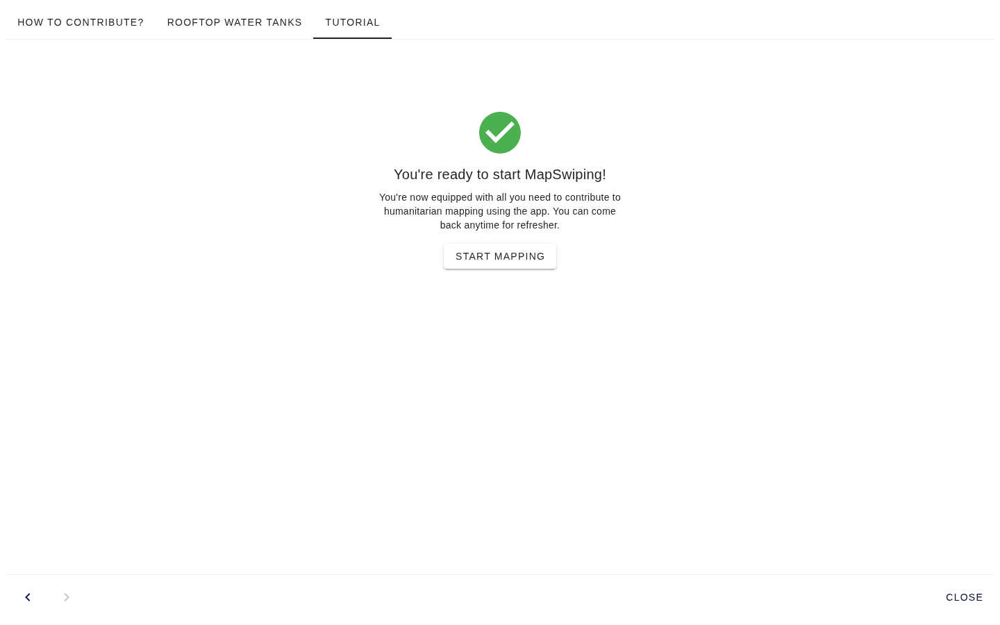

The project tiles follow, one per screen. Tap cells, move with the arrows, and press **Save** at the end of the group.

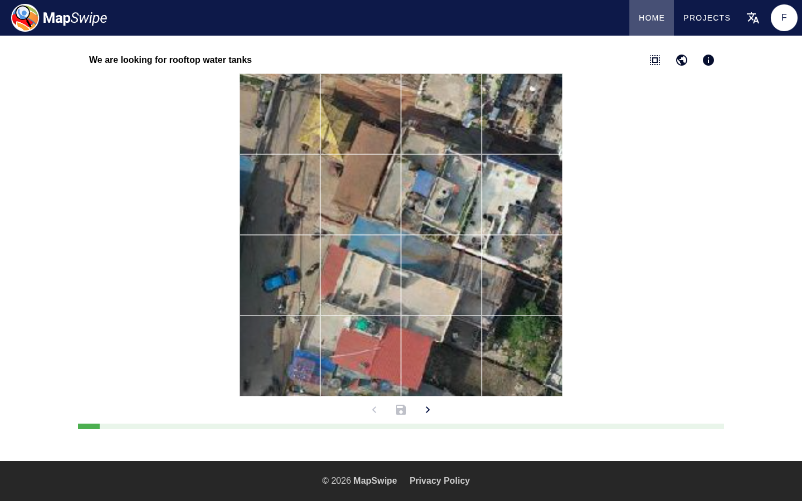

When the project works on stage, create it again on production for volunteers.
