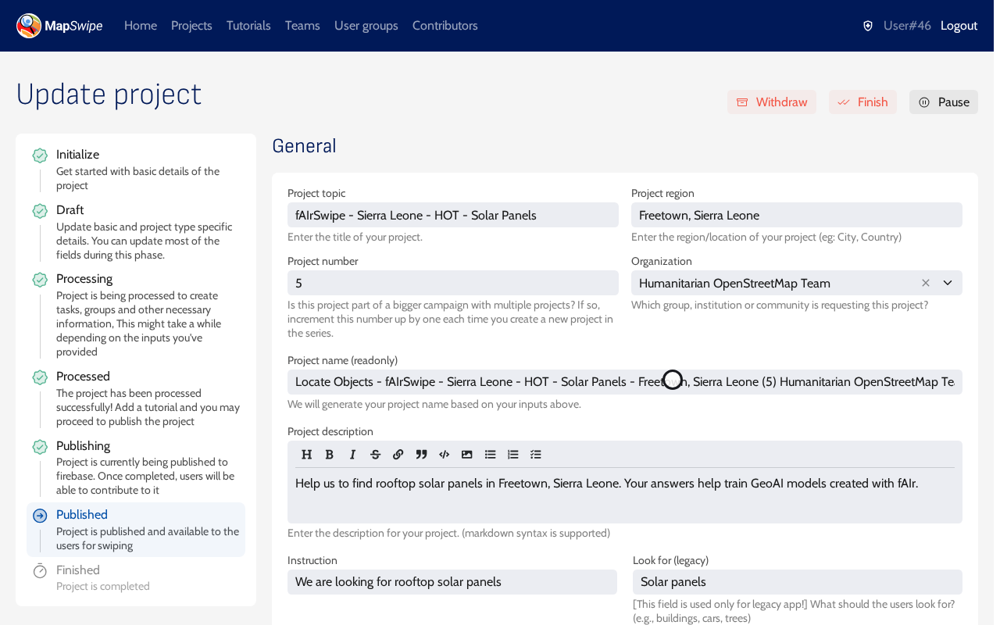
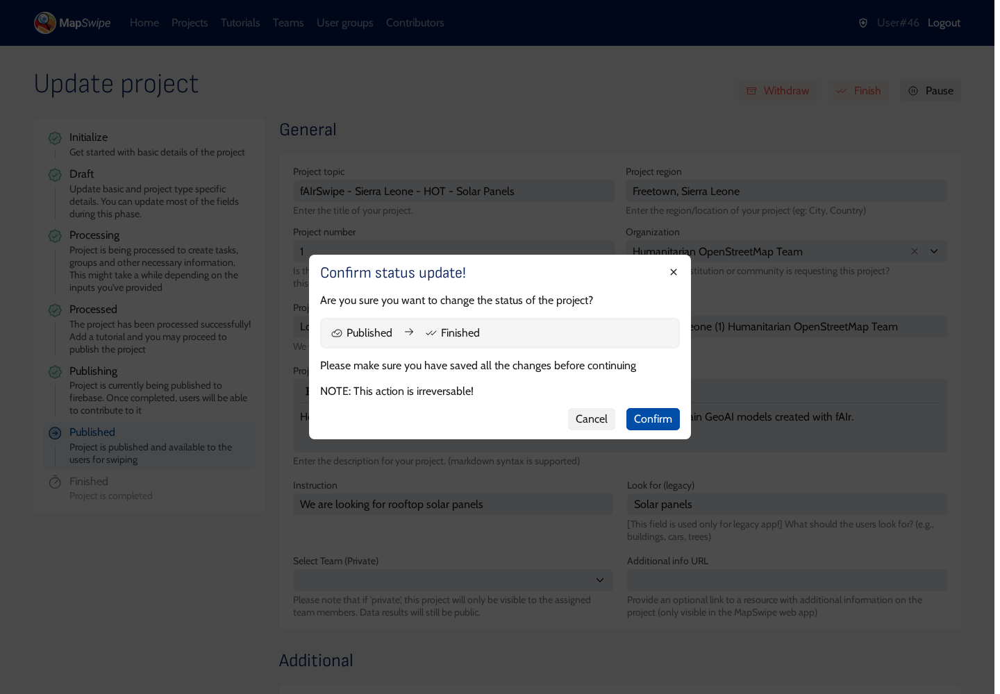
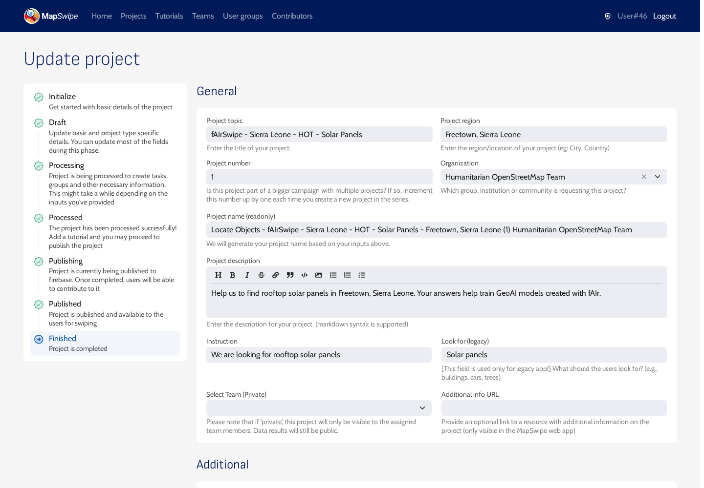

# Publish and check the project

This guide publishes the tutorial and the project, and checks both in the web app as a volunteer. Follow the steps in order, first on stage (see [Stage and production](../index.md#stage-and-production)). You need the tutorial from [Create the tutorial](create-the-tutorial.md) and your manager account.

## 1. Publish the tutorial

1. In the manager, open the tutorial: click **Tutorials** in the top menu and click its title.
2. Click **Publish** at the top right.
3. Click **Confirm**. The **Publish** and **Discard** buttons disappear, and the tutorial is published (observed in the manager).

Only a published tutorial can be attached to a project. Skip this step when you reuse a published tutorial.

<video src="../assets/publish/tutorial-publish.mp4" autoplay loop muted playsinline aria-label="Publishing the tutorial"></video>

## 2. Attach the tutorial to the project

1. Click **Projects** in the top menu and open your project.
2. Scroll down to **Tutorial** and click the field **Select a tutorial for this project**.
3. Click your tutorial. Only tutorials of the same project type are listed.
4. Click **Update project** at the bottom of the page.

<video src="../assets/publish/project-tutorial.mp4" autoplay loop muted playsinline aria-label="Selecting the tutorial and updating the project"></video>

??? note "Two tutorials with the same title"
    The manager accepts several tutorials with the same title (observed in the manager), and the list shows them all. Give each tutorial its own title, for example with the area or the date, so you can pick the right one.

## 3. Publish the project

1. Click **Publish** at the top right.
2. Click **Confirm**.

The project moves to **Published**, and the top right shows **Withdraw**, **Finish** and **Pause**.

<video src="../assets/publish/project-publish.mp4" autoplay loop muted playsinline aria-label="Publishing the project"></video>

??? note "Pause the project"
    **Pause** hides the project from volunteers and keeps everything (observed in the manager); publish it again to bring it back. This helps when you prepare a project ahead of a mapathon.

## 4. Open the project in the web app

1. Open the web app of the same environment: <https://web.mapswipe.org/dev/> for stage, <https://web.mapswipe.org/> for production.
2. To sign in, click the person icon at the top right (**Sign In/Sign Up**) and sign in with your MapSwipe account, the same one as for the manager (observed in the web app).
3. Click **Projects** at the top. Scroll to your project; new projects are near the end of the list (observed in the web app).
4. Click **Contribute** on your project. The project details open.
5. Click **Contribute** again. The tutorial opens on the **How to contribute?** tab.

<video src="../assets/publish/web-open.mp4" autoplay loop muted playsinline aria-label="Finding the project in the web app and opening it"></video>

## 5. Check the tutorial

The tutorial has a tab for **How to contribute?**, one tab per information page, and **Tutorial**. **Close** leaves the tutorial at any time (observed in the web app).

1. Click the tab of your information page, for example **Solar panels**, and check the text and the image.
2. Click **Tutorial**. The first scenario shows your **Instruction** message above the tile.

    <video src="../assets/publish/web-tutorial-tabs.mp4" autoplay loop muted playsinline aria-label="The information page tab and the first scenario"></video>

3. Tap a cell. The **Hint** message replaces the instruction. Each tap on a cell moves it to the project's next answer, for example **Single Feature**, **Multiple Features**, then **No** ([source](https://github.com/mapswipe/mapswipe-web/blob/main/src/components/LocateFeaturesProjectTutorial.vue)).
4. Tap the cells that hold the object, the same cells you marked in the tutorial builder. When all cells match, the **Success** message and **Next task** appear.

    <video src="../assets/publish/web-scenario.mp4" autoplay loop muted playsinline aria-label="A tap shows the hint, and the right cells show the success message"></video>

    The web app shows the hint after the first tap, until all cells are right, and **Show answer** after two taps while a cell is still wrong ([source](https://github.com/mapswipe/mapswipe-web/blob/main/src/components/LocateFeaturesProjectTutorial.vue)). A scenario without the object shows the success message right away (observed in the web app).

5. Click **Next task** for each scenario. After the last one, the app shows "You're ready to start MapSwiping!".
6. Click **Start mapping**. The project tiles follow, one per screen. Tap cells, move with the arrows, and click the save icon at the end of the group (observed in the web app).

    <video src="../assets/publish/web-finish.mp4" autoplay loop muted playsinline aria-label="The end of the tutorial and the first project tile"></video>

??? note "The tutorial doesn't open"
    On stage, once an account had saved results for the project, **Contribute** opened mapping directly, without the tutorial (observed in the web app). Check the tutorial before you save any results.

## 6. Create the project on production

When the project and the tutorial work on stage, create them again on production with the same steps, from [Create a Locate project](create-a-project.md). Under **Organization**, pick **fAIrSwipe Grantees** there too. Volunteers map on production.

## 7. Finish the project

A project reaches 100% when every tile has been seen by as many volunteers as the verification number. The manager accepts 3 or more (observed in the manager), so one account alone can't complete a project.

1. Open the project in the manager.
2. Click **Finish** at the top right and **Confirm**. The confirmation says the action is irreversible. **Finish** works before the project reaches 100% (observed in the manager).

The project moves to **Finished** and leaves the volunteers' project list. Its results stay available.

