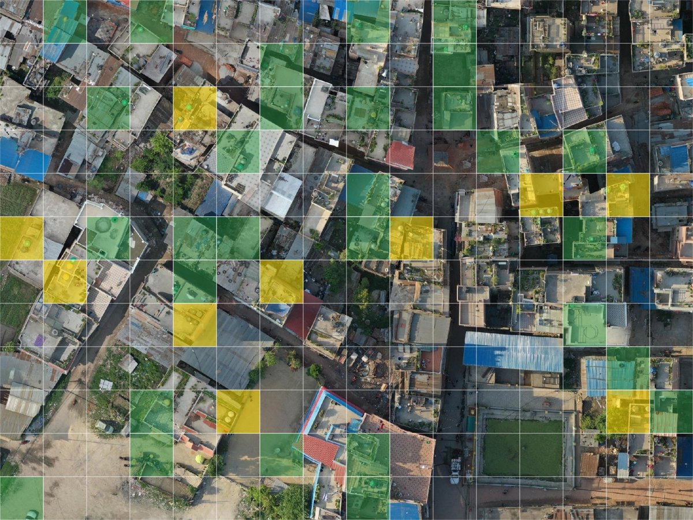

# Use the results in QGIS

This page turns the aggregated results into one polygon per cell in QGIS and colours them by answer.

## 1. Load the results

Download **Aggregated Results (with Geometry)** as described in [Download the results](download-results.md) and unzip it. Drag `agg_results_by_task_<project>_geom.geojson` into QGIS.

## 2. Make one polygon per cell

Open **Processing Toolbox**, search for **Geometry by expression** ([QGIS documentation](https://docs.qgis.org/latest/en/docs/user_manual/processing_algs/qgis/vectorgeometry.html#geometry-by-expression)), select the results layer, keep **Polygon** as the output geometry type, and paste this expression. Change `4` in the first line to the project's sub-grid size (2, 4 or 8).

```text
with_variable('size', 4,
with_variable('tile', bounds(transform($geometry, 'EPSG:4326', 'EPSG:3857')),
with_variable('width', (x_max(@tile) - x_min(@tile)) / @size,
with_variable('column', "task_partition_index" % @size,
with_variable('row', floor("task_partition_index" / @size),
transform(
  make_rectangle_3points(
    make_point(x_min(@tile) + @column * @width, y_max(@tile) - @row * @width),
    make_point(x_min(@tile) + (@column + 1) * @width, y_max(@tile) - @row * @width),
    make_point(x_min(@tile) + (@column + 1) * @width, y_max(@tile) - (@row + 1) * @width)
  ),
  'EPSG:3857', 'EPSG:4326'
))))))
```

Cells are numbered row by row from the top left ([source](https://github.com/mapswipe/manager-dashboard/blob/develop/app/utils/geo.ts)), so the expression finds each cell's row and column inside its tile. The split is done in Web Mercator, the projection the tiles are cut in.

## 3. Add the imagery

In the **Browser** panel, right-click **XYZ Tiles**, choose **New Connection**, and paste the project's tile URL, for example:

```text
https://api.imagery.hotosm.org/raster/collections/openaerialmap/items/62d86c65d8499800053796c4/tiles/WebMercatorQuad/{z}/{x}/{y}?assets=visual&nodata=0
```

Set **Max. Zoom Level** to 22 and add the connection to the map below the cells.

## 4. Colour the cells by answer

Open the cell layer's **Properties**, **Symbology**, choose **Categorized**, and use this expression as the value. A cell counts as an object when more volunteers marked it than left it empty.

```text
CASE
  WHEN "1_count" + "2_count" > "0_count" THEN
    CASE WHEN "2_count" >= "1_count" THEN 'Multiple Features' ELSE 'Single Feature' END
  ELSE 'No'
END
```

Click **Classify**, set **Single Feature** to green and **Multiple Features** to yellow, and give **No** a transparent fill.

The result for the finished stage project in the [Banepa example](../examples/banepa-water-tanks.md): green cells hold one tank, yellow cells several.


