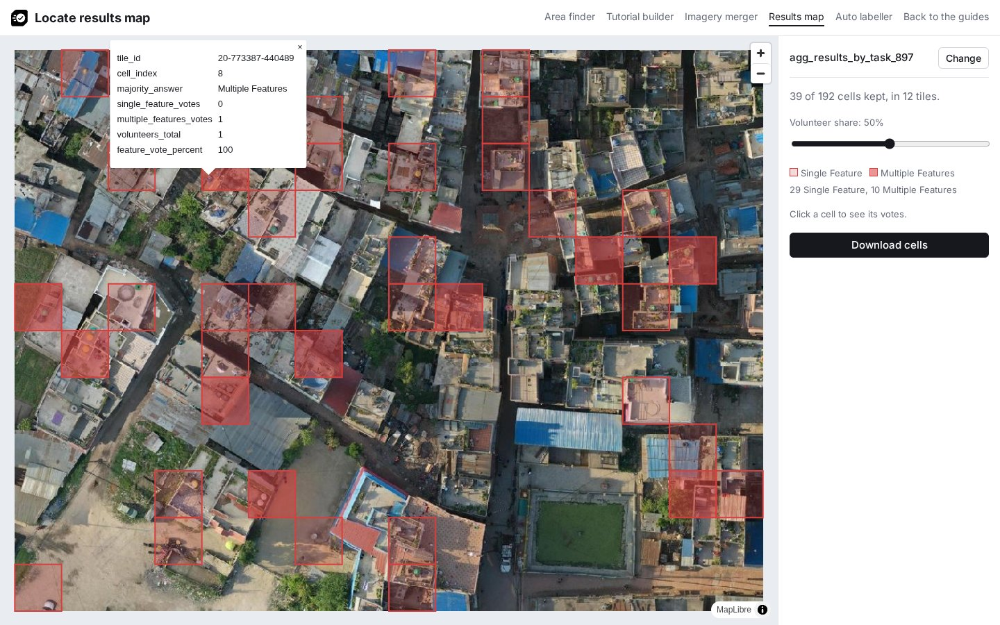
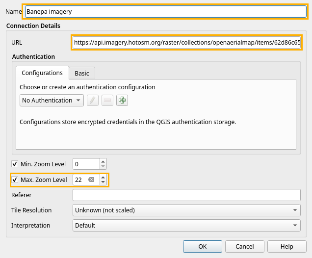
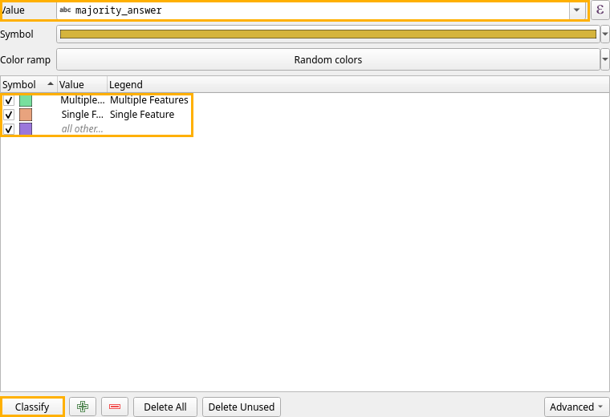

# Use the results in QGIS

This page puts the cells volunteers marked on the map in QGIS, over the project imagery. The steps and screenshots are from QGIS 4.2.

## 1. Get the marked cells

Open the [results map](../builder/results.html). Paste the project link, the address of the project page on the MapSwipe website (see [Download the results](download-results.md)), and click **Load**. Move the **Volunteer share** slider to the share of volunteers a cell needs, for example 50%, and click **Download cells**.

The file has one square per kept cell, with `tile_id`, `cell_index`, `majority_answer`, `single_feature_votes`, `multiple_features_votes`, `volunteers_total` and `feature_vote_percent`. The [helpers page](../helpers/index.md#results-map) explains each property. Click a cell on the helper's map to see its values.



## 2. Add the imagery

In the **Browser** panel, right-click **XYZ Tiles** and choose **New Connection**. Enter a **Name**, paste the project's tile URL into **URL**, tick **Max. Zoom Level** and set it to 22, and click **OK**. The Banepa example uses this tile URL:

```text
https://api.imagery.hotosm.org/raster/collections/openaerialmap/items/62d86c65d8499800053796c4/tiles/WebMercatorQuad/{z}/{x}/{y}?assets=visual&nodata=0
```



Expand **XYZ Tiles** and double-click the new connection to add it to the map.

## 3. Add the cells

Drag the downloaded `.geojson` file into QGIS. It is added above the imagery.

## 4. Colour the cells by answer

Double-click the cell layer in the **Layers** panel to open its properties, and open **Symbology** ([QGIS documentation](https://docs.qgis.org/latest/en/docs/user_manual/working_with_vector/vector_properties.html#categorized-renderer)):

1. Change **Single Symbol** at the top to **Categorized**.
2. Set **Value** to `majority_answer`.
3. Click **Classify**. QGIS gives **Single Feature** and **Multiple Features** each a colour, chosen at random. It also adds an **all other values** class, which stays unused because every cell is Single Feature or Multiple Features.



Under **Layer Rendering** at the bottom of the same tab, set **Opacity** to 50% so the imagery shows through the cells, and click **OK**.


