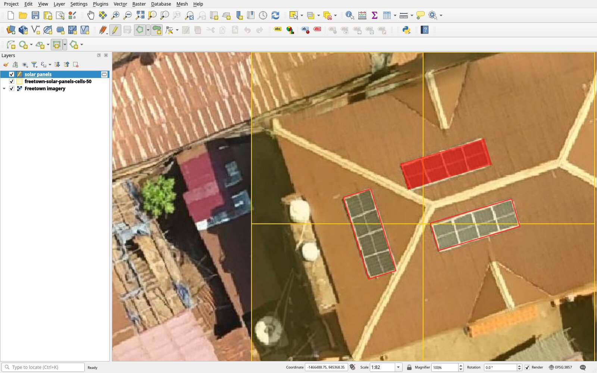
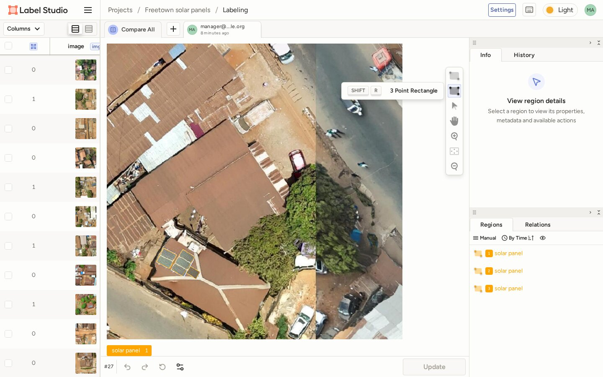
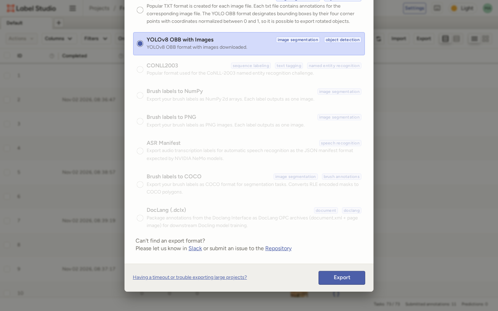
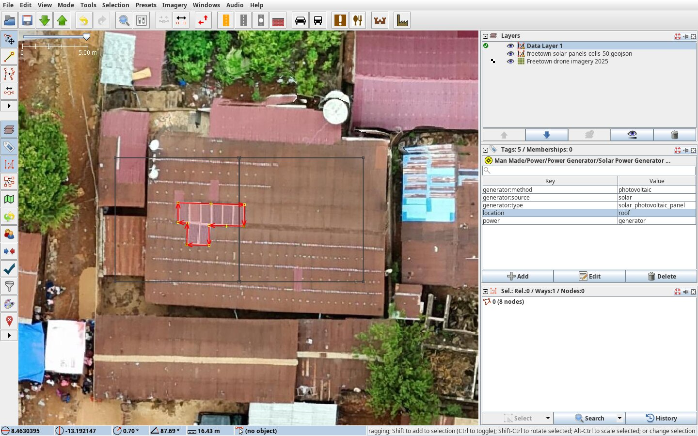
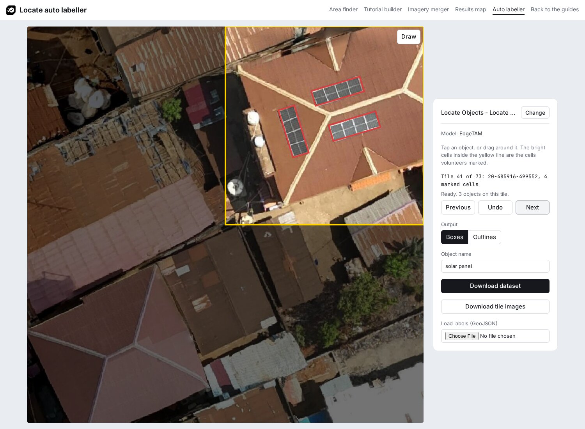

# Create a training dataset

The results show which cells of each tile hold the object. A model learns from a label around each object, so this page turns the marked tiles into a training dataset: tile images and one label per object.

Every method below ends in the same layout, which [Ultralytics](https://docs.ultralytics.com/datasets/obb/) trains on directly:

| File | Content |
|---|---|
| `images/<tile_id>.jpg` | One 1024 by 1024 pixel image per tile, two zoom levels deeper than the project zoom |
| `labels/<tile_id>.txt` | One line per object: class `0`, then the four corners of its box as shares of the image side ([YOLO OBB format](https://docs.ultralytics.com/datasets/obb/)) |
| `data.yaml` | The image folders and the object name |

The auto labeller also writes `labels.geojson` (every label in longitude and latitude) and a `README.md` with the QGIS steps. The steps below use the [Freetown example](../examples/freetown-solar-panels.md) at a 50% volunteer share.

## Choose a method

| Method | Labels come from | Needs |
|---|---|---|
| [Auto labeller](#auto-labeller) | EdgeTAM, from a tap or a drag on each object | A browser |
| [QGIS](#draw-in-qgis) | Rectangles you draw over the imagery | QGIS |
| [Label Studio](#label-studio) | Boxes you draw on the tile images | Python and Label Studio |
| [OpenStreetMap](#openstreetmap) | Objects other mappers traced in OpenStreetMap | A terminal with `curl` |
| [JOSM](#map-in-josm) | Areas you trace in JOSM, kept on your computer | JOSM |

QGIS, OpenStreetMap and JOSM labels end as a GeoJSON file, which the auto labeller turns into the dataset with **Load labels (GeoJSON)**. The methods can be combined: load labels from a file, then add the missing objects with a tap. After labelling with any method, [check the dataset](#check-the-dataset).

## Auto labeller

### 1. Load the project

Open the [auto labeller](../builder/boxes.html), paste the project link, set the **Volunteer share**, for example 50, and click **Load**. **Try the Freetown example** loads the example project.

### 2. Label each tile

On each tile, tap the middle of each group of touching objects, or drag a box close around it. Move between tiles with **Previous** and **Next**.

When a result is wrong, press **Undo** and drag closer, or draw the box yourself with **Draw**.

### 3. Download the dataset

Keep **Boxes** as the **Output**, set the **Object name**, for example `solar panel`, and click **Download dataset**. The [helpers page](../helpers/index.md#auto-labeller) describes each control and what the download holds.

## Draw in QGIS

Start from the map in [Use the results in QGIS](qgis.md), with the imagery and the marked cells. The steps follow the QGIS manual on [creating layers](https://docs.qgis.org/latest/en/docs/user_manual/managing_data_source/create_layers.html) and [editing](https://docs.qgis.org/latest/en/docs/user_manual/working_with_vector/editing_geometry_attributes.html); they were checked in QGIS 4.2.

### 1. Create a layer

Open **Layer > Create Layer > New Temporary Scratch Layer…**. Enter the **Layer name** `solar panels`, set **Geometry type** to **Polygon** and the CRS to **EPSG:4326 - WGS 84**, and click **OK**. Fields are optional; the layer needs only its shapes.

The new layer opens ready for editing. If the pencil next to it is off, turn it on with **Layer > Toggle Editing**.

### 2. Choose the rectangle tool

Show the shape tools with **View > Toolbars > Shape Digitizing Toolbar**. Click **Add Polygon Feature**, and in the drawing method list next to it choose **Digitize Shape**. In the rectangle list, choose **Rectangle from 3 points (projected)**.

### 3. Draw a rectangle around each object

For each array of touching panels, left-click two corners along one long edge, then right-click on the opposite edge. The manual describes the tool as drawing an oriented rectangle where "the length of the second edge is computed from the projection of the third point on the first edge."



### 4. Save the layer as GeoJSON

Save with **Layer > Save Layer Edits**. Then right-click the layer and choose **Make Permanent…**. Set **Format** to **GeoJSON**, enter a file name ending in `.geojson`, and click **OK**. The dialog keeps the layer's CRS, which is why step 1 sets EPSG:4326.

### 5. Load the file in the auto labeller

In the auto labeller, load the project, click **Load labels (GeoJSON)** and pick the file. Check each tile, then click **Download dataset**.

## Label Studio

[Label Studio](https://labelstud.io/) runs on your computer and opens in the browser. These steps were checked with Label Studio 1.23.2.

### 1. Download the tile images

In the auto labeller, load the project and click **Download tile images**. The `.zip` file holds every marked tile as `images/<tile_id>.jpg`. Unzip it.

### 2. Install and start Label Studio

Install and start Label Studio, as in its [install guide](https://labelstud.io/guide/install):

```bash
pip install label-studio
label-studio start
```

The page opens at <http://localhost:8080>. Sign up with an email and a password; the account stays on your computer.

### 3. Create a project

Click **Create Project** and enter a **Project Name**. Under **Data Import**, click **Upload Files** and select the tile images.

Label Studio adds 8 characters and a hyphen to the start of each uploaded file name, for example `01653539-20-485854-499537.jpg`. The part after the first hyphen is the tile ID.

### 4. Set up the labels

Under **Labeling Setup**, choose any template, switch to **Code**, replace the text with this setup and click **Save**:

```xml
<View>
  <Image name="image" value="$image" zoom="true" zoomControl="true"/>
  <Labels name="label" toName="image">
    <Label value="solar panel"/>
  </Labels>
  <Rectangle name="box" toName="image" canRotate="true"/>
</View>
```

The setup uses `<Rectangle>` with a separate `<Labels>` list because the rotated box tool needs it: "The three-point click action is only available when using the `<Rectangle>` tag. It is not available for `<RectangleLabels>`" ([source](https://labelstud.io/templates/image_bbox)).

### 5. Draw the boxes

Open a tile from the list. Click the **solar panel** label under the image, choose **3 Point Rectangle** in the toolbar (++shift+r++), click two corners along the long edge of an array, then click its opposite edge. Repeat for each array, then click **Submit**.



### 6. Export the dataset

When every tile is done, click **Export**, choose **YOLOv8 OBB with Images** and click **Export**.



### 7. Add data.yaml

Unzip the export. It holds `images/`, `labels/`, `classes.txt` and `notes.json`, for the tiles with a submitted annotation. Add a file named `data.yaml` next to `images/` and `labels/`:

```yaml
train: images
val: images
names:
  0: solar panel
```

## OpenStreetMap

Rooftop solar panels in OpenStreetMap carry `power=generator`, `generator:source=solar`, `generator:method=photovoltaic`, `generator:type=solar_photovoltaic_panel` and `location=roof` ([OSM wiki](https://wiki.openstreetmap.org/wiki/Tag:generator:source%3Dsolar)). Mapped as areas, they can be used as labels.

### 1. Download the objects with Postpass

[Postpass](https://wiki.openstreetmap.org/wiki/Postpass) answers SQL queries on OpenStreetMap data with GeoJSON. This command saves the solar panels inside the Freetown area of interest:

```bash
curl https://postpass.geofabrik.de/api/interpreter --data-urlencode "data=
  SELECT osm_id, osm_type, tags, geom
  FROM postpass_pointpolygon
  WHERE tags->>'generator:source'='solar'
  AND geom && ST_SetSRID(ST_MakeBox2D(ST_MakePoint(-13.197283,8.454954), ST_MakePoint(-13.171633,8.467287)), 4326)
" -o solar-panels.geojson
```

For another project, change the tag and the four numbers: the west and south edges of the area of interest, then the east and north edges. QGIS shows them under **Layer Properties > Information > Extent**.

### 2. Load the file in the auto labeller

In the auto labeller, load the project, click **Load labels (GeoJSON)** and pick `solar-panels.geojson`. In November 2026 the command returned 90 solar panel areas for Freetown; loaded into the auto labeller, they give 85 labels on 47 marked tiles.

### 3. Add the missing objects

OpenStreetMap holds only what mappers have traced, and each tile needs a label on every object it shows (see [Check the dataset](#check-the-dataset)). Go through the tiles, add the panels that are missing with a tap, then click **Download dataset**.

## Map in JOSM

[LearnOSM](https://learnosm.org/en/beginner/) teaches editing in [iD](https://learnosm.org/en/beginner/id-editor/) and [JOSM](https://learnosm.org/en/josm/start-josm/). The steps below cover what this workflow adds, in JOSM, which saves a layer as a file on your computer.

### 1. Add the project imagery

Open **Imagery > Imagery preferences…**, click **+TMS**, paste the tile URL with `{zoom}` in place of `{z}`, set the maximum zoom to 22 and enter a name ([LearnOSM: adding imagery](https://learnosm.org/en/josm/josm-adding-imagery/)). Then choose the new entry at the bottom of the **Imagery** menu.

### 2. Open the marked cells

Open the file saved with **Download cells** in [Use the results in QGIS](qgis.md) with **File > Open…** to see where to map.

### 3. Create a local layer

Create a layer with **File > New Local Layer**. JOSM describes it as a layer "for local data which should not be uploaded" ([JOSM wiki](https://josm.openstreetmap.de/wiki/Help/Action/NewLocalLayer)).

### 4. Trace and tag each object

Draw an area tight around each array and add the five tags from [OpenStreetMap](#openstreetmap).



### 5. Save the layer as GeoJSON

Save with **File > Save As…**, set **Files of type** to **GeoJSON Files**, and click **Save** ([JOSM wiki](https://josm.openstreetmap.de/wiki/Help/Action/SaveAs)).

### 6. Load the file in the auto labeller

Load the file into the auto labeller with **Load labels (GeoJSON)**, check each tile, then click **Download dataset**.

Uploading new objects to OpenStreetMap is a separate decision that follows the OpenStreetMap editing rules; this workflow keeps the layer on your computer.

## How the auto labeller loads a GeoJSON file

**Load labels (GeoJSON)** reads every polygon in the file, in longitude and latitude (EPSG:4326), and cuts it to each marked tile it crosses, so an array across two tiles becomes one label on each. A shape, or the part of it on a tile, is kept when it holds at least a tenth of the whole shape, the default of `min_area_ratio` in the [SAHI](https://github.com/obss/sahi/blob/main/sahi/slicing.py) tiling library, and covers at least 36 square pixels, the area of the smallest box a drag makes. Only the outer ring of each polygon is used, so holes are filled. Features without a polygon are left out, and the status line counts them. A shape that crosses the tile edge twice, such as a U, becomes one box over both arms in **Boxes**. Loaded labels show on the tiles like the model's, and **Undo** removes them one by one. Loading the same file again replaces the labels it loaded before.



## Check the dataset

Before training, check every tile:

- Each object has a label, and each label matches its object. Ultralytics describes annotation accuracy as "how close the annotated data is to the true values" ([source](https://docs.ultralytics.com/guides/data-collection-and-annotation/#understanding-accuracy-and-precision)).
- The same rule applies on every tile. Ultralytics describes annotation precision as "giving the same label to the same object or feature throughout the dataset" ([source](https://docs.ultralytics.com/guides/data-collection-and-annotation/#understanding-accuracy-and-precision)). For solar panels: one box per array of touching panels, a separate box where a clear gap splits two arrays, and a skipped tile where the object cannot be told apart from the roof.
- In the auto labeller and the QGIS map, step through the tiles one by one. The `README.md` in the auto labeller download shows how to open `labels.geojson` over the imagery in QGIS.

`data.yaml` uses all images for both training and validation. Before a real training run, move some images and their labels into separate validation folders and point `val` at them.

Each method was checked by training a small YOLO26 model (`yolo26n-obb`) on its Freetown dataset; Ultralytics read every image and label without errors. The Freetown datasets hold 6 to 47 images. Ultralytics recommends "at least 1,500 images and 10,000 labeled instances per class" for reliable real-world performance ([source](https://docs.ultralytics.com/guides/data-collection-and-annotation/#how-many-images-do-i-need-for-training-ultralytics-yolo-models)), so a dataset for real training covers more projects or a larger area.
