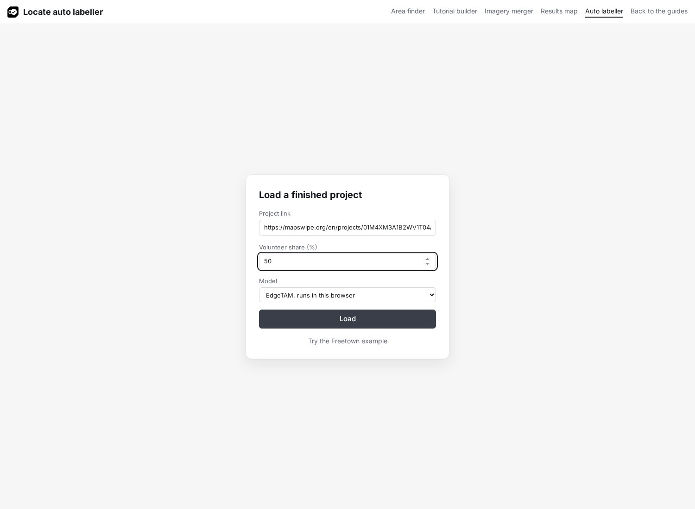
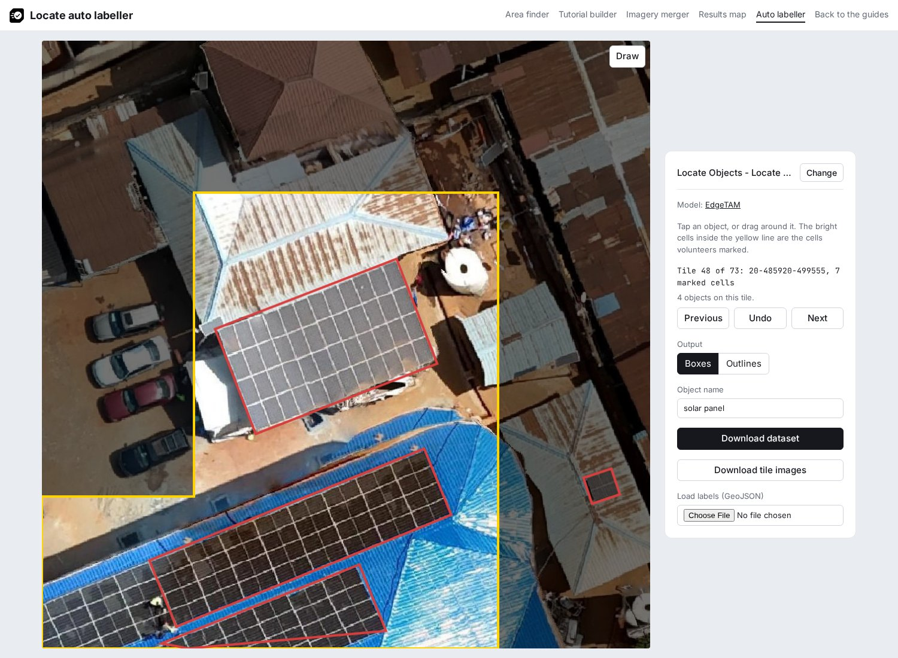
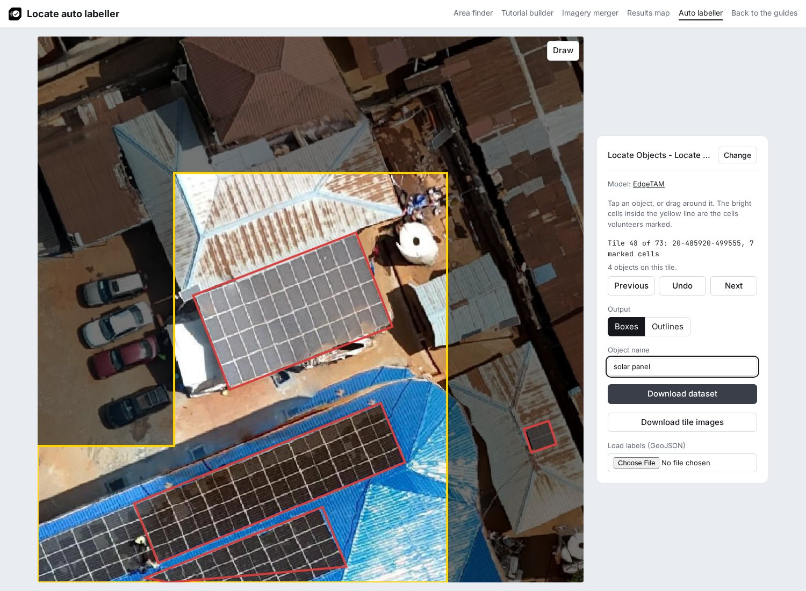

# Label with the auto labeller

The [auto labeller](../../builder/boxes.html) runs EdgeTAM in the browser and draws a box from a tap or a drag on each object. The [helpers page](../../helpers/index.md#auto-labeller) describes each control.

## 1. Load the project

Paste the project link, set the **Volunteer share (%)**, for example 50, and click **Load**. **Try the Freetown example** loads the example project.

## 2. Label each tile

Tap the middle of each group of touching objects, or drag a box close around it. When a result is wrong, press **Undo** and drag closer, or draw the box yourself with **Draw**. Move between tiles with **Previous** and **Next**.

## 3. Download the dataset

Keep **Boxes** as the **Output**, set the **Object name**, for example `solar panel`, and click **Download dataset**. Then [check the dataset](index.md#check-the-dataset).

