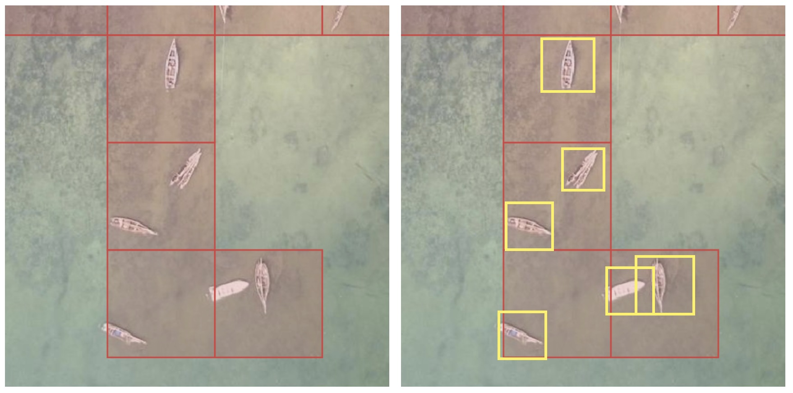

# Create a training dataset

The results show which cells of each tile hold the object. A model learns from a label around each object, so this section turns the marked tiles into a training dataset: tile images and one label per object.

## From marked cells to labels

- Red: the cells volunteers marked in MapSwipe. They show roughly where the objects are, one cell at a time.
- Yellow: the labels you make, one box around each object, which may extend past the red cells. Every object gets its own box, including two objects in the same cell.

The picture boxes the fully visible boats. Boats cut off at the tile edge, like the two in the top row, still need a label, as [Check the dataset](#check-the-dataset) explains.

Each method below turns the red cells into the yellow boxes. [What to deliver](../what-to-deliver.md) lists what the final file needs.

For the delivery, only `labels.geojson` is sent ([What to deliver](../what-to-deliver.md)). For training, every method ends in the same layout, which [Ultralytics](https://docs.ultralytics.com/datasets/obb/) trains on directly. The tools write these files:

| File | Content |
|---|---|
| `images/<tile_id>.jpg` | One 1024 by 1024 pixel image per labelled tile, two zoom levels deeper than the project zoom |
| `labels/<tile_id>.txt` | One line per object: its class (`0`, or one class per attribute value), then the four corners of its box as shares of the image side ([YOLO OBB format](https://docs.ultralytics.com/datasets/obb/)) |
| `data.yaml` | The image folders and the class names |

The auto labeller also writes `labels.geojson` (every label in longitude and latitude) and a `README.md` with the QGIS steps. The steps use the [Freetown example](../../examples/freetown-solar-panels.md) at a 50% volunteer share: a cell counts as marked when at least half the volunteers who saw it marked it.

## Choose a method

| Method | Labels come from | Needs |
|---|---|---|
| [Auto labeller](auto-labeller.md) | EdgeTAM, from a tap or a drag on each object | A browser |
| [QGIS](qgis.md) | Rectangles you draw over the imagery | QGIS |
| [Label Studio](label-studio.md) | Boxes you draw on the tile images, to check a dataset; it doesn't write `labels.geojson` | Python and Label Studio |
| [OpenStreetMap](openstreetmap.md) | Areas you trace in iD over the project imagery and upload | An OpenStreetMap account |

QGIS and OpenStreetMap labels end as a GeoJSON file, which the auto labeller turns into the dataset with **Load labels (GeoJSON)**. The methods can be combined: load labels from a file, then add the missing objects with a tap.

## How the auto labeller loads a GeoJSON file

In short, each shape in the file becomes a label on every marked tile it covers.

??? note "How shapes are cut to tiles"
    **Load labels (GeoJSON)** reads every polygon in the file, in longitude and latitude (EPSG:4326), and cuts it to each marked tile it crosses, so an array across two tiles becomes one label on each. A shape, or the part of it on a tile, is kept when it holds at least a tenth of the whole shape, the default of `min_area_ratio` in the [SAHI](https://github.com/obss/sahi/blob/main/sahi/slicing.py) tiling library, and covers at least 36 square pixels, the area of the smallest box a drag makes. Only the outer ring of each polygon is used, so holes are filled. Features without a polygon are left out, and the status line counts them. A shape that crosses the tile edge twice, such as a U, becomes one box over both arms in **Boxes**. Loaded labels show on the tiles like the model's, and **Undo** removes them one by one. Loading the same file again replaces the labels it loaded before.

## Check the dataset

Before training, check every tile:

- Every object on a tile has a label. Ultralytics notes that "All instances of all classes in all images must be labeled. Partial labeling will not work" ([source](https://docs.ultralytics.com/yolov5/tutorials/tips_for_best_training_results/)).
- Each label matches its object. Ultralytics describes annotation accuracy as "how close the annotated data is to the true values" ([source](https://docs.ultralytics.com/guides/data-collection-and-annotation/#understanding-accuracy-and-precision)).
- The same rule applies on every tile. Ultralytics describes annotation precision as "giving the same label to the same object or feature throughout the dataset" ([source](https://docs.ultralytics.com/guides/data-collection-and-annotation/#understanding-accuracy-and-precision)). For solar panels: one box per array of touching panels, a separate box where a clear gap splits two arrays, and a tile left without labels (press **Next**) where the object cannot be told apart from the roof.

Step through the tiles one by one in the auto labeller. Above the **Previous** and **Next** buttons, the bold line shows how many objects are labelled so far, and the bar under it fills toward a target of 1,000 objects and turns green at 1,000. A dataset with several types needs 1,000 of the most common type, and the other types still get a label wherever they appear. With values set, the bold line shows one count per value and the bar turns green when one value reaches 1,000 (see [What to deliver](../what-to-deliver.md#number-of-labels)). The tile line below shows how many tiles have labels. The `README.md` in its download shows how to open `labels.geojson` over the imagery in QGIS.

`data.yaml` uses all images for both training and validation. Before a real training run, move some images and their labels into separate validation folders and point `val` at them. The delivery doesn't need this step.

Freetown datasets from the auto labeller, QGIS, Label Studio and the solar areas already in OpenStreetMap were checked by training a small YOLO26 model (`yolo26n-obb`) on each; Ultralytics read every image and label without errors. They hold 10 to 47 images. Ultralytics recommends "at least 1,500 images and 10,000 labeled instances per class" for reliable real-world performance ([source](https://docs.ultralytics.com/guides/data-collection-and-annotation/#how-many-images-do-i-need-for-training-ultralytics-yolo-models)), so a dataset for real training covers more projects or a larger area.
