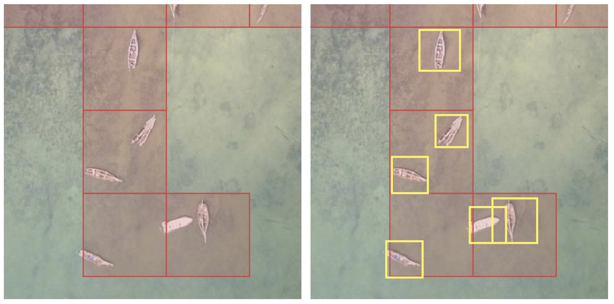

# Create a training dataset

The results show which cells of each tile hold the object. A model learns from a label around each object, so this section turns the marked tiles into one label per object.

## From marked cells to labels

- Red: the cells volunteers marked in MapSwipe. They show roughly where the objects are, one cell at a time.
- Yellow: the labels you make, one box around each object, which may extend past the red cells. Every object gets its own box, including two objects in the same cell.

The picture boxes the fully visible boats. Boats cut off at the tile edge, like the two in the top row, still need a label, as [Check the dataset](#check-the-dataset) explains.

Each method below turns the red cells into the yellow boxes and ends in `labels.geojson`, the file you deliver ([What to deliver](../what-to-deliver.md)). The auto labeller also writes `tiles.geojson`, with each tile's image URL ([What the downloads hold](../../helpers/index.md#auto-labeller)). To train a model, fetch each tile's image from that URL and turn the labels into the format the model needs.

## Choose a method

The steps use the [Freetown example](../../examples/freetown-solar-panels.md) at a 50% volunteer share: a cell counts as marked when at least half the volunteers who saw it marked it.

| Method | Labels come from | Needs |
|---|---|---|
| [Auto labeller](auto-labeller.md) | EdgeTAM, from a tap or a drag on each object | A browser |
| [QGIS](qgis.md) | Rectangles you draw over the imagery | QGIS |
| [OpenStreetMap](openstreetmap.md) | Areas you trace in iD over the project imagery and upload | An OpenStreetMap account |

QGIS and OpenStreetMap labels end as a GeoJSON file. Load it in the auto labeller with **Load labels (GeoJSON)** and check it tile by tile. The methods can be combined: load labels from a file, then add the missing objects with a tap.

## How the auto labeller loads a GeoJSON file

Each shape in the file becomes a label on every listed tile it covers. A `labels.geojson` from the auto labeller, at the project's zoom, puts each label only on the tile named in its `tile_id` ([Come back later](auto-labeller.md#come-back-later)).

??? note "How shapes are cut to tiles"
    **Load labels (GeoJSON)** reads every polygon in the file, in longitude and latitude (EPSG:4326), and cuts it to each listed tile it crosses, so an array across two tiles becomes one label on each. A shape, or the part of it on a tile, is kept when it holds at least a tenth of the whole shape, the default of `min_area_ratio` in the [SAHI](https://github.com/obss/sahi/blob/main/sahi/slicing.py) tiling library, and covers at least 36 square pixels, the area of the smallest box a drag makes. Only the outer ring of each polygon is used, so holes are filled. Features without a polygon are left out, and the status line counts them. A shape that crosses the tile edge twice, such as a U, becomes one box over both arms in **Boxes**. Loaded labels show on the tiles like the model's, and **Undo** removes them one by one. Loading the same file again replaces the labels it loaded before.

## Check the dataset

Before training, check every tile:

- Every object on a tile has a label. Ultralytics notes that "All instances of all classes in all images must be labeled. Partial labeling will not work" ([source](https://docs.ultralytics.com/yolov5/tutorials/tips_for_best_training_results/)).
- Each label matches its object. Ultralytics describes annotation accuracy as "how close the annotated data is to the true values" ([source](https://docs.ultralytics.com/guides/data-collection-and-annotation/#understanding-accuracy-and-precision)).
- The same rule applies on every tile. Ultralytics describes annotation precision as "giving the same label to the same object or feature throughout the dataset" ([source](https://docs.ultralytics.com/guides/data-collection-and-annotation/#understanding-accuracy-and-precision)). For solar panels: one box per array of touching panels, a separate box where a clear gap splits two arrays, and a tile left without labels (press **Next**) where the object cannot be told apart from the roof.

In the auto labeller, above **Previous** and **Next**, the bold line shows how many objects are labelled so far, and the bar under it fills toward 1,000 objects and turns green at 1,000. With several types, the bold line and bar follow the most common type, which needs 1,000 labels ([Objects with types](auto-labeller.md#objects-with-types)); the other types still get a label wherever they appear. The line below, for example **Tile 3 of 40, 5 labelled, 12 viewed**, shows which tile is open, how many tiles have labels and how many you opened; its bar shows how far through the tiles you are.

Ultralytics recommends "at least 1,500 images and 10,000 labeled instances per class" for reliable real-world performance ([source](https://docs.ultralytics.com/guides/data-collection-and-annotation/#how-many-images-do-i-need-for-training-ultralytics-yolo-models)), so a dataset for real training covers more projects or a larger area.
