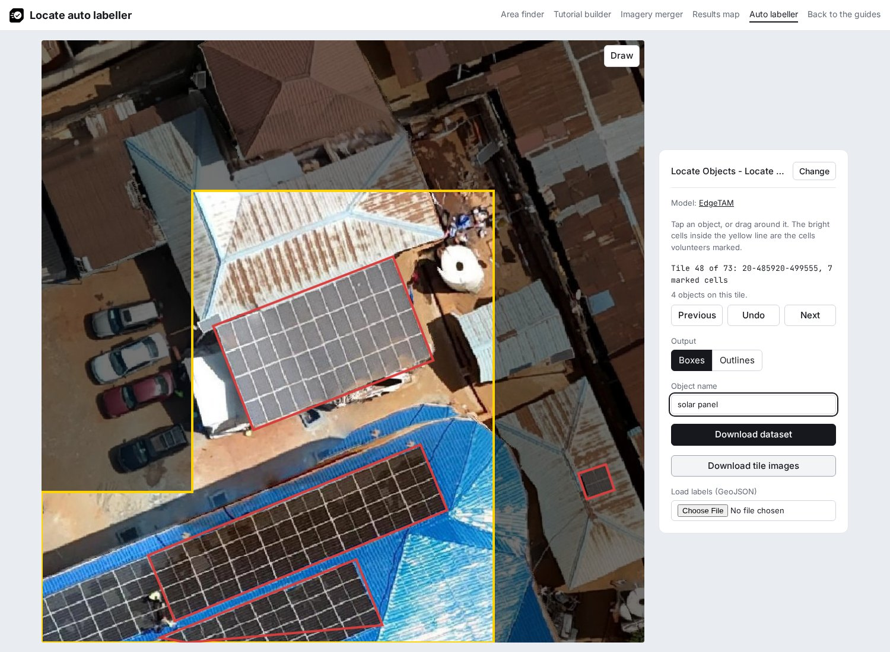
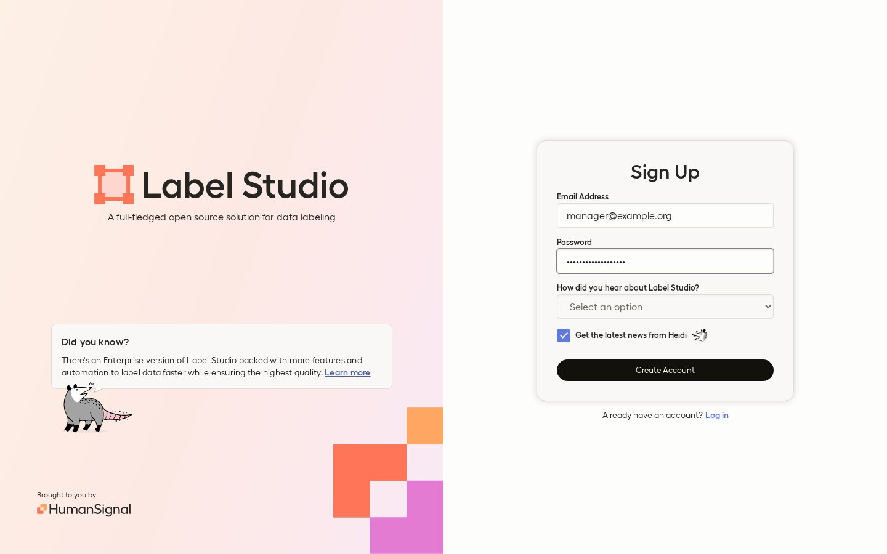
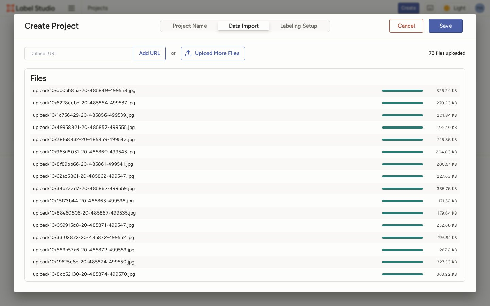
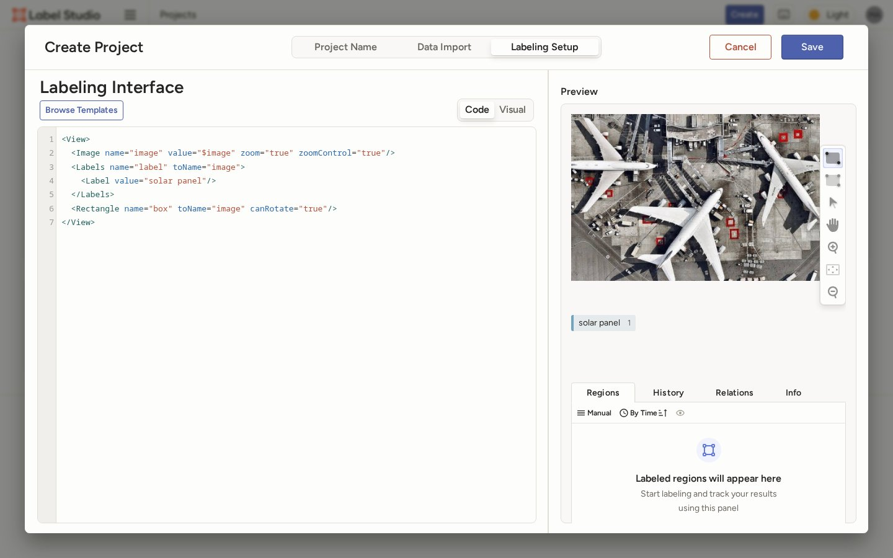
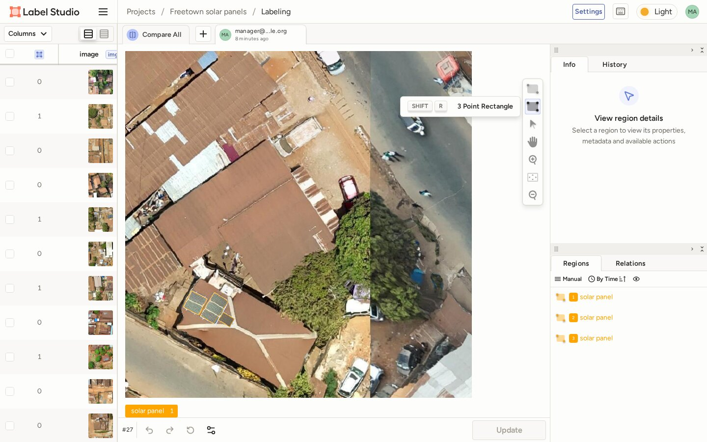
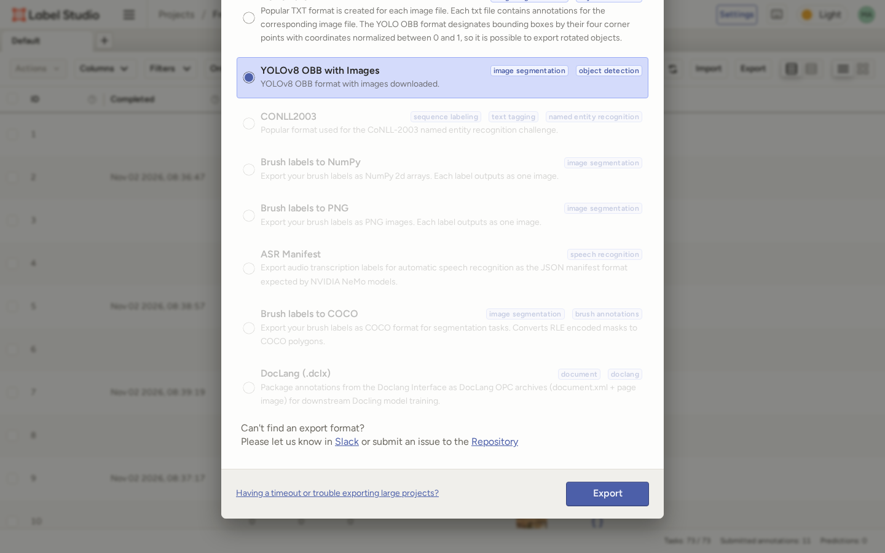

# Label in Label Studio

[Label Studio](https://labelstud.io/) runs on your computer and opens in the browser. The steps were checked with Label Studio 1.23.2.

## 1. Download the tile images

1. In the [auto labeller](../../builder/boxes.html), load the project.
2. Click **Download tile images**.
3. Unzip the file. It holds every marked tile as `images/<tile_id>.jpg`.



## 2. Install and start Label Studio

Install and start it as in its [install guide](https://labelstud.io/guide/install):

```bash
pip install label-studio
label-studio start
```

The page opens at <http://localhost:8080>. Sign up with an email and a password; the account stays on your computer.



## 3. Create a project

1. Click **Create Project** (**Create** once a project exists) and enter a **Project Name**.
2. Under **Data Import**, click **Upload Files** and select the tile images. After the first upload, the button reads **Upload More Files** (observed in Label Studio 1.23.2).

Label Studio adds 8 characters and a hyphen to each file name, for example `01653539-20-485854-499537.jpg`; the part after the first hyphen is the tile ID.



## 4. Set up the labels

1. Under **Labeling Setup**, choose any template and switch to **Code**.
2. Replace the text with this setup and click **Save**:

```xml
<View>
  <Image name="image" value="$image" zoom="true" zoomControl="true"/>
  <Labels name="label" toName="image">
    <Label value="solar panel"/>
  </Labels>
  <Rectangle name="box" toName="image" canRotate="true"/>
</View>
```

The rotated box tool needs `<Rectangle>` with a separate `<Labels>` list: "The three-point click action is only available when using the `<Rectangle>` tag. It is not available for `<RectangleLabels>`" ([source](https://labelstud.io/templates/image_bbox)).



## 5. Draw the boxes

1. Open a tile.
2. Click the **solar panel** label under the image.
3. Choose **3 Point Rectangle** in the toolbar (++shift+r++).
4. Click two corners along the long edge of an array, then click its opposite edge.
5. Repeat for each array, then click **Submit**. On a tile you already submitted, the button reads **Update** (observed in Label Studio 1.23.2).



## 6. Export the dataset

1. When every tile is done, click **Export**.
2. Choose **YOLOv8 OBB with Images** and click **Export**.



## 7. Add data.yaml

Unzip the export. It holds `images/`, `labels/`, `classes.txt` and `notes.json` for the tiles with a submitted annotation. Add a file named `data.yaml` next to `images/` and `labels/`:

```yaml
train: images
val: images
names:
  0: solar panel
```

Then [check the dataset](index.md#check-the-dataset).
