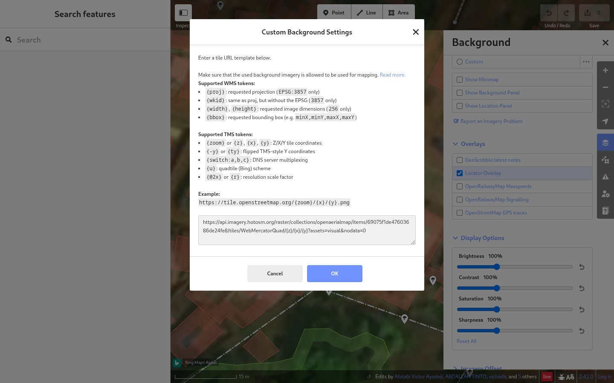
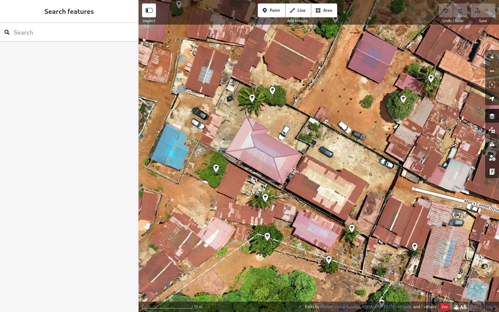
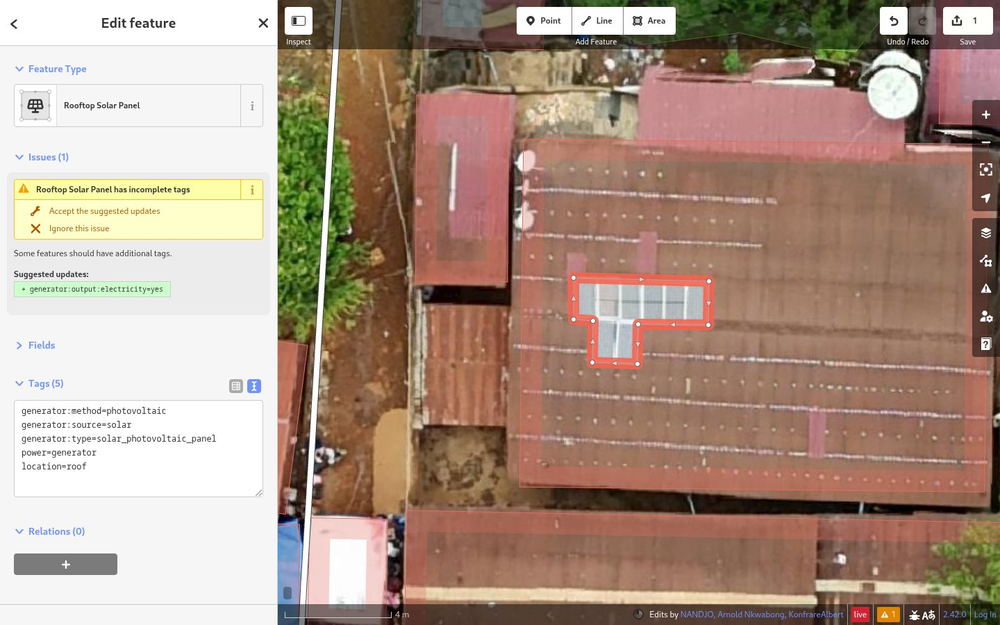
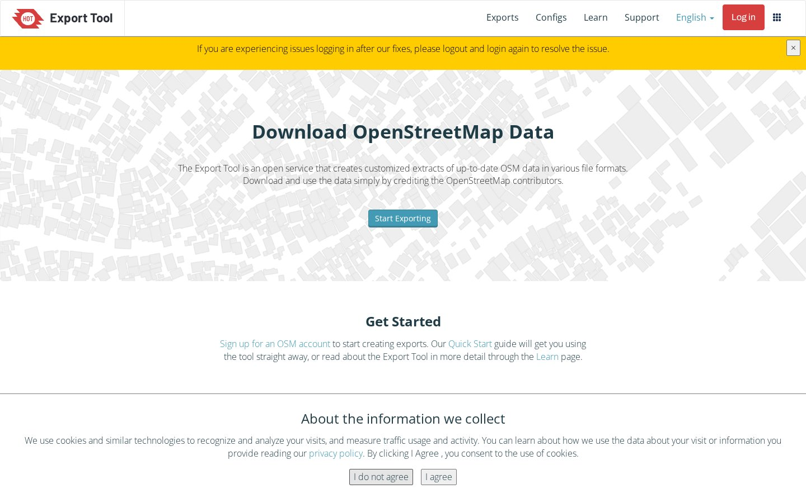
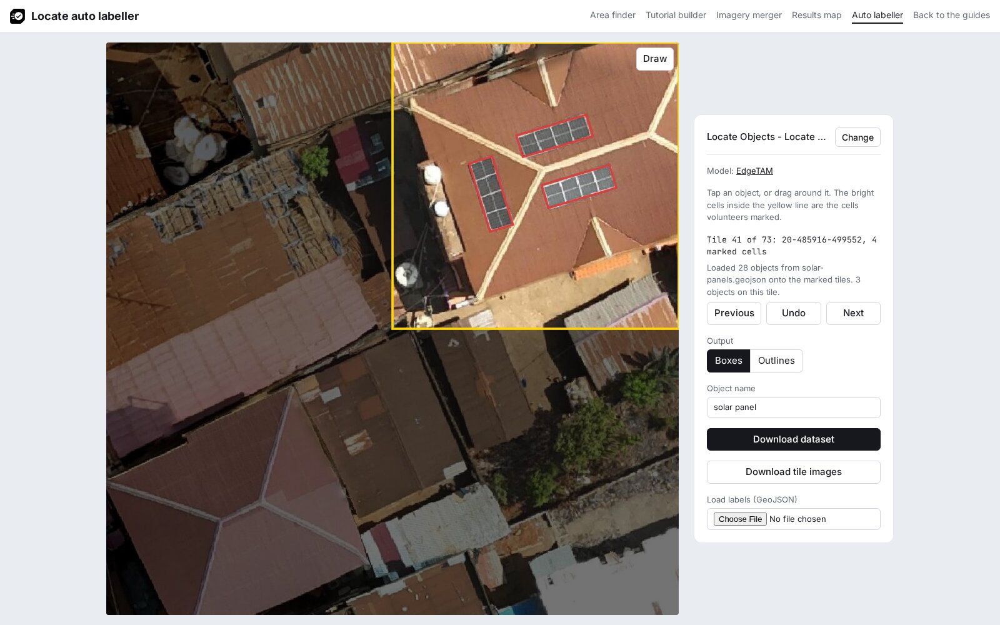

# Label in OpenStreetMap

Trace each object in OpenStreetMap over the project imagery, so every label is checked against the same images the model trains on. Then download the traced areas with the HOT Export Tool. [LearnOSM](https://learnosm.org/en/beginner/id-editor/) teaches editing in iD; the steps below cover what this workflow adds. In [JOSM](https://learnosm.org/en/josm/start-josm/), add the imagery as in [LearnOSM: adding imagery](https://learnosm.org/en/josm/josm-adding-imagery/).

OpenAerialMap states that "All imagery is available to be traced in OpenStreetMap" ([source](https://openaerialmap.org/legal)). For imagery released under a licence with attribution, the OpenStreetMap Foundation publishes [waiver templates](https://osmfoundation.org/wiki/Licence/Waiver_and_Permission_Templates/Template_text_for_aerial_imagery_waivers). Mapping for a project follows the [Organised Editing Guidelines](https://wiki.osmfoundation.org/wiki/Organised_Editing_Guidelines).

## 1. Add the project imagery

Open iD from <https://www.openstreetmap.org/edit> and log in. Open the **Background** panel (++b++), click **…** next to **Custom**, paste the project's tile URL in **Custom Background Settings** and click **OK**. iD accepts `{z}` as it is ([iD source](https://github.com/openstreetmap/iD/blob/develop/data/core.yaml)).



## 2. Find the objects

Drag the file saved with **Download cells** in [Use the results in QGIS](../qgis.md) onto the map. iD shows it under **Map Data** (++u++) > **Custom Map Data**. Zoom to a marked cell. Check that each area already mapped there matches the object in the image.



## 3. Trace and tag each object

Click **Area**, trace tight around each array of touching panels, and choose the **Rooftop Solar Panel** preset. It adds `power=generator`, `generator:source=solar`, `generator:method=photovoltaic`, `generator:type=solar_photovoltaic_panel` and `location=roof`. iD then suggests `generator:output:electricity=yes`; click **Accept the suggested updates** ([preset](https://github.com/openstreetmap/id-tagging-schema/blob/main/data/presets/power/generator/method/photovoltaic/location/roof.json), [OSM wiki](https://wiki.openstreetmap.org/wiki/Tag:generator:source%3Dsolar)).



## 4. Upload

Click **Save** and upload the changes, as in [LearnOSM](https://learnosm.org/en/beginner/id-editor/).

## 5. Download with the HOT Export Tool

Log in to the [HOT Export Tool](https://export.hotosm.org) with your OpenStreetMap account and click **Start Exporting**. The form has four steps ([source](https://github.com/hotosm/osm-export-tool/blob/master/ui/app/components/ExportForm.js)):

1. **Describe**: name the export and set the area of interest.
2. **Formats**: tick **Geojson .geojson**.
3. **Data**: open the **YAML** tab and paste:

    ```yaml
    solar_panels:
      types:
        - polygons
      select:
        - power
        - generator:source
        - location
      where: generator:source = 'solar'
    ```

4. **Summary**: click **Create Export**, then download the `.zip` file when it is ready.

The YAML follows the Export Tool's [YAML guide](https://export.hotosm.org/learn/yaml). The tool updates from OpenStreetMap every minute ([source](https://github.com/hotosm/osm-export-tool)).



## 6. Load the file in the auto labeller

In the [auto labeller](../../builder/boxes.html), load the project. Under **Load labels (GeoJSON)**, click **Choose File** and pick the `.geojson` file from the download. Go through the tiles, add any object that is still missing with a tap, click **Download dataset**, then [check the dataset](index.md#check-the-dataset).


