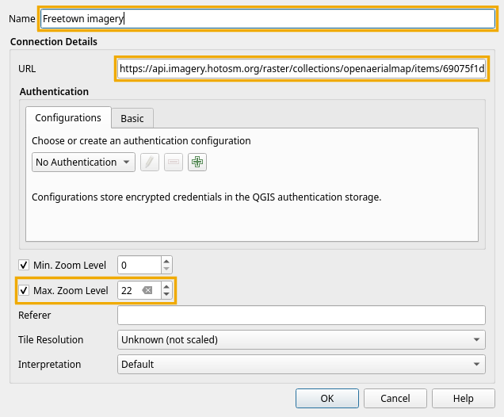
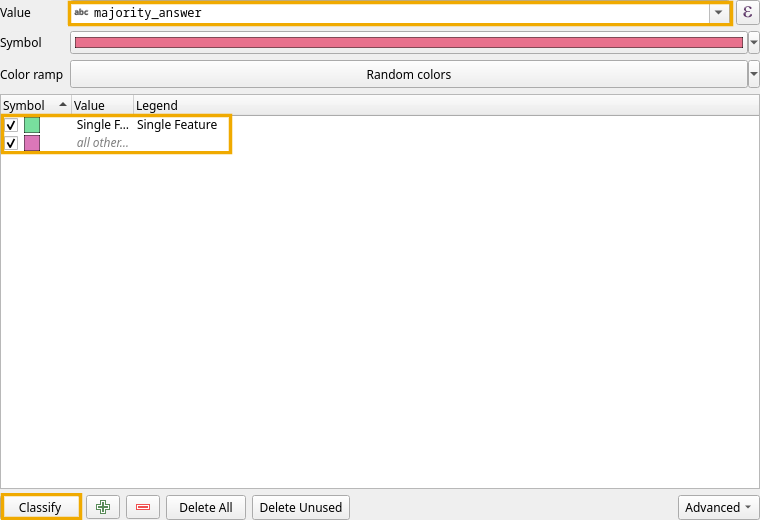
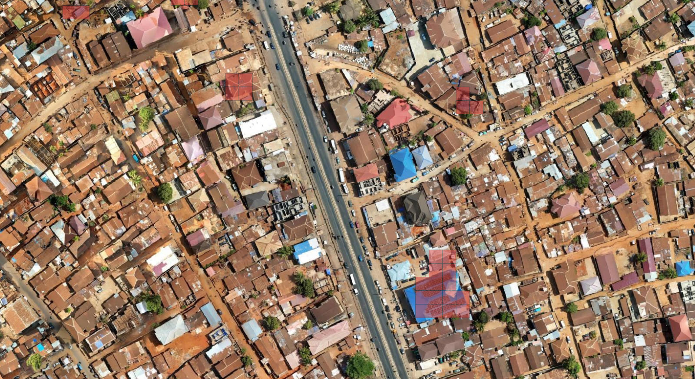
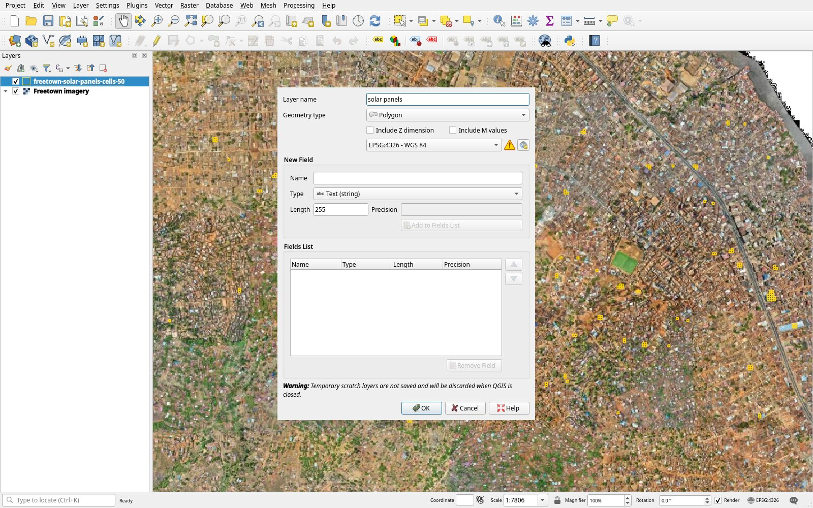
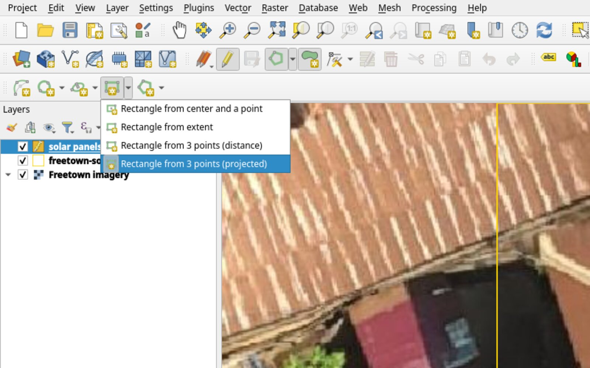
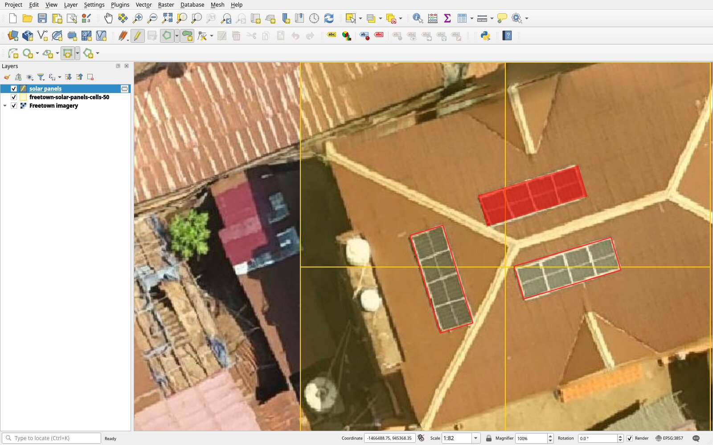
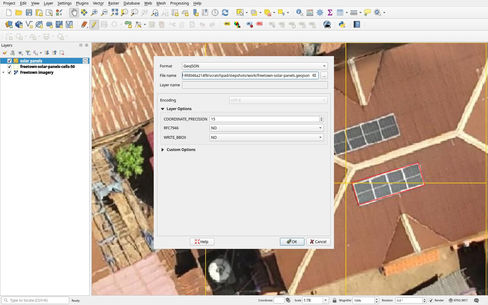
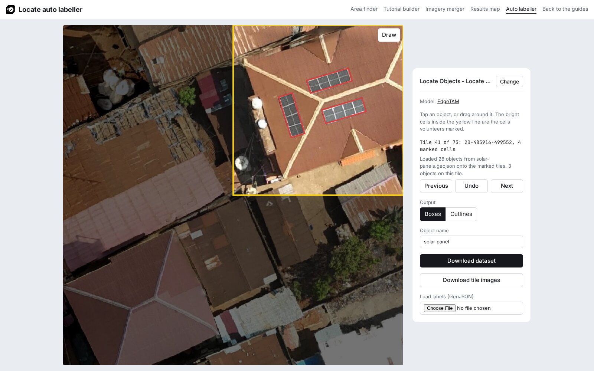

# Label in QGIS

The first steps put the project imagery and the cells volunteers marked on the map; the next ones draw a rectangle around each object. The steps follow the QGIS manual on [creating layers](https://docs.qgis.org/latest/en/docs/user_manual/managing_data_source/create_layers.html) and [editing](https://docs.qgis.org/latest/en/docs/user_manual/working_with_vector/editing_geometry_attributes.html), and were checked in QGIS 4.2.

## 1. Add the imagery

In the **Browser** panel, right-click **XYZ Tiles** and choose **New Connection**. Enter a **Name**, paste the project's tile URL into **URL**, tick **Max. Zoom Level** and set it to 22, and click **OK**. The [Freetown example](../../examples/freetown-solar-panels.md) uses this tile URL:

```text
https://api.imagery.hotosm.org/raster/collections/openaerialmap/items/69075f1de47603686de24fe8/tiles/WebMercatorQuad/{z}/{x}/{y}?assets=visual&nodata=0
```



Expand **XYZ Tiles** and double-click the new connection to add it to the map.

## 2. Add the cells

Drag the file saved with **Download cells** in [View the results](../view-results.md) into QGIS. It is added above the imagery.

## 3. Colour the cells by answer

Double-click the cell layer in the **Layers** panel to open its properties, and open **Symbology** ([QGIS documentation](https://docs.qgis.org/latest/en/docs/user_manual/working_with_vector/vector_properties.html#categorized-renderer)):

1. Change **Single Symbol** at the top to **Categorized**.
2. Set **Value** to `majority_answer`.
3. Click **Classify**. QGIS gives each answer in the file, **Single Feature** and, when the project includes it, **Multiple Features**, a colour chosen at random. It also adds an **all other values** class, which stays unused because every cell has one of these answers.



Under **Layer Rendering** at the bottom of the same tab, set **Opacity** to 50% so the imagery shows through the cells, and click **OK**.



## 4. Create a layer

Open **Layer > Create Layer > New Temporary Scratch Layer…**. Enter the **Layer name** `solar panels`, set **Geometry type** to **Polygon** and the CRS to **EPSG:4326 - WGS 84**, and click **OK**. The layer opens ready for editing; if the pencil next to it is off, turn it on with **Layer > Toggle Editing**.



## 5. Choose the rectangle tool

Show the shape tools with **View > Toolbars > Shape Digitizing Toolbar**. Click **Add Polygon Feature**. In the digitizing method list, which shows **Digitize with Segment** at first, choose **Digitize Shape**. In the rectangle list, choose **Rectangle from 3 points (projected)**.



## 6. Draw a rectangle around each object

For each array of touching panels, left-click two corners along one long edge, then right-click on the opposite edge. The manual describes the tool as drawing an oriented rectangle where "the length of the second edge is computed from the projection of the third point on the first edge."



## 7. Save the layer as GeoJSON

Click **Layer > Save Layer Edits**. Right-click the layer, choose **Make Permanent…**, set **Format** to **GeoJSON**, enter a **File name** ending in `.geojson`, and click **OK**. The file keeps the layer's CRS, EPSG:4326.



## 8. Load the file in the auto labeller

In the [auto labeller](../../builder/boxes.html), load the project. Under **Load labels (GeoJSON)**, click **Choose File** and pick the file. Check each tile, click **Download dataset**, then [check the dataset](index.md#check-the-dataset).


