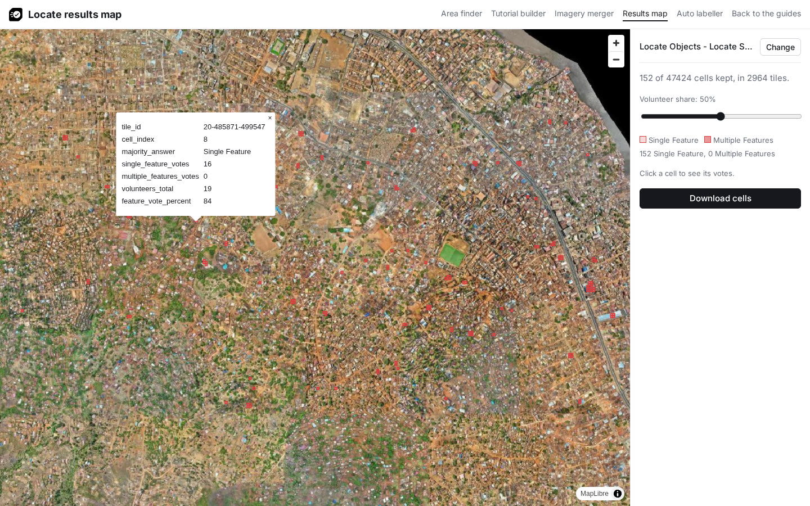

# View the results

The [results map](../builder/results.html) shows the cells volunteers marked over the project imagery, and downloads them as GeoJSON for labelling.

## 1. Load the project

Open the [results map](../builder/results.html). Paste the project link, the address of the project page on the MapSwipe website, `https://mapswipe.org/en/projects/<firebase id>/` (see [Download the results](download-results.md#from-the-mapswipe-website-production)), and click **Load**. For a project not on the website yet, such as a new stage project, paste its **Aggregated Results** link from the [MapSwipe API](download-results.md#from-the-mapswipe-api-stage-and-production). **Try the Freetown example** loads the [example project](../examples/freetown-solar-panels.md).

## 2. Choose the volunteer share

Move the **Volunteer share** slider to the share of volunteers a cell needs, for example 50%. The map keeps the cells where at least that share of volunteers marked the object.

## 3. Check the cells

Click a cell to see its votes. The [helpers page](../helpers/index.md#results-map) explains each value.

## 4. Download the cells

Click **Download cells**. The file has one square per kept cell, with `tile_id`, `cell_index`, `majority_answer`, `single_feature_votes`, `multiple_features_votes`, `volunteers_total` and `feature_vote_percent`.

[Create a training dataset](training-data/index.md) from the marked tiles with the auto labeller, QGIS, Label Studio or OpenStreetMap. [Download the results](download-results.md) describes the project's export files, with every answer of every volunteer.
