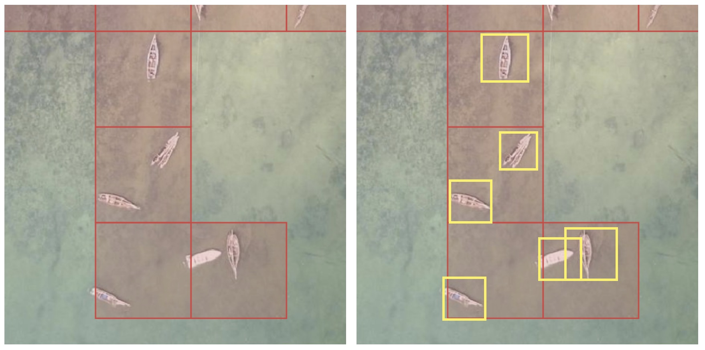
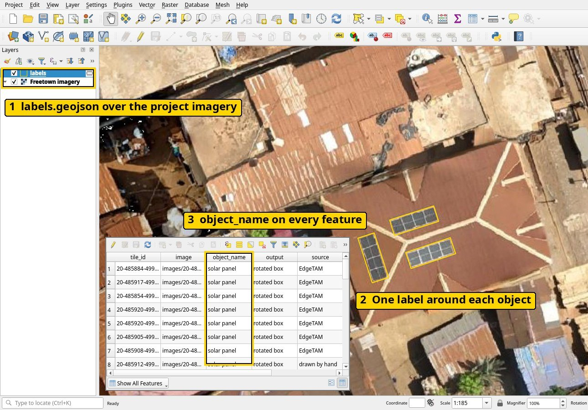
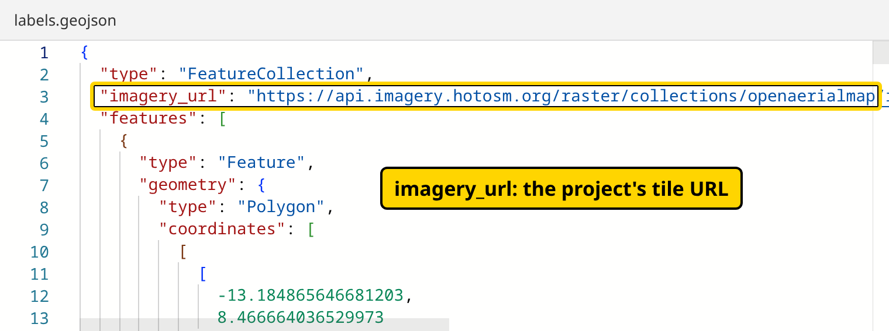
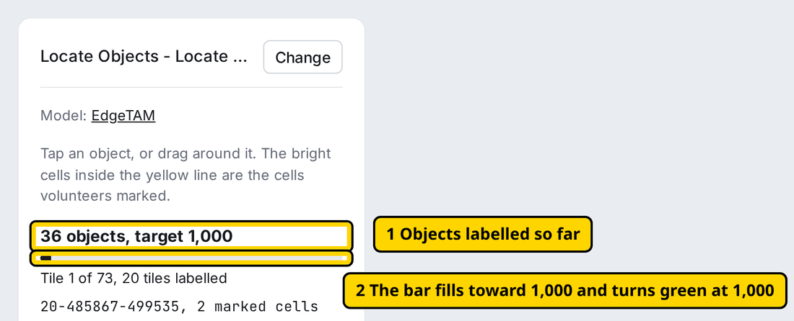
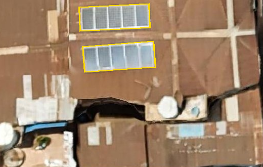
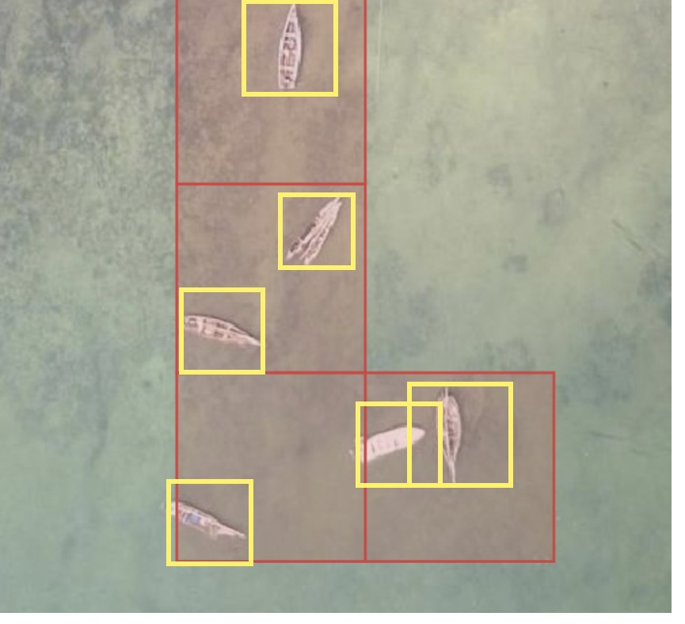
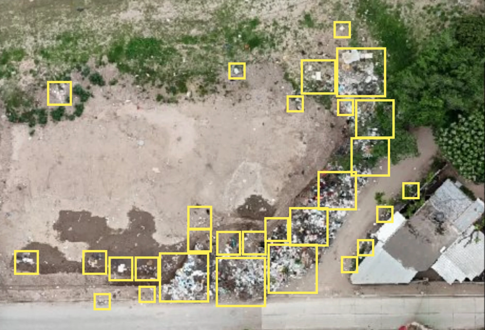
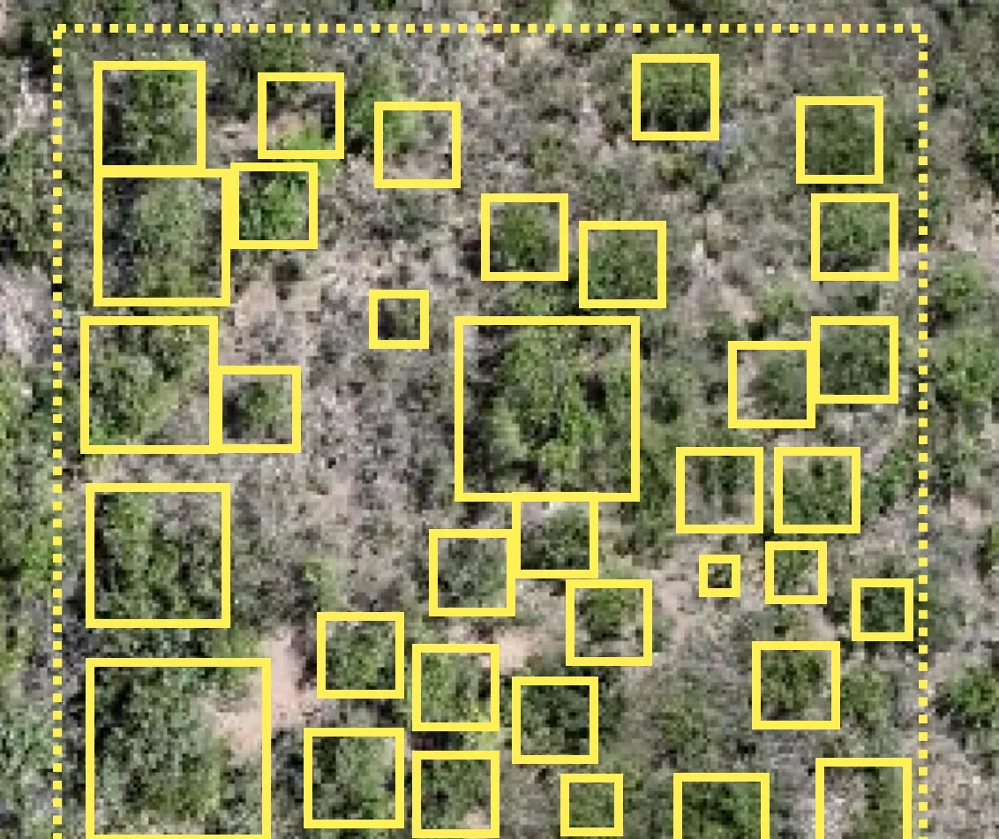
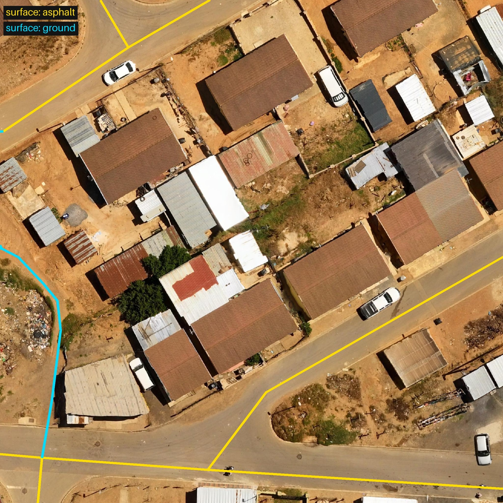
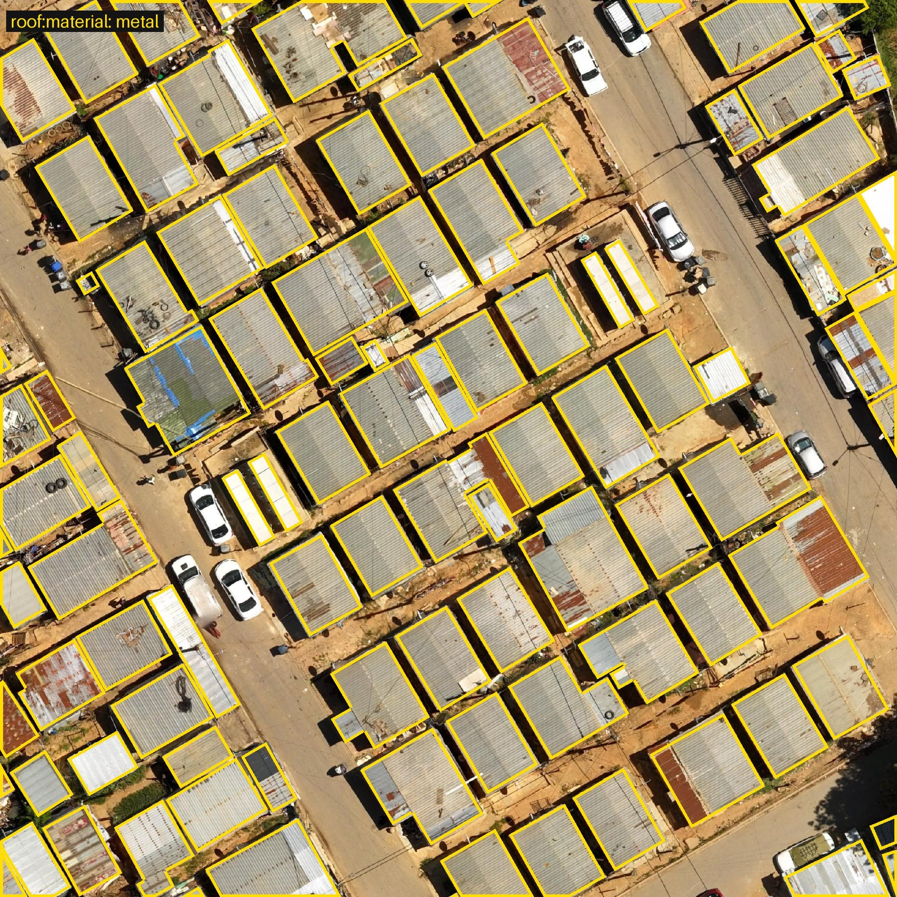

# What to deliver

Deliver one `labels.geojson` per object type, from the auto labeller's `.zip` or the HOT Export Tool, with the `area-of-interest.geojson` of each Locate project. One delivery can cover several Locate projects with one tile URL and one zoom; for several images, use the URL from the [imagery merger](../helpers/index.md#imagery-merger).



Red: the cells volunteers marked. Yellow: the labels you deliver, one per object. The two boats cut off at the top also need a label.

## Submit

- The [fAIrSwipe submission form](https://docs.google.com/forms/d/e/1FAIpQLSdgGwxWYnlRZRlOyjSSVKBjhBqq7SqpGEuT1GT-EyyhSReceg/viewform). It needs a Google account for the uploads ([Google Forms Help](https://support.google.com/docs/answer/7322334)).
- Without a Google account: email the files to [fair@hotosm.org](mailto:fair@hotosm.org) with your name, organisation, grant project name, country, Locate project links, object, zoom, tile URL, imagery source and credit, labels licence, area size, counts per type, labelling method, label shape, which parts lack labels, and how to credit you.

Licence: imagery CC BY 4.0; labels CC BY 4.0, or ODbL when traced in OpenStreetMap ([licence](https://www.openstreetmap.org/copyright)).

## Checklist

Check each line in the [labels checker](../helpers/index.md#labels-checker) and over the imagery in QGIS (see the auto labeller's `README.md`):

1. One labels GeoJSON file per object type, in longitude and latitude, EPSG:4326 ([RFC 7946](https://www.rfc-editor.org/rfc/rfc7946#section-4)).
2. `imagery_url` at the top of the file ([see below](#the-imagery-url-at-the-top)).
3. One feature per object: a box or an outline, or a line for roads and drains.
4. `object_name` on every feature, such as `solar panel`.
5. The type as an attribute when the object has types, such as `natural: tree`, `roof:material: metal`, `damage: partial` or `surface: unpaved`.
6. Every object labelled, also the ones cut off at the tile edge ([Per object or per tile](#per-object-or-per-tile)).
7. At least 1,000 of the most common type, on at least 500 tiles of that type at the project zoom, or for roads and drains 1,000 tiles of one type ([Number of labels](#number-of-labels)).

Extra properties are fine.

In QGIS, the numbers in the picture show where to look:

[](../assets/dataset/deliver-qgis-check.jpg)

1. The labels layer above the project imagery in the **Layers** panel.
2. One label around each object.
3. `object_name` on every feature, in the attribute table (right-click the layer, **Open Attribute Table**).

## The imagery URL at the top

Put the project's tile URL from [step 5 of Create a Locate project](create-a-project.md#5-save-a-cover-image-and-copy-the-tile-url) at the top of the file. GeoJSON allows extra members next to `features` ([RFC 7946, section 6.1](https://www.rfc-editor.org/rfc/rfc7946#section-6.1)). The auto labeller writes it for you.

[](../assets/dataset/deliver-imagery-url.png)

A file from the auto labeller is on one line; most editors can format it (in VS Code, **Format Document** in the Command Palette).

```json
{
  "type": "FeatureCollection",
  "imagery_url": "https://api.imagery.hotosm.org/raster/collections/openaerialmap/items/69075f1de47603686de24fe8/tiles/WebMercatorQuad/{z}/{x}/{y}?assets=visual&nodata=0",
  "features": []
}
```

## Per object or per tile

| Labelled | Each feature is | Covers |
|---|---|---|
| Per tile (auto labeller) | The part of the object on one tile, with its `tile_id` | Every object on each tile that has a label |
| Per object (other tools) | The whole object | Every object in the project area |

## Number of labels

| Labels | Target |
|---|---|
| Boxes and outlines | 1,000 labels of the most common type, on at least 500 tiles at the project zoom |
| Roads and drains (lines) | 1,000 tiles of one type at the project zoom, one training image each |

Below the target, a delivery isn't accepted: cover a larger area. At or above it, HOT still reviews the coverage, and the kilometres of roads and drains. Each tile is one training image, so labels packed on a few tiles give the model few images. For boxes and outlines, the checker marks fewer than 500 tiles **To fix** and 500 to 999 tiles **Warning**; a delivery with a warning is accepted.

Other types can have fewer, but every object still gets a label: one left out teaches the model it isn't there. The [labels checker](../helpers/index.md#labels-checker) gives the labels, kilometres and tiles per type; enter them under **Each type and its count** in the form. Ultralytics recommends "at least 1,500 images and 10,000 labeled instances per class" ([source](https://docs.ultralytics.com/guides/data-collection-and-annotation/#how-many-images-do-i-need-for-training-ultralytics-yolo-models)), so later projects add to each delivery.

[](../assets/dataset/deliver-label-count.png)

## Examples

Each example shows the labels, then one feature with its coordinates shortened.

### Solar panels

One turned box per array of touching panels, from one tap each in the auto labeller.



```json
{
  "type": "Feature",
  "geometry": { "type": "Polygon", "coordinates": [[[-13.1906509, 8.4672741], [-13.1906501, 8.4672579], [-13.1906031, 8.4672601], [-13.1906039, 8.4672764], [-13.1906509, 8.4672741]]] },
  "properties": { "object_name": "solar panel" }
}
```

### Fishing boats

One box per boat. Labelled per tile, each feature names its tile.



```json
{
  "type": "Feature",
  "geometry": { "type": "Polygon", "coordinates": [[[39.8210793, -5.2398882], [39.8210793, -5.2399908], [39.8211479, -5.2399908], [39.8211479, -5.2398882], [39.8210793, -5.2398882]]] },
  "properties": { "object_name": "fishing boat", "tile_id": "20-640275-539571" }
}
```

### Solid waste

One box per pile or single item. A large dump gets several boxes.



```json
{ "object_name": "solid waste" }
```

### Trees

One outline per tree crown, small trees included, with **Outlines** in the auto labeller. The picture shows boxes; the delivery uses outlines. Every tree inside the dotted tile line gets a label.



- Single tree, one crown you can tell apart: `natural: tree` ([wiki](https://wiki.openstreetmap.org/wiki/Tag:natural%3Dtree)).
- Tree group, crowns too close to tell apart: one outline around the group, `natural: tree_group` ([wiki](https://wiki.openstreetmap.org/wiki/Tag:natural%3Dtree_group)).

```json
{
  "object_name": "tree",
  "natural": "tree"
}
```

```json
{
  "object_name": "tree",
  "natural": "tree_group"
}
```

### Roads, with attributes

One line along the centre of each road, with its [highway](https://wiki.openstreetmap.org/wiki/Key:highway) and [surface](https://wiki.openstreetmap.org/wiki/Key:surface) tags, from OpenStreetMap ([Roads and drains](training-data/openstreetmap.md#roads-and-drains)). Drains follow the same steps.



Labels from HOT's [road surface training dataset](https://huggingface.co/datasets/hotosm/fAIr-guru-td-road-surface), © OpenStreetMap contributors (ODbL), on OpenAerialMap imagery (CC-BY 4.0, Open Imagery Network contributors).

```json
{
  "type": "Feature",
  "geometry": { "type": "LineString", "coordinates": [[18.838858, -33.9200017], [18.8388636, -33.9199506]] },
  "properties": { "object_name": "road", "highway": "residential", "surface": "asphalt" }
}
```

### Buildings by roof type, with attributes

For a Locate project about buildings, label every building with one outline along its roof edges and its [roof:material](https://wiki.openstreetmap.org/wiki/Key:roof:material), such as `metal`, `roof_tiles`, `concrete` or `thatch`.



Labels from HOT's [roof type training dataset](https://huggingface.co/datasets/hotosm/fAIr-guru-td-roof-type), © OpenStreetMap contributors (ODbL), on OpenAerialMap imagery (CC-BY 4.0, Open Imagery Network contributors).

```json
{
  "type": "Feature",
  "geometry": { "type": "Polygon", "coordinates": [[[18.8409309, -33.9176639], [18.8408984, -33.9176786], [18.8409269, -33.917722], [18.8409594, -33.9177073], [18.8409309, -33.9176639]]] },
  "properties": { "object_name": "building", "roof:material": "metal" }
}
```

For building damage, use `damage` with `none`, `partial` or `destroyed`:

```json
{ "object_name": "building", "damage": "partial" }
```

Add the value in the auto labeller as you label ([Objects with types](training-data/auto-labeller.md#objects-with-types)), or in QGIS with **New field** in the attribute table ([QGIS manual](https://docs.qgis.org/latest/en/docs/user_manual/working_with_vector/attribute_table.html#introducing-the-attribute-table-interface)).
