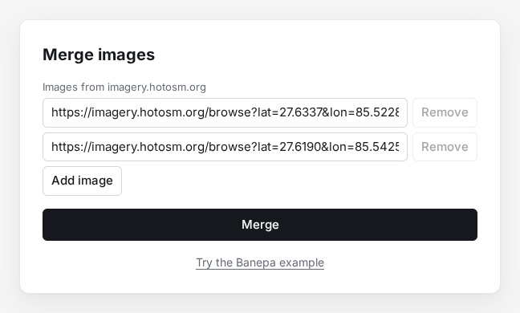
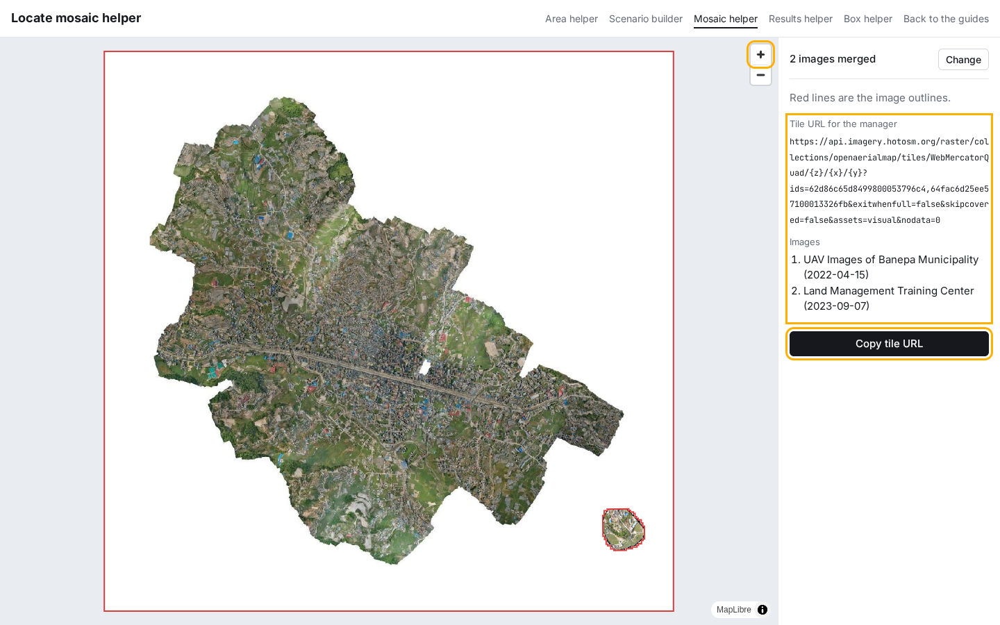
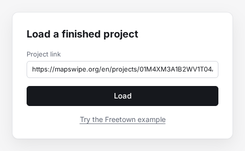
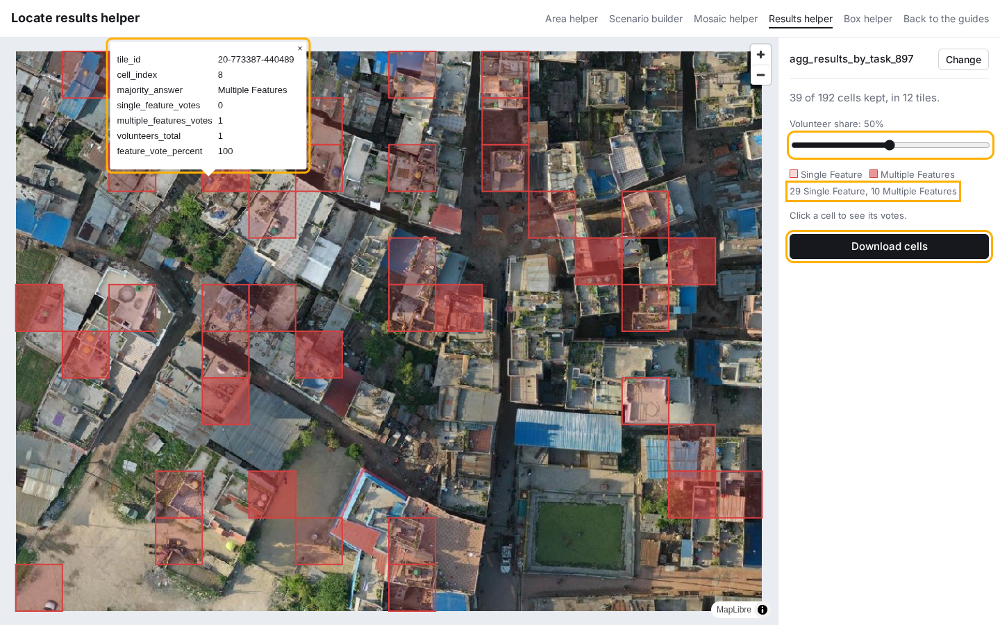
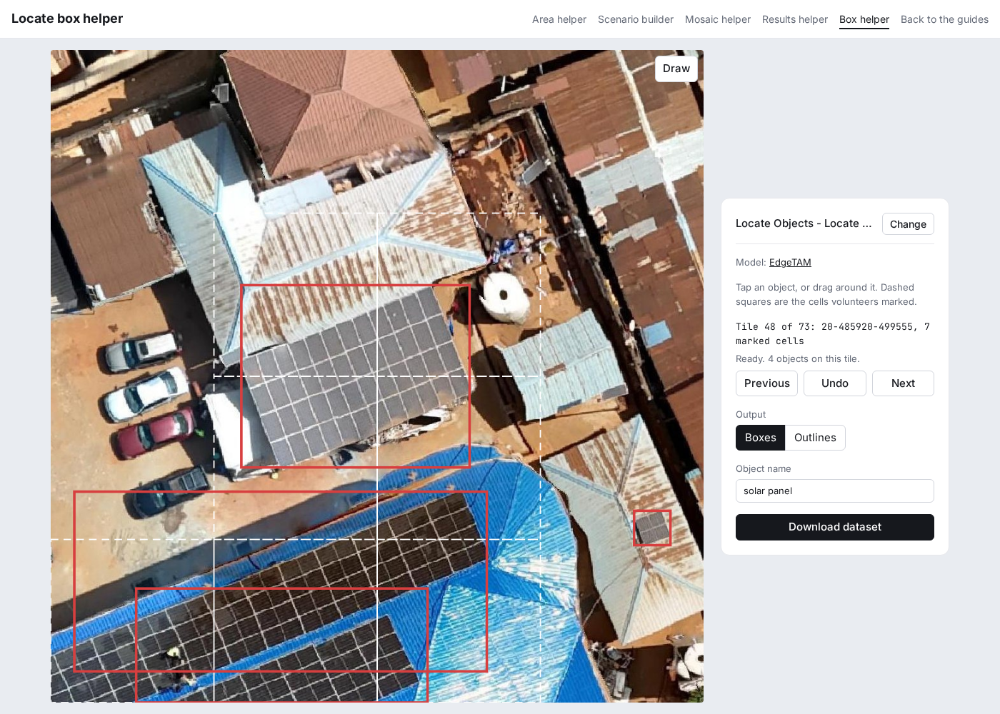
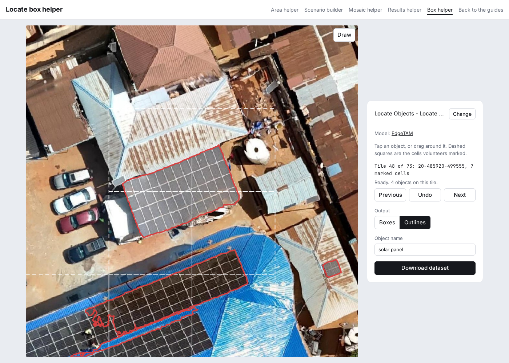

# Helpers

Pages that prepare the files the manager asks for and clean up the results. They run in the browser. Each opens with a short form and a link to try it with sample data; after loading, the form folds into a line at the top of the side panel, and **Change** opens it again.

-   :lucide-crop: **[Area helper](../builder/area.html)**

    Paste an image from imagery.hotosm.org. Get its real footprint, an area of interest cut to the imagery with a tile estimate, the tile URL and a cover image.

-   :lucide-grid-3x3: **[Scenario builder](../builder/index.html)**

    Load the project's processed tasks, click tiles and cells to mark the tutorial answers, and download the scenario file.

-   :lucide-images: **[Mosaic helper](../builder/mosaic.html)**

    Add two or more images from imagery.hotosm.org. Get one tile URL that shows them all, and check it on the map.

-   :lucide-square-check: **[Results helper](../builder/results.html)**

    Paste the link of a finished project, set the share of volunteers a cell needs, and download the cells as GeoJSON.

-   :lucide-square-dashed-mouse-pointer: **[Box helper](../builder/boxes.html)**

    Paste the link of a finished project, tap or drag around each group of objects on the tiles volunteers marked, and download boxes or outlines as a YOLO dataset.

## Mosaic helper

Use it when the project area needs more than one image.

Before you start, copy the page address or **Copy TMS** of each image on <https://imagery.hotosm.org/browse>, as in [step 1 of Create a Locate project](../guides/create-a-project.md#1-prepare-the-area-tile-url-and-cover-image). Then open the [mosaic helper](../builder/mosaic.html).

1. Under **Images**, paste one image per field. Click **Add image** for each further image, and **Remove** to drop one. Click **Merge**.

    

    The map shows the merged imagery, with a red outline per image, and the list on the right shows each image with its date. Zoom in with the **+** button to check the imagery where the images meet.

2. Click **Copy tile URL** and use it as the **Custom Imagery Server URL** in the manager and as the tile URL in the scenario builder.

    

The tile URL lists the image IDs (`/raster/collections/openaerialmap/tiles/...?ids=<id>,<id>`), and the HOT imagery API merges those images on every tile request ([titiler-pgstac documentation](https://stac-utils.github.io/titiler-pgstac/latest/endpoints/collections_endpoints/)). To change the mosaic, edit the IDs in the URL.

- Where images overlap, the newest is drawn on top: pgstac sorts items by `datetime` descending by default ([source](https://github.com/stac-utils/pgstac/blob/main/src/pgstac/sql/002d_keyset.sql)).
- The URL sets `exitwhenfull=false` and `skipcovered=false`, so an older image still fills the parts of a tile where a newer image has no pixels.
- White or near-black edges of a newer image are drawn on top of older imagery. When they hide what volunteers need to see, leave that image out.
- The area helper reads one image at a time, so its footprint and area of interest cover only that image. For an area across several images, draw the area of interest in a tool such as <https://geojson.io>.

**Try the Banepa example** merges two images over Banepa, Nepal.

## Results helper

Use it on a finished project to get only the cells volunteers marked, as GeoJSON.

Open the [results helper](../builder/results.html).

1. Paste the project link and click **Load**. The project link is the address of the project page on the MapSwipe website, `https://mapswipe.org/en/projects/<firebase id>/` (see [Download the results](../guides/download-results.md#from-the-mapswipe-website-production)). The helper reads the **Aggregated Results** link from that page and loads the file.

    

2. Move the **Volunteer share** slider to the share of volunteers a cell needs, for example 50%. The map and the counts under the slider update as you move it. Click a cell on the map to check its properties.
3. Click **Download cells** to save the GeoJSON. [Use the results in QGIS](../guides/qgis.md) continues from this file.

    To share the results, copy the page address: after a project loads, the address carries the link, and the page loads it again when opened. The address carries the link only: it opens at 50%, so tell others the percentage you used.

    

The MapSwipe website lists production projects, and the stage website (<https://website-stage.mapswipe.org/>) some stage projects; links to both work. The websites are rebuilt every six hours ([source](https://github.com/mapswipe/website/blob/main/.github/workflows/cd.yml)). For a project not on the website yet, such as a stage project, paste its **Aggregated Results** link (`https://backend.mapswipe.org/...csv.gz` or `https://backend-stage.mapswipe.org/...csv.gz`) from the [MapSwipe API](../guides/download-results.md#from-the-mapswipe-api-stage-and-production) in the same field.

How the cells are chosen and drawn:

- A cell is kept when Single Feature and Multiple Features answers together make up at least the chosen share of the volunteers who saw it.
- Each kept cell becomes a square, cut from its tile row by row from the top left ([source](https://github.com/mapswipe/manager-dashboard/blob/develop/app/utils/geo.ts)). The split is done in Web Mercator, the projection the tiles are cut in.
- On the map, Multiple Features cells have the darker fill. Click a cell to see its properties.

The download has one feature per kept cell, with these properties:

| Property | Meaning |
|---|---|
| `tile_id` | The tile, as `zoom-x-y`, for example `20-773386-440490` (the `task_id` of the results) |
| `cell_index` | The cell inside the tile, counted row by row from the top left, starting at 0 (the `task_partition_index` of the results) |
| `majority_answer` | Which of the two feature answers got more votes: **Multiple Features** when at least as many volunteers answered Multiple Features as Single Feature, otherwise **Single Feature**. **No** answers are left out of the comparison |
| `single_feature_votes` | How many volunteers answered Single Feature (one tap) |
| `multiple_features_votes` | How many volunteers answered Multiple Features (two taps); 0 for projects without that answer |
| `volunteers_total` | How many volunteers saw the cell |
| `feature_vote_percent` | Single Feature and Multiple Features votes together, as a percentage of `volunteers_total`, rounded |

The vote counts show how volunteers split. For example, 6 Single Feature and 5 Multiple Features votes give `majority_answer` Single Feature, but nearly half saw several objects; check such cells on the imagery. `feature_vote_percent` and `volunteers_total` together show how sure the result is: 100% of 1 volunteer and 75% of 20 volunteers both pass a 50% threshold, but the second rests on many more answers.

The map shows the imagery from the `url` column of the file. `tiles.openaerialmap.org` sends each tile request on to `titiler.hotosm.org` without CORS headers, which browsers refuse, so for those projects the helpers read the tiles from the `titiler.hotosm.org` address directly. The helpers build that address from the redirect `tiles.openaerialmap.org` answered with in October 2026; the redirect is not documented, so the address can change.

**Try the Freetown example** loads production project 3451, Locate Solar Panels Freetown (zoom 20, 4x4 cells).

## Box helper

Use it on a finished project to mark each object on the tiles volunteers marked, as training data for a YOLO model: a box around each object for object detection, or an outline of each object for segmentation.

Open the [box helper](../builder/boxes.html).

1. Paste the project link, as for the results helper, set the **Volunteer share** a cell needs, for example 50, and click **Load**. The **Model** field shows the model that finds the objects, [EdgeTAM](https://huggingface.co/onnx-community/EdgeTAM-ONNX), which is the only choice. After loading, the side panel shows it under the project name, and the status names it while it works.

    The first load downloads the model, about 41 MB. On an HTTPS page the browser stores it, so later visits load it from the browser's cache ([Transformers.js `useBrowserCache`](https://huggingface.co/docs/transformers.js/api/env)).

2. The page shows the first tile with a cell volunteers marked, and the marked cells as dashed squares. For each group of touching objects, such as the panels of one array, do one of these:

    - Tap or click the middle of the group.
    - Drag a box close around the group, from one corner to the opposite corner.

    The model finds the object and the page draws its box or its outline, depending on the **Output** choice in the side panel. Where the result is wrong, for example one row of a large array or a whole roof, press **Undo**, which removes the newest object on the tile, and drag closer around the group. Where it stays wrong, turn on **Draw** in the corner of the tile: a drag then keeps the box exactly as drawn, and a tap still asks the model. With **Outlines**, the outline of a drawn box is the rectangle. **Draw** stays on until you turn it off. Move between tiles with **Previous** and **Next**. On a phone, these buttons and the status stay at the bottom of the screen. While the page loads the results, reads a tile, finds an object or builds the download, the status shows a spinner and the buttons and the **Output** choice are off until it finishes.

    

    Every object keeps both its box and its outline, so the **Output** choice can change at any time. With **Outlines** the same tile shows the outlines:

    

3. Set the **Object name**, for example `solar panel`, and click **Download dataset** to save a `.zip` file for the chosen output: **Boxes** for object detection, **Outlines** for segmentation.

The page keeps the objects in the browser's local storage, under the project (the `project_internal_id` column of the results) and the share of volunteers. Loading the same results with the same share in the same browser brings back the objects and opens the tile you were on. The download fetches the imagery again for tiles not shown since the results were loaded.

The download holds, for each tile with at least one object:

| File | Content |
|---|---|
| `images/<tile_id>.jpg` | The 1024 by 1024 pixel tile image |
| `labels/<tile_id>.txt` | One line per object, class `0` first. **Boxes**: the box centre and size as shares of the image side ([Ultralytics detection format](https://docs.ultralytics.com/datasets/detect/)). **Outlines**: the outline points as shares of the image side ([Ultralytics segmentation format](https://docs.ultralytics.com/datasets/segment/)) |
| `data.yaml` | The image folders and the object name for Ultralytics |

Tiles without an object are left out. `data.yaml` uses all images for both training and validation; split them into separate folders before a real training run.

**Try the Freetown example** loads production project 3451, Locate Solar Panels Freetown (zoom 20, 4x4 cells).

### How the box helper works

Everything runs in the browser. The page needs the project page, the results file, the project's imagery and the model files, and sends nothing back.

1. **Tiles.** The page keeps the cells where Single Feature and Multiple Features answers together reach the chosen share of volunteers, as the results helper does, and lists every tile with at least one kept cell.
2. **Image.** Each tile is shown two zoom levels deeper than the project zoom: 16 imagery tiles from the project's tile URL, joined into one 1024 by 1024 pixel image. For a zoom 20 project, the imagery must serve zoom 22. The imagery server must send CORS headers; `tiles.openaerialmap.org` imagery is read from `titiler.hotosm.org`, as in the results helper. On tiles at the edge of the image, the parts beyond the edge are black.
3. **Image embeddings.** EdgeTAM has two parts, stored as two ONNX files in the [model repository](https://huggingface.co/onnx-community/EdgeTAM-ONNX/tree/main/onnx). The image encoder (`vision_encoder.onnx`) turns the tile into image embeddings once, when the tile opens. [Transformers.js](https://huggingface.co/docs/transformers.js) runs it on the CPU with WebAssembly, which holds the page for a moment: with the Freetown example in Chromium on an Intel Core i9-14900HX laptop, about 1 second, and about 6 seconds with the CPU slowed four times.
4. **Prompt.** A drag with **Draw** on is kept as drawn and skips the model; its outline is the drawn rectangle. Otherwise, a tap is sent to the second part (`prompt_encoder_mask_decoder.onnx`) as one point. A drag is sent as a box together with its centre point. This part reuses the stored embeddings, so each tap or drag takes under a second. It returns candidate masks with a predicted quality score each, and the page keeps the mask with the highest score.
5. **Box and outline.** The box is the smallest rectangle around the mask's pixels. The outline is traced from the mask with [d3-contour](https://github.com/d3/d3-contour). A mask can come with small specks next to the main shape, so the outline is the largest traced shape, simplified to within one pixel with [@turf/simplify](https://turfjs.org/docs/api/simplify) to keep the label files small.
6. **Saving and download.** Each change is saved in local storage. The download builds the `.zip` file with [JSZip](https://stuk.github.io/jszip/).

The inputs were measured on 20 Freetown tiles with 36 hand-drawn reference boxes, counting a result as tight when it overlaps the reference box by at least 0.75. Simulated drags moved each edge of the reference box by a random share of its size.

| Input | Tight results | Mean overlap |
|---|---|---|
| Tap in the middle of the group | 30 of 36 | 0.83 |
| Drag with each edge up to 10% off | 35 of 36 | 0.88 |
| Drag with each edge up to 20% off | 29 of 36 | 0.84 |
| Drag 20% larger than the group on every side | 11 of 36 | 0.67 |

A drag close around the group gives the best result. A drag much larger than the group includes nearby roofs and objects. Outlines of large, dark arrays on similar roofs can be ragged; check them with **Outlines** before downloading.
