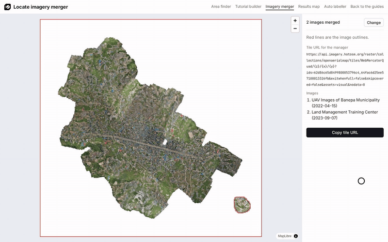
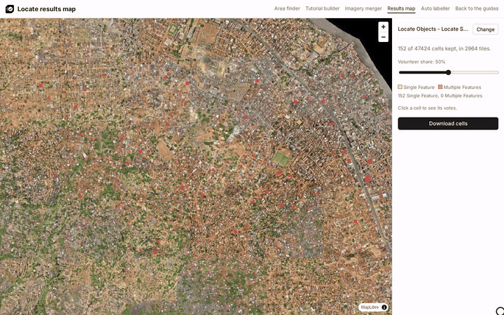
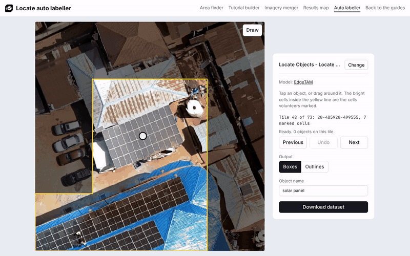
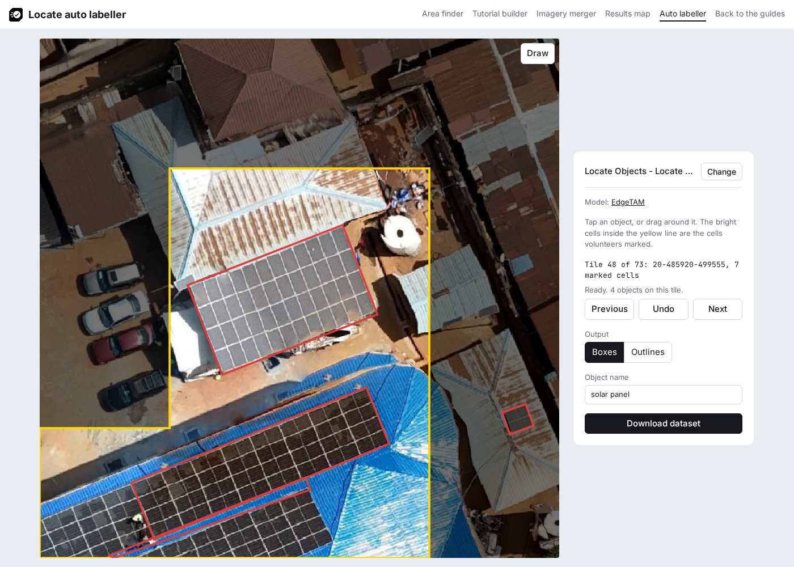
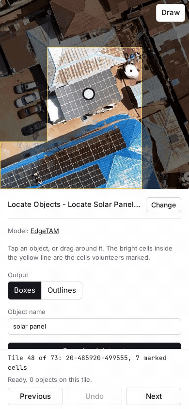

# Helpers

Pages that prepare the files the manager asks for and clean up the results. They run in the browser. Each opens with a short form and a link to try it with sample data; after loading, the form folds into a line at the top of the side panel, and **Change** opens it again. While a helper is working, a spinner shows next to its status line, and **Loading map...** shows at the top left of the map until the map has finished drawing. Large results files, such as the Pemba Island fishing boat project, take several seconds to read.

-   :lucide-crop: **[Area finder](../builder/area.html)**

    Paste an image from imagery.hotosm.org, or open merged images from the imagery merger. Download the imagery footprint or shapes you draw as the area of interest, and save a cover image.

-   :lucide-layout-grid: **[Tutorial builder](../builder/index.html)**

    Load the project's processed tasks, click tiles and cells to mark the tutorial answers, and download the scenario file.

-   :lucide-images: **[Imagery merger](../builder/mosaic.html)**

    Add two or more images from imagery.hotosm.org. Get one tile URL that shows them all, and check it on the map.

-   :lucide-map: **[Results map](../builder/results.html)**

    Paste the link of a finished project, set the share of volunteers a cell needs, and download the cells as GeoJSON.

-   :lucide-scan-search: **[Auto labeller](../builder/boxes.html)**

    Paste the link of a finished project, tap or drag around each group of objects on the tiles volunteers marked, and download a YOLO dataset with a GeoJSON of the labels.

The area finder and the tutorial builder are explained step by step in [Create a Locate project](../guides/create-a-project.md) and [Create the tutorial](../guides/create-the-tutorial.md).

## Imagery merger

Use it when the project area needs more than one image.

{ loading=lazy }

1. Copy the page address or **Copy TMS** of each image on <https://imagery.hotosm.org/browse>, as in [step 1 of Create a Locate project](../guides/create-a-project.md#1-copy-the-image-link).
2. In the [imagery merger](../builder/mosaic.html), paste one image per field under **Images**. **Add image** adds a field and **Remove** drops one. Click **Merge**.
3. Zoom in where the images meet. Each image has a red outline, and the list on the right shows its date.
4. Click **Copy tile URL** and use it in the manager and in the tutorial builder.
5. Click **Open in area finder** to find the footprint of all the images and draw the area of interest across them.

**Try the Banepa example** merges two images over Banepa, Nepal.

??? note "How the tile URL merges the images"
    The tile URL lists the image IDs (`/raster/collections/openaerialmap/tiles/...?ids=<id>,<id>`), and the HOT imagery API merges those images on every tile request ([titiler-pgstac documentation](https://stac-utils.github.io/titiler-pgstac/latest/endpoints/collections_endpoints/)). To change the mosaic, edit the IDs in the URL.

    - Where images overlap, the newest is drawn on top: pgstac sorts items by `datetime` descending by default ([source](https://github.com/stac-utils/pgstac/blob/main/src/pgstac/sql/002d_keyset.sql)).
    - The URL sets `exitwhenfull=false` and `skipcovered=false`, so an older image still fills the parts of a tile where a newer image doesn't have pixels.
    - White or near-black edges of a newer image are drawn on top of older imagery. When they hide what volunteers need to see, leave that image out.

## Results map

Use it on a finished project to get only the cells volunteers marked, as GeoJSON.

{ loading=lazy }

1. In the [results map](../builder/results.html), paste the project link, the address of the project page on the MapSwipe website (see [Download the results](../guides/download-results.md#from-the-mapswipe-website-production)), and click **Load**.
2. Move the **Volunteer share** slider to the share of volunteers a cell needs, for example 50%. Click a cell to see its votes.
3. Click **Download cells**. [Label in QGIS](../guides/training-data/qgis.md) and [Label in OpenStreetMap](../guides/training-data/openstreetmap.md) continue from this file.

To share the results, copy the page address. It opens at 50%, so tell others the share you used.

**Try the Freetown example** loads the [Freetown solar panel project](../examples/freetown-solar-panels.md).

??? note "Projects not on the website"
    The MapSwipe website lists production projects, and the stage website (<https://website-stage.mapswipe.org/>) some stage projects; links to both work. The websites are rebuilt every six hours ([source](https://github.com/mapswipe/website/blob/main/.github/workflows/cd.yml)). For a project not on the website yet, paste its **Aggregated Results** link (`https://backend.mapswipe.org/...csv.gz` or `https://backend-stage.mapswipe.org/...csv.gz`) from the [MapSwipe API](../guides/download-results.md#from-the-mapswipe-api-stage-and-production) in the same field.

??? note "How cells are kept, and the downloaded properties"
    A cell is kept when Single Feature and Multiple Features answers together make up at least the chosen share of the volunteers who saw it. Each kept cell becomes a square, cut from its tile row by row from the top left in Web Mercator, the projection the tiles are cut in ([source](https://github.com/mapswipe/manager-dashboard/blob/develop/app/utils/geo.ts)). On the map, Multiple Features cells have the darker fill.

    | Property | Meaning |
    |---|---|
    | `tile_id` | The tile, as `zoom-x-y` (the `task_id` of the results) |
    | `cell_index` | The cell inside the tile, counted row by row from the top left, starting at 0 (the `task_partition_index` of the results) |
    | `majority_answer` | **Multiple Features** when at least as many volunteers answered Multiple Features as Single Feature, otherwise **Single Feature**. **No** answers are left out of the comparison |
    | `single_feature_votes` | How many volunteers answered Single Feature (one tap) |
    | `multiple_features_votes` | How many volunteers answered Multiple Features (two taps); 0 for projects without that answer |
    | `volunteers_total` | How many volunteers saw the cell |
    | `feature_vote_percent` | Single Feature and Multiple Features votes together, as a percentage of `volunteers_total`, rounded |

    The vote counts show how volunteers split: 6 Single Feature and 5 Multiple Features votes give Single Feature, but nearly half saw several objects, so check such cells on the imagery. `feature_vote_percent` and `volunteers_total` together show how sure the result is: 100% of 1 volunteer and 75% of 20 volunteers both pass a 50% threshold, but the second rests on many more answers.

??? note "Imagery from tiles.openaerialmap.org"
    The map shows the imagery from the `url` column of the file. `tiles.openaerialmap.org` sends each tile request on to `titiler.hotosm.org` without CORS headers, which browsers refuse, so the helpers read those tiles from the `titiler.hotosm.org` address directly. The helpers build that address from the redirect `tiles.openaerialmap.org` answered with in October 2026; the redirect is not documented, so the address can change.

## Auto labeller

Use it on a finished project to mark each object on the tiles volunteers marked, as training data for a YOLO model.

{ loading=lazy }

1. In the [auto labeller](../builder/boxes.html), paste the project link, set the **Volunteer share**, for example 50, and the **Object name**, for example `solar panel`, and click **Load**. The first load downloads the [EdgeTAM](https://huggingface.co/onnx-community/EdgeTAM-ONNX) model, about 41 MB.
2. Each tile is darker outside the cells volunteers marked, with a yellow line around them. For each object, tap its middle or drag a box close around it. Touching solar panels form one array and get one label.
3. When the result is wrong, press **Undo**, which removes the newest object on the tile, and drag closer. When it stays wrong, turn on **Draw**, which stays on until you turn it off: drag along one side of the object, then tap the opposite side. A tap before any drag still asks the model. With **Outlines**, a drag keeps an upright box as drawn.
4. Move between tiles with **Previous** and **Next**.
5. Choose the **Output** and click **Download dataset**.

For objects with types, **Attribute** and **Values** add a value to each label, such as `roof:material` with `metal, roof_tiles`. Pick a value with its button above the tile, or with its number key on a keyboard; [Objects with types](../guides/training-data/auto-labeller.md#objects-with-types) shows the steps.

**Download tile images** saves every marked tile image, to label in another tool. **Load labels (GeoJSON)** puts polygons drawn in QGIS or taken from OpenStreetMap on the marked tiles, as in [Create a training dataset](../guides/training-data/index.md#how-the-auto-labeller-loads-a-geojson-file).

| Output | Shape | YOLO task |
|---|---|---|
| **Boxes** | The smallest box around the outline, at any angle | Oriented bounding boxes, OBB ([format](https://docs.ultralytics.com/datasets/obb/)) |
| **Outlines** | The outline of each object | Segmentation ([format](https://docs.ultralytics.com/datasets/segment/)) |

Every object keeps its outline, and its box is worked out from the outline, so the **Output** can change at any time. The objects stay in the browser: loading the same project with the same share brings them back.

**Try the Freetown example** loads the [Freetown solar panel project](../examples/freetown-solar-panels.md).

??? note "What the download holds"
    The `.zip` file holds, for each tile with at least one object:

    | File | Content |
    |---|---|
    | `images/<tile_id>.jpg` | The 1024 by 1024 pixel tile image |
    | `labels/<tile_id>.txt` | One line per object, class first (`0`, or the value's place in **Values** counting from `0`), positions as shares of the image side. A box corner past the image edge is moved onto it, because the format takes values between 0 and 1 |
    | `data.yaml` | The image folders and the class names for Ultralytics: the object name, or each value. It uses all images for both training and validation; split them before a real training run |
    | `labels.geojson` | One polygon per object in longitude and latitude (EPSG:4326), in the chosen output |
    | `README.md` | The project, share, model and counts, the tile URL to add in QGIS as an XYZ connection, and the QGIS steps |

    Each feature in `labels.geojson` has `tile_id`, `image` (the file in the `.zip` file), `object_name`, the attribute with its value when one is set, `output` (`rotated box` or `outline`), `source` (the model, `drawn by hand`, or the name of a loaded GeoJSON file), `marked_cells` (how many cells volunteers marked on the tile) and `imagery_url`. Pixel positions are turned into longitude and latitude through the tile's place in the Web Mercator tile grid, and each outer ring runs counterclockwise, as [RFC 7946](https://datatracker.ietf.org/doc/html/rfc7946#section-3.1.6) asks.

??? note "On a phone"
    [EdgeTAM](https://github.com/facebookresearch/EdgeTAM) is a version of SAM 2 (Segment Anything Model 2) made for devices: its README describes it as "an on-device executable variant of the SAM 2" that "achieves 16 FPS on iPhone 15 Pro Max without quantization" ([paper](https://arxiv.org/abs/2501.07256)). That figure comes from the EdgeTAM authors. The GIF below was recorded in desktop Chromium at phone size (390 by 844 pixels); the speed of the page on a real phone has not been measured.

    { width="320" loading=lazy }

    Both GIFs can be downloaded and shared: [laptop](../assets/helpers/auto-labeller-laptop.gif), [phone](../assets/helpers/auto-labeller-phone.gif).

??? note "How the auto labeller works"
    Everything runs in the browser. The page reads the project page, the results file, the project's imagery and the model files, and sends nothing back.

    1. The page keeps the cells where Single Feature and Multiple Features answers together reach the chosen share, as the results map does, and lists every tile with at least one kept cell.
    2. Each tile is shown two zoom levels deeper than the project zoom: 16 imagery tiles joined into one 1024 by 1024 pixel image. For a zoom 20 project, the imagery must serve zoom 22 and send CORS headers. Parts beyond the edge of the image are black.
    3. The EdgeTAM image encoder (`vision_encoder.onnx` in the [model repository](https://huggingface.co/onnx-community/EdgeTAM-ONNX/tree/main/onnx)) turns the tile into embeddings once, when the tile opens. [Transformers.js](https://huggingface.co/docs/transformers.js) runs it on the CPU with WebAssembly: with the Freetown example in Chromium on an Intel Core i9-14900HX laptop, about 1 second, and about 6 seconds with the CPU slowed four times. On an HTTPS page the browser keeps the model files ([`useBrowserCache`](https://huggingface.co/docs/transformers.js/api/env)).
    4. A tap is sent to `prompt_encoder_mask_decoder.onnx` as one point, and a drag as a box with its centre point. Each takes under a second. The page keeps the candidate mask with the highest predicted quality score. A box drawn with **Draw** skips the model.
    5. The outline is traced with [d3-contour](https://github.com/d3/d3-contour), keeps the largest shape and is simplified to within one pixel with [@turf/simplify](https://turfjs.org/docs/api/simplify). The box is the smallest rectangle around the outline's convex hull ([@turf/convex](https://turfjs.org/docs/api/convex)).

    The inputs were measured on 20 Freetown tiles with 36 hand-drawn reference boxes, counting a result as tight when it overlaps the reference box by at least 0.75. Simulated drags moved each edge of the reference box by a random share of its size.

    | Input | Tight results | Mean overlap |
    |---|---|---|
    | Tap in the middle of the group | 30 of 36 | 0.83 |
    | Drag with each edge up to 10% off | 35 of 36 | 0.88 |
    | Drag with each edge up to 20% off | 29 of 36 | 0.84 |
    | Drag 20% larger than the group on every side | 11 of 36 | 0.67 |

    A drag close around the group gives the best result. A drag much larger than the group includes nearby roofs and objects. Outlines of large, dark arrays on similar roofs can be ragged; check them with **Outlines** before downloading.
