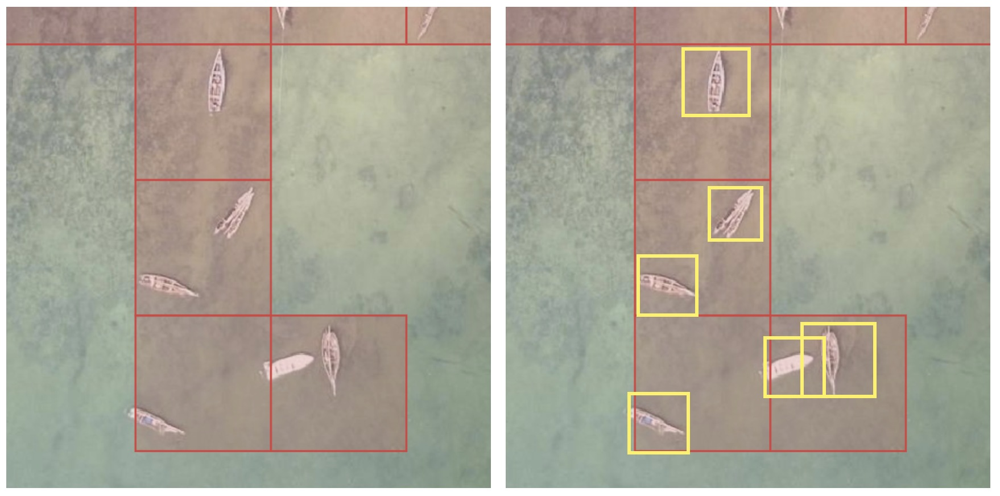

# MapSwipe Locate tutorials

Step-by-step guides for creating a MapSwipe **Locate Objects** project, adding its tutorial, publishing it and downloading the results.

In a Locate Objects project, volunteers see one imagery tile at a time, split into a grid of 2x2, 4x4 or 8x8 cells. They tap each cell that contains the object the project asks for: once for one object, twice for several. The results record which cells of each tile hold the object, intended as training data for AI models such as fAIr ([source](https://github.com/mapswipe/mapswipe-docs/blob/main/docs/project_types/locate_objects.md)).

Volunteers mark the cells that hold the object (red). You then add one box around each object (yellow), which becomes the training data. [Create a training dataset](guides/training-data/index.md) shows how, and [What to deliver](guides/what-to-deliver.md) lists what the final file needs.

!!! warning "Check that your object fits"
    Locate Objects suits separate objects you can point at from above, such as solar panels, water tanks, fishing boats or solid waste. It fits partly for areas such as green spaces, and poorly for lines such as roads, for sorting by type such as roof types, and for two objects in one project. [Check your object](guides/check-your-object.md) before you start.

-   :lucide-list-checks: **[Check that your object fits](guides/check-your-object.md)**

    A four-question check and examples of objects that fit well, partly or poorly.

-   :lucide-book-open: **[Guides](guides/index.md)**

    Create a project, build its tutorial, publish it, get the results into QGIS, and create a training dataset.

-   :lucide-wrench: **[Helpers](helpers/index.md)**

    Prepare the area, the tutorial and merged imagery, and clean up the results, with one-click sample data.

-   :lucide-sun: **[Example: solar panels in Freetown](examples/freetown-solar-panels.md)**

    A finished project from the imagery to a training dataset, with the files to download.

## Stage and production

MapSwipe runs two environments. Volunteers map on production. Create and check every project on stage first, and create it on production once it works on stage.

| | Manager dashboard | Where volunteers map |
|---|---|---|
| Stage (test) | <https://managers-stage.mapswipe.org/> | <https://web.mapswipe.org/dev/> |
| Production | <https://managers.mapswipe.org/> | <https://web.mapswipe.org/> |

The screenshots in these guides come from stage. The production manager has the same screens.

## Before you start

- A MapSwipe account with project manager rights. The manager login page says: "If you don't yet have access, please reach out to the MapSwipe community via Slack." Edit only projects you created.
- The image on <https://imagery.hotosm.org/browse> that volunteers will map. The [area finder](builder/area.html) makes the tile URL, the area of interest and a cover image from it.

!!! note "Project naming"
    Set the **Project topic** as `fAIrSwipe - Country - Feature`, for example `fAIrSwipe - Sierra Leone - Solar Panels`.
